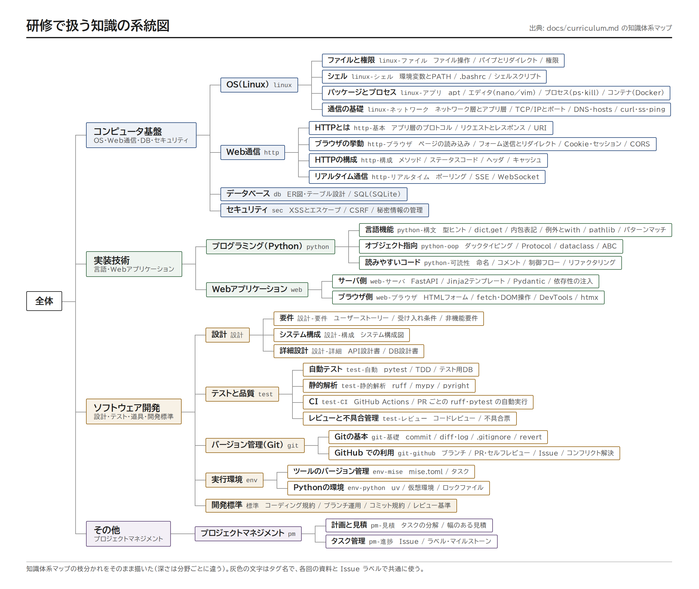
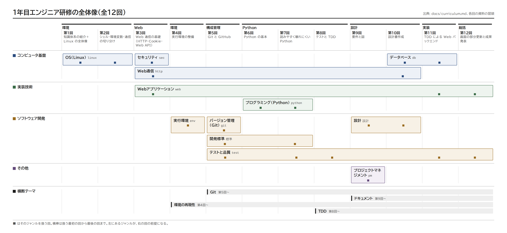

# 1年目エンジニア研修 全体概要

週1回×1時間×全12回の研修です。カリキュラムの正本は [curriculum.md](curriculum.md) です。この全体概要の表と図は curriculum.md から生成するので、直すときは curriculum.md のほうを直します。

## 目的

Linux の基礎から始めて、配属後に知らない領域に触れたときの判断基準となるベースを作っておくことが目的です。1つの題材「TODO・タスク管理アプリ」を通して、「作る」よりも「仕事を進める型」（記録する・小さく変更する・設計で合意する・テストで確かめる）を身につけます。評価の中心は Git 運用・設計書の質・テストのある実装で、Web 開発はそのための手段です。

- 全回を個人で進めます。共通のリポジトリは使わず、各自のリポジトリで作ります。レビューは PR のセルフレビューと、講師や隣の人に見てもらう形で行います
- 第1〜2回: Linux の全体像、シェル・環境変数・通信の切り分け
- 第3回: Web 通信の基礎（HTTP のヘッダ・Cookie とセッション・Web API・CORS・XSS をデモのサーバとブラウザで観察する）
- 第4〜5回: 実行環境（mise と uv）と構成管理（Git と GitHub）
- 第6〜8回: Python で TODO の CLI を作り、読みやすく整理して、テストと CI を付ける
- 第9〜10回: Web 版の要件と設計書を書く
- 第11〜12回: FastAPI＋Jinja2＋SQLite＋素の HTML/JavaScript で Web 版をテスト付きで作る（第12回は fetch による画面の部分更新）
- 第12回の後半: 1人ずつ成果を発表する
- 1回の配分: 座学 → ハンズオン（合計60分）。冒頭の座学で要点をまとめて話し、ハンズオンの合間にも短い座学を挟みます。配分は回ごとに違い、各回の資料の「所要」の行と下の一覧に書いています。振り返り・宿題・発展課題はありません
- プロジェクトマネジメントは軽く扱います。第9回で作る機能をユーザーストーリーに分け、幅を持たせて見積もり、GitHub の Issue とラベルで管理してみます（研修そのものの見積と実績の記録はしません）

全回を通して、次の4つを横断テーマとして扱います。

1. Git: 第5回以降、コードと設計書は自分のリポジトリにコミットし、まとまった変更は PR にしてセルフレビューしてからマージする
2. ドキュメント: 設計書・README・手順書をリポジトリ内に Markdown で置く。第9回で図と要件、第10回で設計書の書き方を学び、以降も要所で Mermaid の図を使う
3. 環境の再現性: 第4回以降、mise.toml と手順書だけで他人が再現できることを完了条件にする
4. TDD: 第8回以降の実装はテストを先に書き、テストと実装のコミットを分ける

### 研修で扱う知識の系統図

研修で扱う知識を、知識体系マップの枝分かれのとおりに描いた系統図です（深さは分野ごとに違います）。第1回の冒頭で全体を見回すのに使い、どの回で扱うかは下の全体像の図で説明します。



PDF 版は [knowledge-map.pdf](diagrams/knowledge-map.pdf) です。

### 研修の全体像

列はフェーズと回、行は大分野です。ジャンル（分野）は、扱う最初の回から最後の回までの横棒で表します。■ が扱う回です。左にあるジャンルが、右の回の前提になります。系統図とこの図は、カリキュラムと各回の資料の冒頭から生成しているので、手で編集しません（`tools/` で `mise run diagrams`）。



PDF 版は [overview.pdf](diagrams/overview.pdf)、同じ配置の Mermaid 版（Markdown に貼れる）は [overview.mmd](diagrams/overview.mmd) です。

## 各回の内容

日程は研修ごとに決めます。回のテーマ・タグ・成果物は [curriculum.md](curriculum.md) の「全N回の一覧」から生成しています。

<!-- BEGIN sessions: tools の `mise run tag-index` で生成。手で編集しない -->
| 回 | テーマ | 所要 | tag | 前提タグ | 成果物 | 資料 | 見本 |
| --- | --- | --- | --- | --- | --- | --- | --- |
| 第1回 | 知識体系の紹介＋Linux の全体像 | 座学15分 / ハンズオン45分 | linux | なし | — | [session01](session01/README.md) | [session01](../examples/session01/README.md) |
| 第2回 | シェル・環境変数・通信の切り分け | 座学15分 / ハンズオン45分 | linux-シェル, linux-アプリ, linux-ネットワーク | linux | 環境設定手順書 | [session02](session02/README.md) | [session02](../examples/session02/README.md) |
| 第3回 | Web 通信の基礎（HTTP・Cookie・Web API） | 座学15分 / ハンズオン45分 | http, web-ブラウザ, sec | linux-シェル, linux-ネットワーク | — | [session03](session03/README.md) | [session03](../examples/session03/README.md) |
| 第4回 | 実行環境の整備 | 座学15分 / ハンズオン45分 | env-mise, env-python | linux-シェル, linux-アプリ, linux-ネットワーク | mise.toml＋環境構築手順書（README） | [session04](session04/README.md) | [session04](../examples/session04/README.md) |
| 第5回 | Git と GitHub | 座学15分 / ハンズオン45分 | git-基礎, git-github, 標準, test-レビュー | linux-ファイル, linux-アプリ, env-mise, env-python | 手順書のリポジトリ＋PR 2本（コンフリクト解決つき） | [session05](session05/README.md) | [session05](../examples/session05/README.md) |
| 第6回 | Python の基本 | 座学15分 / ハンズオン45分 | python-構文 | env-python, git-基礎, git-github | TODO の CLI＋アプリのリポジトリ（期限の追加を PR でマージ） | [session06](session06/README.md) | [session06](../examples/session06/README.md) |
| 第7回 | 読みやすく壊れにくい Python | 座学15分 / ハンズオン45分 | python-oop, python-可読性, test-静的解析, 標準 | python-構文, env-python, git-github | `src/todo/` パッケージ＋ruff・mypy の設定と README（PR でマージ） | [session07](session07/README.md) | [session07](../examples/session07/README.md) |
| 第8回 | テストと TDD | 座学15分 / ハンズオン45分 | test-自動, test-CI | python-oop, test-静的解析, git-github | テスト＋CI＋期限順の一覧（TDD の履歴が残る PR でマージ） | [session08](session08/README.md) | [session08](../examples/session08/README.md) |
| 第9回 | 要件と図 | 座学15分 / ハンズオン45分 | 設計-要件, pm-見積, pm-進捗 | python-構文, test-自動, git-github | 要件メモ（業務フロー図・状態遷移図）＋ストーリー S-01〜S-04（Issue とその控え、PR でマージ） | [session09](session09/README.md) | [session09](../examples/session09/README.md) |
| 第10回 | 設計書作成 | 座学15分 / ハンズオン45分 | 設計-詳細, 設計-構成, http-構成, db | 設計-要件, git-github | API・DB設計書＋システム構成図（隣の人の質問を反映し、PR でマージ） | [session10](session10/README.md) | [session10](../examples/session10/README.md) |
| 第11回 | TDD による Web バックエンド | 座学15分 / ハンズオン45分 | web-サーバ, db, test-自動 | 設計-詳細, python-oop, test-自動, test-CI | Web 版（FastAPI＋Jinja2＋SQLite）＋受け入れ条件 (1)〜(15) のテスト（TDD の履歴が残る PR でマージし、ストーリーの Issue を閉じる） | [session11](session11/README.md) | [session11](../examples/session11/README.md) |
| 第12回 | 画面の部分更新と成果発表 | 座学5分 / ハンズオン25分 / 発表準備5分 / 発表25分 | web-ブラウザ, test-レビュー | http, web-サーバ, test-自動 | fetch による部分更新（HTML 断片＋比較用の JSON 版）＋不具合票 BUG-001 とその修正＋発表資料（PR 3本でマージ） | [session12](session12/README.md) | [session12](../examples/session12/README.md) |
<!-- END sessions -->

## 資料の読み方

各回の資料の冒頭は、次の形にそろえています。

```markdown
# 第2回 シェル・環境変数・通信の基礎
tag: linux-シェル, linux-アプリ, linux-ネットワーク
前提タグ: linux-ファイル
所要: 座学20分 / ハンズオン40分
```

- `tag`: その回で扱う知識。[タグ一覧](tags.md) から、タグごとの索引（扱う回・読む本）に飛べます
- `前提タグ`: その回の前に身につけておきたい知識
- `所要`: 座学・ハンズオンの配分（回ごとに違う）
- 資料はチートシートです。「まとめ」はその回の要点（コマンド・用語・判断の基準）を表と箇条書きにしたもので、冒頭の座学で使います。詳しい説明は各行の「参照」と「読む章」にある参考書と無料資料で読みます（副読本は持っている人向けの紹介）
- 見出しは「ゴール → まとめ → ハンズオン → 読む章」の順です
- ハンズオンは1ステップずつ「🖋 やること → 📚 参考書の節 → 📒 説明 → コマンド」の形です
- `instructor.md` は講師用です（受講者に配るときは除きます）

## ディレクトリ

| ディレクトリ | 内容 |
| --- | --- |
| `docs/sessionNN/` | 各回の資料（`README.md` 受講者用、`instructor.md` 講師用、`assets/` 演習素材） |
| `docs/templates/` | 設計書・ユーザーストーリー（Issue）・不具合票・PR のひな形 |
| `docs/tags.md`、`docs/tags/` | タグ一覧とタグ索引（`tools/` で生成） |
| `docs/open-questions.md` | 未確定事項（社内プロキシ、Git ホスティングなど） |
| `docs/_template/` | 資料を書くときのひな形（講師・作成者向け） |
| `docs/diagrams/` | 知識の系統図（`knowledge-map.png`・`.pdf`・`.html`）と研修の全体像の図（`overview.png`・`.pdf`・`.html`、Mermaid 版 `overview.mmd`・`overview-mermaid.png`。`tools/` で生成） |
| `docs/_build/` | HTML 版（`html/`）と1冊の PDF 版（`handsoff.pdf`）。`tools/` で生成 |
| `examples/sessionNN/` | 各回の成果物の見本と、その回の見本への案内 |
| `examples/todo-app/` | 見本の TODO アプリの最新（第12回終了時点） |
| `examples/todo-app-snapshots/` | 見本の TODO アプリの各回終了時点の状態（`session-06/` 〜 `session-12/`）。一覧と追いつき方は [examples/README.md](../examples/README.md) |

## 事前準備

- WSL（Ubuntu）が使えること（[open-questions.md](open-questions.md) の Q2）
- git（Ubuntu に入っているもの）
- mise（第4回でインストールする）

回の構成やタグを変えるときは、[curriculum.md](curriculum.md) を直してから `tools/` で `mise run tag-index`（一覧と索引の再生成）と `mise run check`（資料との食い違いの検査）を実行してください。
