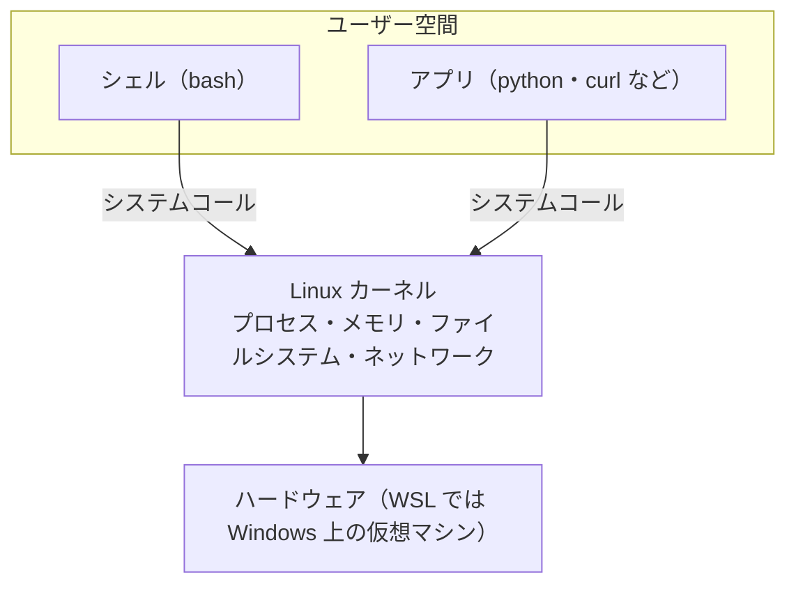
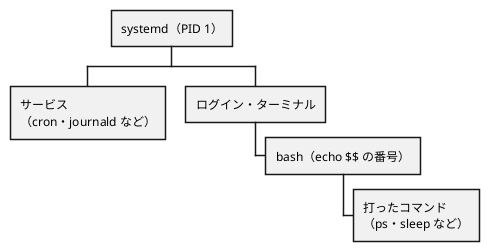
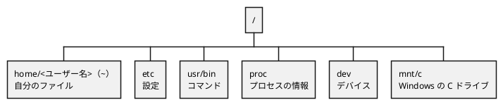
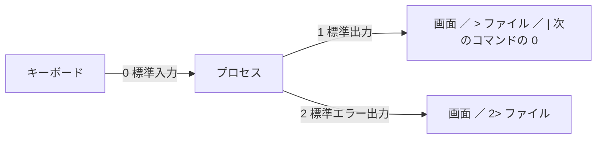
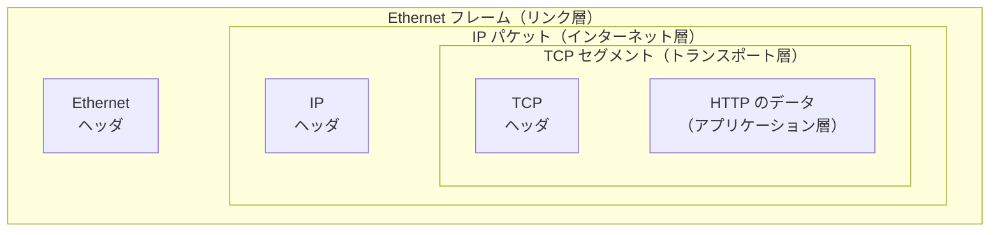
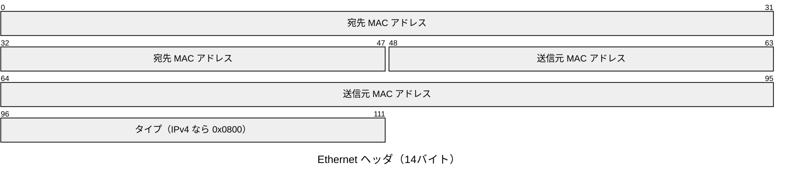
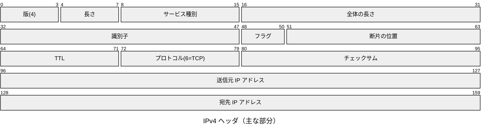
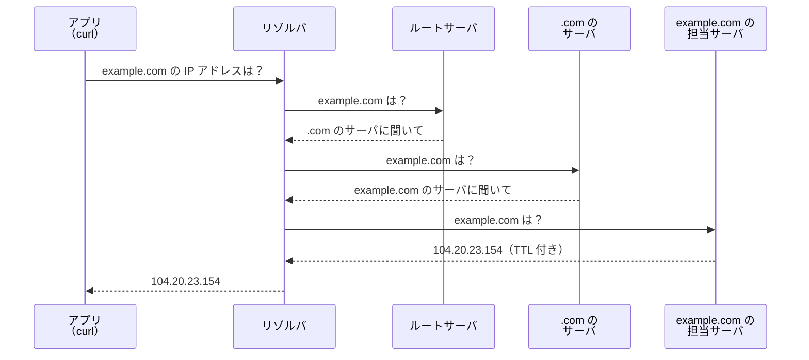
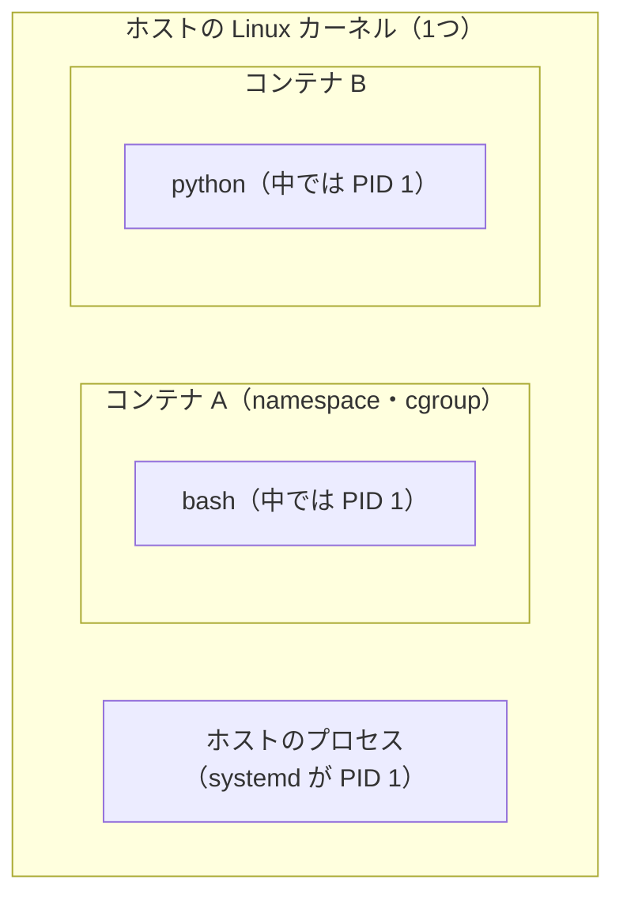

# 第1回 知識体系の紹介＋Linux の全体像
tag: linux
前提タグ: なし
所要: 座学15分 / ハンズオン45分

## ゴール

- 研修の知識の全体地図（4つの大分野とタグ）を知り、どの回で何を扱うかを言える
- Linux の部品（カーネル・プロセス・ファイルシステム・ネットワーク）を、それぞれ見るコマンドと一緒に言える
- `grep`・`wc` で、ログから特定のエラーの件数を数えられる

## 事前準備

- WSL と Ubuntu が使えること（講師から案内。[open-questions.md](../open-questions.md) の Q2）
- 研修ディレクトリ一式が `~/handsoff` にあること

## まとめ

冒頭の座学で使います。ハンズオンは下の流れの順に、1ステップずつ参考書の節を開きながら進めます。

### 研修の地図

| 項目 | 内容 |
| --- | --- |
| 系統図 | 研修で扱う知識の木（[knowledge-map](../diagrams/knowledge-map.png)）→ 回ごとの流れ（[全体像](../diagrams/overview.png)） |
| 大分野 | コンピュータ基盤／実装技術／ソフトウェア開発／その他（[タグ一覧](../tags.md)） |
| `tag:` | その回で扱う知識。リンク先のタグ索引に扱う回と読む本 |
| `前提タグ:` | その回の前に身につけておきたい知識 |
| 評価の中心 | Git 運用・設計書・テストのある実装。Web 開発は練習の題材 |

### Linux の全体像（この回の流れ）

| # | 分野 | ひとことで | 参照（モダンLinux） | 深掘りする回 |
| --- | --- | --- | --- | --- |
| 1 | 全体 | ハードウェアの上にカーネル、その上にユーザー空間（シェル・アプリ） | 1.6、2.1、2.3 | — |
| 2 | プロセス | 動いているプログラム。番号（PID）と親子関係を持つ。PID 1 が全部の先祖 | 2.3.1、3.1.2、6.2、9.1.1 | 第2回 |
| 3 | ファイルシステム | ディレクトリの木。デバイスやプロセスの情報もファイルとして見える | 5.1〜5.3、4.3.1 | 第2回 |
| 4 | ネットワーク | 層の積み重ね（リンク → インターネット → トランスポート → アプリケーション） | 7.1〜7.4 | 第2回、第3回 |
| 5 | 押さえておくコマンド | 探す・数える・並べる・調べる | 付録A | 毎回 |
| 6 | コンテナ | namespace と cgroup でほかから隔離したプロセス。Docker はコンテナを扱う道具 | 6.6 | — |
| 7 | モダンなコマンド | 昔からのコマンドの使いやすい代替 | 3.1.3、付録B | — |

### WSL とファイルの置き場所

| 場所 | 見え方 | 使い方 |
| --- | --- | --- |
| Linux のホーム | `~` = `/home/<ユーザー名>` | 研修のファイルはここ |
| Windows の C ドライブ | `/mnt/c` | 遅く、権限の扱いも違うので作業しない |
| Linux 側を Windows から | `\\wsl.localhost\Ubuntu\...` | `explorer.exe .` で開く |

## ハンズオン

1ステップ1コマンド。各ステップは「🖋 やること → 📚 参考書の節 → 📒 説明 → コマンド」。

### 1. 全体: カーネルとユーザー空間（4分）

#### 🖋 カーネルのバージョンを見る

📚 モダンLinux 1.6 Linuxの全体像、2.1 Linuxアーキテクチャ

📒 カーネルはハードウェアを管理する。シェルやアプリ（ユーザー空間）は、システムコールでカーネルの機能を使う。WSL は Windows の上の仮想マシンで、本物の Linux カーネルを動かしている



```sh
uname -a        # microsoft-standard-WSL2 と出る
```

#### 🖋 ディストリビューションを見る

📚 モダンLinux 1.4 Linuxディストリビューション

📒 カーネルに道具一式（シェル・パッケージ管理など）をまとめたものがディストリビューション。研修では Ubuntu を使う

```sh
cat /etc/os-release
```

#### 🖋 カーネルが管理している資源を見る

📚 モダンLinux 2.3 カーネルコンポーネント、1.5 リソースの可視性

```sh
nproc; free -h; df -h /     # CPU の数・メモリ・ディスク
```

#### 🖋 Windows のファイルを Linux から見る

📒 Windows の C ドライブは `/mnt/c` に見える。`/mnt/c` は遅く、権限の扱いも違う。そのため研修の作業は Linux 側の `~` で行う

```sh
ls /mnt/c/Users
explorer.exe .  # Linux のホームを Windows のエクスプローラーで開く
```

- 確認: アドレス欄に `\\wsl.localhost\Ubuntu\home\<ユーザー名>`

### 2. プロセス: シェルもプロセス、PID 1 が先祖（6分）

#### 🖋 PID を確認する

📚 モダンLinux 2.3.1 プロセス管理、3.1.2 シェル

📒 動いているプログラムがプロセス。コマンドを打っているシェル（bash）もプロセスで、PID という番号を持つ

```sh
echo $$
```

#### 🖋 PID と PPID を見比べる

📚 モダンLinux 2.3.1 プロセス管理

📒 コマンドはシェルの子プロセスとして動く。PPID は親の PID

```sh
ps -f           # ps の PPID が、echo $$ の番号と同じ
```

#### 🖋 PID 1 を確認する

📚 モダンLinux 6.2 Linuxの起動プロセス、6.3 systemd

📒 PID 1 は起動時に最初に動くプロセス（systemd または init）。ほかの全プロセスはこの子孫



```sh
ps -p 1 -o pid,comm
```

#### 🖋 親子関係をたどる

📚 モダンLinux 6.2 Linuxの起動プロセス

```sh
pstree -p | head -20    # PID 1 から自分の bash までたどる
```

#### 🖋 裏でプロセスを動かす

📒 コマンドの後に `&` を付けると、シェルはコマンドの終了を待たずに次の入力を受け付ける（ジョブ）

```sh
sleep 300 &
jobs; ps -f     # sleep の PPID が自分の bash の PID
```

#### 🖋 シグナルで止める

📚 モダンLinux 9.1.1 シグナル

📒 `kill` は「殺す」ではなく「シグナルを送る」コマンド。既定で送るのは SIGTERM（終了を求めるシグナル）

```sh
kill %1; jobs   # Terminated と出る
```

#### 🖋 全体を眺める

📚 モダンLinux 付録A.2 ユーザとプロセス

```sh
top             # q で終了
```

### 3. ファイルシステム: すべてはファイル（7分）

#### 🖋 ルートの下を見る

📚 モダンLinux 5.1 基本、5.2.3 一般的なファイルシステムレイアウト

📒 ディレクトリは `/` を根とする1つの木構造。`/proc` と `/dev` の下は、ディスク上にない擬似ファイル



```sh
ls /
```

#### 🖋 マウントを見る

📚 モダンLinux 5.2.2 ファイルシステムの操作

📒 ディスクやデバイスは、木構造の途中のディレクトリにマウント（接続）される

```sh
findmnt | head  # / と /mnt/c がどこにつながっているか
```

#### 🖋 プロセスの情報をファイルで見る

📚 モダンLinux 5.3.1 procfs

```sh
ls /proc/$$     # 自分の bash の情報がファイルとして並ぶ
```

#### 🖋 標準入出力を見る

📚 モダンLinux 3.1.2 シェル、付録A.5 リダイレクトとパイプ

📒 プロセスは最初から 0（標準入力）・1（標準出力）・2（標準エラー出力）を開いている。リダイレクトとパイプは、この 0・1・2 のつなぎ先を変える



```sh
ls -l /proc/$$/fd   # 0 1 2 が端末（/dev/pts/...）につながっている
```

#### 🖋 作業場所を作り、ログをコピーする

📚 モダンLinux 付録A.4 ファイルとディレクトリ

```sh
cd ~/handsoff/workspace/session01
mkdir logs
cp ../../docs/session01/assets/logs/*.log logs/
ls -l logs      # todo-app-2026-04-01.log 〜 04-07.log の7ファイル
```

#### 🖋 出力をファイルにする

📚 モダンLinux 付録A.5 リダイレクトとパイプ

📒 `>` は上書き、`>>` は追記

```sh
echo hello > memo.md; echo world >> memo.md; cat memo.md
```

#### 🖋 エラーだけをファイルにする

📒 エラーは 2 番（標準エラー出力）から出る。`>` は 1 番だけをファイルにつなぐので、エラーは捕まらない

```sh
ls /nothing 2> err.txt; cat err.txt
```

#### 🖋 権限を読む

📚 モダンLinux 4.3.1 ファイルのパーミッション

📒 `-rw-r--r--` = 種類（`-` ファイル、`d` ディレクトリ）＋ 所有者・グループ・その他 ×（r 読む・w 書く・x 実行）

```sh
ls -l memo.md
```

#### 🖋 権限を変える

📒 `644` は r=4, w=2, x=1 の和（所有者 6=読み書き、ほか 4=読むだけ）

```sh
chmod u-r memo.md; cat memo.md   # Permission denied
chmod 644 memo.md; ls -l memo.md
```

### 4. ネットワーク: 層ごとに見る（10分）

#### 🖋 インタフェースを見る（リンク層: Ethernet）

📚 モダンLinux 7.1 基本、7.2 TCP/IPスタック、7.2.1 リンク層

📒 通信は4つの層に分かれ、層ごとに役目が決まっている。つながらないときは下の層から確かめる

| 層 | やること | ヘッダに入る主なもの | 見るコマンド |
| --- | --- | --- | --- |
| アプリケーション（HTTP など） | アプリどうしが決まった手順（プロトコル）でやり取りする | （HTTP なら）メソッド・URL・ヘッダ | `curl -v`、`getent hosts` |
| トランスポート（TCP・UDP） | どのアプリに渡すかを決め、TCP なら届いたかを確かめて順番をそろえる | 送信元・宛先のポート、順番の番号 | `ss -tln` |
| インターネット（IP） | 宛先の IP アドレスまで、ルーターを経由して運ぶ | 送信元・宛先の IP アドレス、TTL | `ip addr`、`ip route`、`ping` |
| リンク（Ethernet・Wi-Fi） | 同じネットワークの隣の機器まで運ぶ | 送信元・宛先の MAC アドレス | `ip link` |

📒 送るときは上の層から順にヘッダを付ける。ヘッダは入れ子になり、受け取った側は外側（下の層）から順に外す



📒 いちばん外側の Ethernet ヘッダ（14バイト）。同じネットワークの中で、どの機器に渡すかを MAC アドレスで示す



```sh
ip link         # link/ether の後ろが自分の MAC アドレス
```

#### 🖋 IP アドレスと経路を見る（インターネット層: IP）

📚 モダンLinux 7.2.2 インターネット層

📒 IP ヘッダ（20バイト＋オプション）。IP パケットは、ルーターが宛先の IP アドレスまで運ぶ。TTL はルーターを1つ通るたびに1減り、0 になると捨てられる。プロトコルは中身が TCP（6）か UDP（17）かを示す



```sh
ip -br addr; ip route   # 自分の IP アドレスと、外への出口（default）
```

#### 🖋 DNS の仕組みを知る

📚 モダンLinux 7.3 DNS、7.3.2 DNSルックアップ

📒 DNS は名前（example.com）を IP アドレスに変える仕組み。アプリは近くのリゾルバに問い合わせる。リゾルバは答えを知らなければ、ルート → .com → example.com の担当サーバの順にたどって調べる。リゾルバは調べた答えを TTL の秒数だけ保存し（キャッシュ）、次からはすぐ返す



```sh
cat /etc/resolv.conf    # nameserver の行が、図のリゾルバ
```

#### 🖋 hosts ファイルを見る

📒 `/etc/hosts` に書いた名前は DNS より先に使われる。どの順に調べるかは `/etc/nsswitch.conf` の hosts の行で決まる

```sh
cat /etc/hosts
grep hosts /etc/nsswitch.conf   # files（/etc/hosts）→ dns の順
```

#### 🖋 OS の仕組みで名前を引く

📒 `getent hosts` は、アプリと同じ順（hosts → DNS）で名前を引く

```sh
getent hosts example.com
```

#### 🖋 dig を入れる

📒 `dig` は DNS サーバに直接問い合わせて、答えをそのまま見せる道具。`/etc/hosts` は見ない。入れられないときは、最初から入っている `resolvectl` を代わりに使う（下の各ステップに併記）

```sh
sudo apt install -y bind9-dnsutils   # 社内ではプロキシの設定が要る（第2回）
```

#### 🖋 dig で IP アドレスを引く

📚 モダンLinux 7.3.1 DNSレコード

📒 DNS の答えはレコードという単位で返る。`dig` の出力では、QUESTION（何を聞いたか）、ANSWER（答え）、最後の SERVER（どのリゾルバが答えたか）を見る

| レコード | 中身 |
| --- | --- |
| A | IPv4 アドレス |
| AAAA | IPv6 アドレス |
| CNAME | 別名（本当の名前を指す） |
| NS | そのドメインを担当する DNS サーバ |
| MX | メールの受け取り先 |
| TXT | 文字列（ドメインの持ち主の確認などに使う） |

```sh
dig example.com
# ;; ANSWER SECTION:
# example.com.   300   IN   A   104.20.23.154
#   名前           TTL(秒)    種類  答え
# ;; SERVER: 10.255.255.254#53   ← 答えたリゾルバ
dig +short example.com          # 答えだけ表示する
resolvectl query example.com    # dig が使えないとき（A と AAAA をまとめて表示）
getent ahosts example.com       # resolvectl も使えないとき（WSL で systemd が無効）
```

#### 🖋 ほかのレコードを引く

```sh
dig +short AAAA example.com
dig +short NS example.com
dig +short MX gmail.com
resolvectl query -t NS example.com   # dig が使えないとき（-t でレコードの種類を指定）
resolvectl query -t MX gmail.com
```

#### 🖋 ルートからたどる様子を見る

📒 `+trace` を付けると、リゾルバに任せずに、ルート → .com → 担当サーバの順に自分でたどる。社内では外の DNS サーバに直接問い合わせられず、失敗することがある。`resolvectl` に同じ機能はないので、dig が使えないときは講師の画面で見る

```sh
dig +trace example.com
```

#### 🖋 届くか確かめる

📚 モダンLinux 7.2.2 インターネット層

```sh
ping -c 3 example.com   # 社内では止められていることがある
```

#### 🖋 サーバを立てる

📚 モダンLinux 7.4.1 ウェブ

```sh
python3 -m http.server 8000 &
```

#### 🖋 待ち受けているポートを見る（トランスポート層: TCP）

📚 モダンLinux 7.2.3 トランスポート層、7.2.4 ソケット

📒 TCP ヘッダ（20バイト＋オプション）。宛先ポートで、どのアプリ（ここでは 8000 番の http.server）に渡すかが決まる。シーケンス番号と確認応答番号で、届いたことを確かめて順番をそろえる


```sh
ss -tln | grep 8000
```

#### 🖋 HTTP のやり取りを見る（アプリケーション層: HTTP）

📚 モダンLinux 7.4.1 ウェブ

📒 いちばん内側の HTTP。HTTP はビット単位ではなく、文字の行で書く。リクエストは「リクエスト行 → ヘッダ（名前: 値）→ 空行 → 本文」の順に並び、TCP セグメントのデータ部分に入る。レスポンスは1行目がステータス行になり、あとは同じ形

```text
GET / HTTP/1.1                         ← リクエスト行（メソッド・パス・版）
Host: 127.0.0.1:8000                   ← ヘッダ（名前: 値）
User-Agent: curl/8.5.0
Accept: */*
                                       ← 空行でヘッダが終わる（GET には本文がない）

HTTP/1.0 200 OK                        ← ステータス行（版・ステータスコード）
Server: SimpleHTTP/0.6 Python/3.12     ← ヘッダ
Content-type: text/html; charset=utf-8
Content-Length: 389
                                       ← 空行
<!DOCTYPE HTML>                        ← 本文（ファイル一覧の HTML）
<html lang="en">
...
```

📒 `curl -v` の出力では、`>` の行が送ったリクエスト、`<` の行が受け取ったレスポンス。ヘッダの意味は第3回で読む

```sh
curl -v http://127.0.0.1:8000/ | head
kill %1         # サーバを止める
```

### 5. 押さえておくコマンド: ログを数える（8分）

#### 🖋 ログの先頭を見る

📚 モダンLinux 付録A.3 ファイル情報

📒 ログの1行は `日付 時刻 レベル [部品] メッセージ`。レベルは `INFO` 通常／`WARN` 注意／`ERROR` 失敗

```sh
head logs/todo-app-2026-04-01.log
```

#### 🖋 検索しながら読む

```sh
less logs/todo-app-2026-04-01.log   # /ERROR で検索 → n で次 → q で終了
```

#### 🖋 語を含む行を数える

📚 モダンLinux 付録A.5 リダイレクトとパイプ

📒 `grep` で行を選び、パイプ（`|`）で `wc -l` に渡して数える

```sh
grep ERROR logs/todo-app-2026-04-01.log | wc -l
```

#### 🖋 grep だけで数える

```sh
grep -c ERROR logs/todo-app-2026-04-01.log
```

#### 🖋 使い方を調べる

📒 迷ったら `--help` か `man`。`grep` の `-i`（大小文字を区別しない）・`-h`（ファイル名を付けない）もここで確かめる

```sh
grep --help | head -30
```

#### 🖋 演習: 数える

答えと使ったコマンドを両方記録する。

1. 2026-04-03 の `ERROR` の行数
2. 7ファイル合計の `ERROR` の行数（ヒント: `cat logs/*.log | grep ...`）
3. 2 を `grep -i error` にすると件数はどう変わるか。理由を実際の行で説明
4. 1週間の `ERROR` のうち `database is locked` の行数。`grep 'database is locked'` だけの件数とも比べる

> 座学: 数え方の条件で答えが変わる。仕事でログを数えるときに気をつけること

### 6. コンテナ: 隔離されたプロセス（2分・講師の画面）

受講者 PC で Docker が使えるかは未確定（[open-questions.md](../open-questions.md) の Q12）。使えない場合は講師の画面で見る。

#### 🖋 コンテナを動かす

📚 モダンLinux 6.6 コンテナ、6.6.4 Docker

📒 コンテナは仮想マシンではなく、namespace（見える範囲）と cgroup（使える資源）でほかから隔離したプロセス。カーネルはホストと共有する



```sh
docker run --rm hello-world
```

#### 🖋 コンテナの中の PID 1 を見る

📚 モダンLinux 6.6.1 namespace

```sh
docker run --rm -it ubuntu:24.04 bash
ps -ef          # 中では bash が PID 1（手順2の PID 1 と比べる）。exit で出る
```

#### 🖋 コンテナとイメージを一覧する

```sh
docker ps -a; docker images
```

### 7. モダンなコマンド（2分・講師の画面）

#### 🖋 モダンなコマンドを入れる

📚 モダンLinux 3.1.3 モダンなコマンド、付録B モダンLinuxツール

| 昔からのコマンド | モダンな代替 | 良いところ |
| --- | --- | --- |
| `grep -r` | `rg`（ripgrep） | 速い、.gitignore を見て余計なファイルを飛ばす |
| `find` | `fd`（Ubuntu では `fdfind`） | 書き方が短い |
| `cat` | `bat`（Ubuntu では `batcat`） | 色付き・行番号つき |
| `history \| grep` | `fzf` | 絞り込みながら選べる |
| （なし） | `jq` | JSON を整形・抽出 |
| `top` | `htop` | 見やすく操作できる |

```sh
sudo apt install -y ripgrep fd-find bat fzf jq htop   # 社内ではプロキシの設定が要る（第2回）
```

#### 🖋 ripgrep で数える

```sh
rg -c ERROR logs/
```

#### 🖋 JSON を整形する

```sh
echo '{"task":"牛乳を買う","done":false}' | jq .
```

## 読む章

| 区分 | 資料 | 範囲 | 読み方 |
| --- | --- | --- | --- |
| 参考書 | [入門 モダンLinux](https://www.oreilly.co.jp/books/9784814400218/)（モダンLinux） | 1章、2章、5章、6.6、7章、付録B | 該当章（ハンズオンの「参照」の節を中心に） |
| 参考書 | 同上 | 3章、4章、付録A | 該当章（第2回と合わせて。付録Aは引く） |
| 参考書 | [ソフトウェアエンジニアリングの基礎](https://www.oreilly.co.jp/books/9784814401789/)（SE基礎） | 12章 学び方を学ぶ | 通読（研修の軸。第12回まで回ごとに読み進める） |
| 参考書 | 同上 | 6章 初めて触れるシステムの調査と変更 | 該当章（第12回でも使う） |
| 紹介（副読本） | [達人プログラマー 第2版](https://www.hanmoto.com/bd/isbn/9784274226298) | 基本ツール（シェル、プレーンテキスト） | 持っている人は通読（第1〜5回で基本ツールの範囲） |
