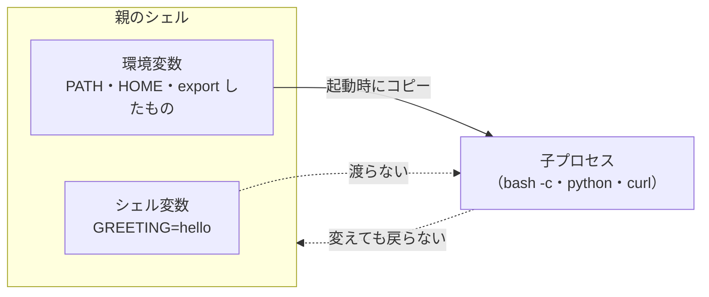
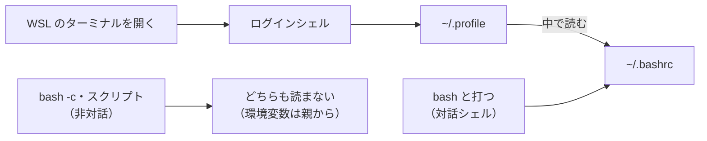
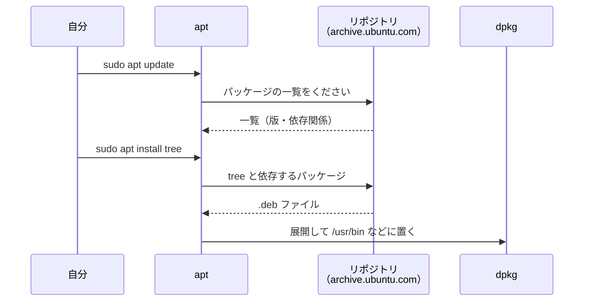
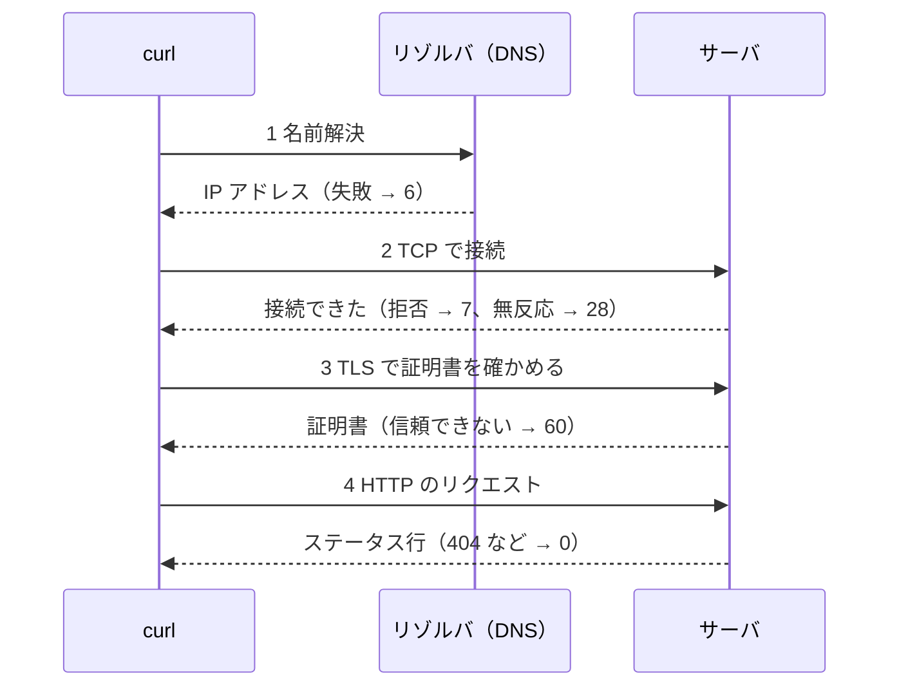
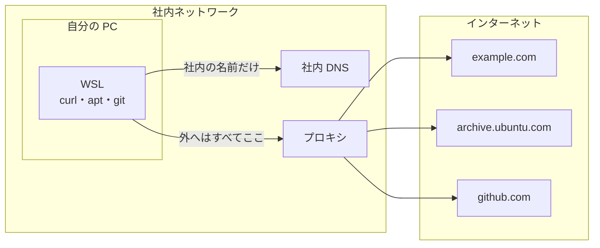
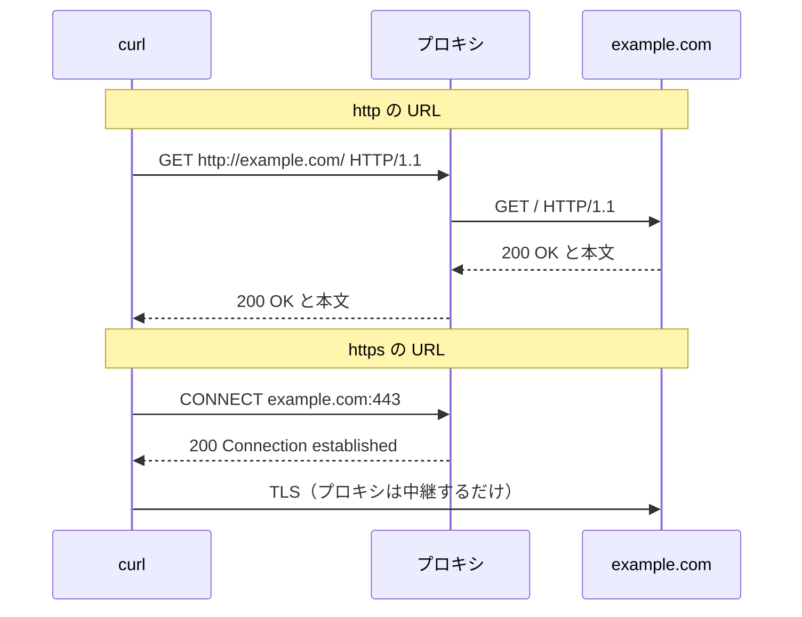
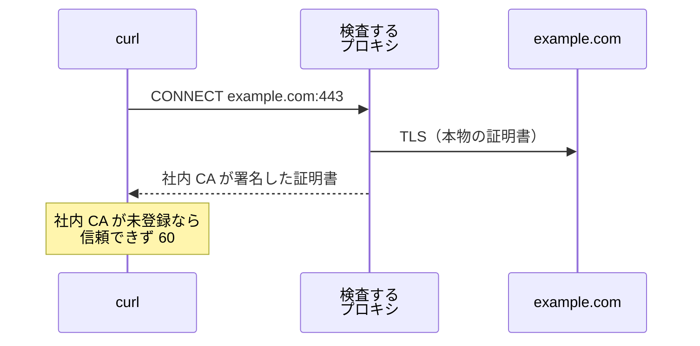

# 第2回 シェル・環境変数・通信の切り分け
tag: linux-シェル, linux-アプリ, linux-ネットワーク
前提タグ: linux
所要: 座学15分 / ハンズオン45分

## ゴール

- シェル変数と環境変数の違い、`export` が効く範囲を説明できる
- `command not found` のとき、PATH とコマンドを探す順番から原因を見つけて直せる
- `.bashrc` がいつ読まれるかを説明し、コピーを取ってから書き換えられる
- apt でパッケージを入れ、`sudo` で環境変数が変わることを説明できる
- つながらないとき、`curl` の表示と終了コードから、名前解決・接続・TLS・HTTP のどこで止まったかを言える
- 社内で必要なプロキシの設定（環境変数・`no_proxy`・apt・社内 CA 証明書）を入れ、環境設定手順書にまとめられる

## 事前準備

- 第1回を終えていること（`~/handsoff` があり、第1回の手順4でネットワークの層・DNS・`curl -v` を一度見ている）
- 講師から受け取る: `<社内プロキシのアドレス>`・`<プロキシ認証の有無>`（[open-questions.md](../open-questions.md) の Q1）、`<社内CA証明書の入手方法>`（Q3）

## まとめ

冒頭の座学で使います。第1回で見た部品のうち、シェル・パッケージ・ネットワークを深掘りします。ハンズオンで打ったコマンドは、その場で環境設定手順書に書いていきます。

### シェルと環境変数

| コマンド・ファイル | 意味 | 参照（モダンLinux） |
| --- | --- | --- |
| `NAME=値` | シェル変数。そのシェルの中だけ。`=` の前後に空白を入れない | 3.1.2 |
| `export NAME` | 環境変数にする。子プロセスにコピーが渡る。子から親は変えられない | 3.1.2 |
| `NAME=値 コマンド` | そのコマンドにだけ渡す | 3.1.2 |
| `env`・`printenv NAME` | 環境変数を見る | 付録A |
| `echo "$PATH" \| tr ':' '\n'` | コマンドを探すディレクトリ。前から順に探す | 3.1.2 |
| `type -a 名前` | 探す順番（エイリアス → 関数 → 組み込み → PATH）で全部見せる | 3.1.2 |
| `export PATH="$HOME/mybin:$PATH"` | PATH に**足す**（元を残す） | 3.1.2 |
| `~/.bashrc` | 対話シェルを開くたびに読まれる。WSL のターミナルは `~/.profile` 経由で読む | 3章 |
| `source ~/.bashrc` | 今のシェルで読み直す。2回読むと PATH が重複する | 3章 |
| `cp ~/.bashrc ~/.bashrc.bak` | 書き換える前に必ずコピー。追記は `>>`（`>` は全部消す） | 付録A.5 |

### apt と sudo

| コマンド・ファイル | 意味 | 参照（モダンLinux） |
| --- | --- | --- |
| `/etc/apt/sources.list.d/ubuntu.sources` | パッケージの取得元（リポジトリ） | 6.4、6.5 |
| `sudo apt update` | 取得元からパッケージの一覧を取り直す | 6.5 |
| `sudo apt install -y 名前` | 依存するパッケージごと入れる | 6.5 |
| `apt policy 名前`・`dpkg -L 名前` | 入っている版と候補／入ったファイル | 6.5 |
| `sudo コマンド` | root で実行。環境変数はほぼ消え、PATH は決まった値（`secure_path`）になる | 4.2 |

### つながらないときの切り分け

下の段階から順に確かめます。`curl` の終了コードは `echo $?` で見ます。この回の HTTP はステータス行が届くまでで、届いた後のヘッダ・Cookie は第3回の範囲です。

| 段階 | 止まったときの `curl` の表示 | 終了コード | 次に見るもの | 参照 |
| --- | --- | --- | --- | --- |
| 名前解決（DNS） | `Could not resolve host` | 6 | `getent hosts 名前`、`/etc/resolv.conf` | モダンLinux 7.3 |
| 接続（TCP） | `Could not connect to server`（相手が待っていない） | 7 | 相手が動いているか、`ss -tln` | モダンLinux 7.2.3 |
| 接続（TCP） | `Connection timed out`（返事がない） | 28 | 途中で止められていないか、プロキシが要るか | モダンLinux 7.2.2 |
| TLS | `SSL certificate problem` などの証明書のエラー | 60 | 社内 CA 証明書、日時 | Web技術の基本 6章 |
| HTTP | `< HTTP/1.1 404` などのステータス行 | 0（`-f` を付けると 22） | URL、サーバのログ | Web技術の基本 2章 |

### 社内で必要な設定: プロキシ

| 設定 | 書き方・場所 | 参照 |
| --- | --- | --- |
| 環境変数 | `http_proxy`・`https_proxy`・`no_proxy` を**小文字と大文字の両方** `.bashrc` に書く。curl は http の URL では小文字だけ読む | Web技術の基本 6章 |
| `no_proxy` | `localhost,127.0.0.1` がないと、自分の PC のサーバへの通信までプロキシに送る | Web技術の基本 6章 |
| curl・git | 環境変数を読む | Web技術の基本 6章 |
| apt | `sudo` で環境変数が消えるので `/etc/apt/apt.conf.d/95proxy` に書く | モダンLinux 6.5 |
| 社内 CA 証明書 | 未登録だと TLS で止まる（60）。`.crt` で `/usr/local/share/ca-certificates/` に置き `update-ca-certificates` | Web技術の基本 6章 |
| pip・uv | 環境変数＋独自の証明書の設定。通すのは第4回 | — |
| パスワード | コマンド・`.bashrc`・手順書に書かない（履歴とファイルに残る） | — |

## ハンズオン

1ステップ1コマンド。各ステップは「🖋 やること → 📚 参考書の節 → 📒 説明 → コマンド」。作業場所は `~/handsoff/workspace/session02/`。

### 1. 変数: シェル変数と環境変数（4分）

#### 🖋 作業場所に移る

```sh
cd ~/handsoff/workspace/session02
```

#### 🖋 シェル変数を作る

📚 モダンLinux 3.1.2 シェル

📒 `名前=値` で変数を作る。`=` の前後に空白を入れると、コマンドとして扱われてエラーになる

```sh
GREETING=hello; echo "$GREETING"
```

#### 🖋 子プロセスから見る

📒 `bash -c` は新しいシェルを子プロセスとして動かす。シェル変数は子に渡らないので、`子:` の後ろは空になる

```sh
bash -c 'echo "子: $GREETING"'
```

#### 🖋 export して子に渡す

📚 モダンLinux 3.1.2 シェル

📒 `export` した変数（環境変数）だけが、子プロセスの起動時にコピーされる。コピーなので、子で変えても親には戻らない



```sh
export GREETING; bash -c 'echo "子: $GREETING"'
```

#### 🖋 子では親を変えられないことを確かめる

```sh
bash -c 'GREETING=changed'; echo "$GREETING"   # hello のまま
```

#### 🖋 1つのコマンドにだけ渡す

📒 `名前=値 コマンド` の形は、そのコマンドの環境変数にだけ入る。プロキシを1回だけ試すときに使う（手順6）

```sh
GREETING=bye bash -c 'echo "子: $GREETING"'; echo "$GREETING"
```

#### 🖋 環境変数の一覧を見る

📚 モダンLinux 付録A

```sh
printenv HOME USER SHELL LANG; env | wc -l
```

### 2. PATH: コマンドを探す順番（6分）

#### 🖋 PATH を1行ずつ見る

📚 モダンLinux 3.1.2 シェル

📒 PATH は `:` 区切りのディレクトリの並び。前から順に探し、最初に見つかったものを動かす。WSL では後ろに Windows 側（`/mnt/c/...`）が付く

```sh
echo "$PATH" | tr ':' '\n'
```

#### 🖋 どれが動くかを見る

📒 シェルはエイリアス → 関数 → 組み込みコマンド → PATH の順に探し、最初に見つかったものを動かす。`type -a` は見つかったものを全部、この順に表示する

```sh
type -a echo; type cd ll
```

#### 🖋 自分のコマンドを作る

📚 モダンLinux 4.3.1 ファイルのパーミッション

📒 先頭の `#!/bin/bash` は、どのプログラムで動かすかの指定。実行の権限（`x`）がないと動かない

```sh
mkdir -p ~/mybin && printf '#!/bin/bash\necho "hello from mybin"\n' > ~/mybin/hello && chmod +x ~/mybin/hello
```

#### 🖋 名前だけでは動かないことを確かめる

📒 `~/mybin` が PATH にないので見つからない。パスを書けば動く

```sh
hello; ~/mybin/hello
```

#### 🖋 PATH に足す

📒 元の `$PATH` を後ろに残して足す。前に足したので、同じ名前があれば `~/mybin` が先に使われる

```sh
export PATH="$HOME/mybin:$PATH"; hello; type hello
```

#### 🖋 子のシェルで PATH を壊す

📒 子のシェルの中で壊すので、`exit` で親に戻れば元どおり（手順1の図）。壊れたシェルでもフルパスなら動く

```sh
bash
PATH="$HOME/mybin"; ls; /usr/bin/ls; hello   # ls だけ command not found
exit
```

- 確認: 親のシェルで `ls` が動く

### 3. .bashrc: 設定を残す（8分）

#### 🖋 ログインシェルかどうかを見る

📚 モダンLinux 3章 シェルとスクリプト

📒 `export` はそのシェルと子だけに効き、ターミナルを閉じると消える。残すには起動時に読まれるファイルに書く。どのファイルを読むかは、シェルの起動のされ方で決まる



```sh
shopt -q login_shell && echo ログインシェル || echo ログインシェルではない
```

#### 🖋 .profile が .bashrc を読んでいるのを見る

```sh
grep -n -A2 'bashrc' ~/.profile
```

#### 🖋 コピーを取る

📚 モダンLinux 付録A.4 ファイルとディレクトリ

```sh
cp ~/.bashrc ~/.bashrc.bak
```

#### 🖋 PATH を足す行を追記する

📚 モダンLinux 付録A.5 リダイレクトとパイプ

📒 `>>` は追記、`>` は上書き（`.bashrc` が1行になる）。単一引用符で囲むと `$HOME` が展開されずにそのまま書かれる

```sh
echo 'export PATH="$HOME/mybin:$PATH"' >> ~/.bashrc; tail -1 ~/.bashrc
```

#### 🖋 読み直す

📒 `source` は今のシェルでファイルを読み直す。手順2で足した分と重なり、`mybin` が2つになる。新しいターミナルなら1つ

```sh
source ~/.bashrc; echo "$PATH" | tr ':' '\n' | grep -c mybin
```

#### 🖋 わざと壊す

📒 元を残さない行を追記すると、以降に開くシェルは全部壊れる。壊しても戻せるのは、コピーを取ってあるから

```sh
echo 'export PATH="$HOME/mybin"' >> ~/.bashrc; bash
ls              # command not found（新しいシェルは壊れている）
exit
```

#### 🖋 差分を見て直す

📒 親のシェルは `.bashrc` を読み直していないので動く。最後の1行だけを消す。どのターミナルも壊れたときは `/usr/bin/nano ~/.bashrc` とフルパスで開くか、`cp ~/.bashrc.bak ~/.bashrc` で戻す

```sh
diff ~/.bashrc.bak ~/.bashrc; sed -i '$d' ~/.bashrc; diff ~/.bashrc.bak ~/.bashrc
```

- 確認: 2回目の `diff` は `export PATH="$HOME/mybin:$PATH"` の1行だけ。新しいターミナルで `ls` と `hello` が動く

#### 🖋 環境設定手順書を用意する

📒 ここからの手順は、打ったらすぐ手順書に書く。各節に「コマンド」と「確認（成功したときの表示）」を書く。第4回の手順7で、隣の人がこの手順書の「確認」の行を打って前提がそろっているかを確かめる

```sh
cp ~/handsoff/docs/session02/assets/環境設定手順書.md .; code 環境設定手順書.md
```

- 書く: 「0. 今の状態を確かめる」と「1. PATH に自分のコマンドの場所を足す」（コピー → 追記 → 反映 → `type hello`）
- `code` が使えないときは `nano 環境設定手順書.md`

### 4. apt と sudo（6分）

#### 🖋 パッケージの取得元を見る

📚 モダンLinux 6.4 Linuxアプリケーションサプライチェーン、6.5 パッケージとパッケージマネージャ

📒 apt はリポジトリ（取得元）から一覧を取り、パッケージ（.deb）と依存するパッケージを落として dpkg で入れる



```sh
grep -E '^(URIs|Suites)' /etc/apt/sources.list.d/ubuntu.sources
```

#### 🖋 一覧を更新する

📒 社内で止まったら `Ctrl+C` で止め、手順6でプロキシを設定してからやり直す。止まった理由は手順5でわかる

```sh
sudo apt update
```

#### 🖋 入れる前の状態を見る

```sh
apt policy tree     # Installed: (none) と Candidate（入れられる版）
```

#### 🖋 入れる

```sh
sudo apt install -y tree; tree -L 1 ~/handsoff
```

#### 🖋 どこに入ったかを見る

📒 パッケージのコマンドは `/usr/bin` に入る。PATH にあるので、名前だけで動く

```sh
dpkg -L tree | grep bin; type tree
```

#### 🖋 sudo で環境変数が変わるのを見る

📚 モダンLinux 4.2 ユーザ

📒 `sudo` は root としてコマンドを動かす。そのとき自分の環境変数はほぼ捨てられ、PATH は決まった値になる。プロキシの環境変数も渡らないので、apt には別の設定が要る（手順6）

```sh
export DEMO=1; printenv DEMO; sudo printenv PATH DEMO   # DEMO は出ない
```

#### 🖋 手順書に書く

- 書く: 「2. apt でパッケージを入れる」（`apt update` → `apt install` → 確認は `type tree`）

### 5. つながらないときの切り分け（9分）

第1回の手順4で層ごとのコマンドを見た。ここでは、わざと各段階で止めて、`curl` の表示と終了コードを覚える。

#### 🖋 段階ごとの時間を見る

📚 モダンLinux 7.4.1 ウェブ、Web技術の基本 2章

📒 `curl` は名前解決 → TCP 接続 → TLS（https だけ）→ HTTP の順に進む。どこで止まったかで、表示と終了コードが変わる



```sh
curl -sS -o /dev/null -w 'dns=%{time_namelookup} tcp=%{time_connect} tls=%{time_appconnect} code=%{http_code}\n' https://example.com
```

#### 🖋 名前解決で止める

📚 モダンLinux 7.3 DNS

📒 `.invalid` は、どこにも存在しないと決められた名前。`$?` は直前のコマンドの終了コード（0 が成功）

```sh
curl -v http://nothing.invalid/; echo "終了コード: $?"   # Could not resolve host、6
```

#### 🖋 接続で止める: 相手が待っていない

📚 モダンLinux 7.2.3 トランスポート層

📒 相手の PC には届いても、そのポートで誰も待っていなければすぐに断られる

```sh
curl -v http://127.0.0.1:8000/; echo "終了コード: $?"    # Could not connect to server、7
```

#### 🖋 接続で止める: 返事がない

📚 モダンLinux 7.2.2 インターネット層

📒 途中で捨てられると返事が来ず、待ち時間が切れる。社内で外に直接出ようとしたときによく見る形

```sh
curl -v --connect-timeout 3 http://10.255.255.1/; echo "終了コード: $?"   # timed out、28
```

#### 🖋 TLS で止める

📚 Web技術の基本 6章

📒 期限切れの証明書を返すテスト用のサイト。社内 CA 証明書を登録していないときも同じ 60 になる（手順6）

```sh
curl -v https://expired.badssl.com/; echo "終了コード: $?"  # certificate has expired、60
```

#### 🖋 HTTP のエラーを見る

📚 Web技術の基本 2章

📒 HTTP まで届けば、404 でも `curl` は成功（0）を返す。`-f` を付けると 4xx・5xx を失敗（22）として扱う

```sh
python3 -m http.server 8000 &
curl -v http://127.0.0.1:8000/nothing; echo "終了コード: $?"     # < HTTP/1.0 404、0
curl -f http://127.0.0.1:8000/nothing; echo "終了コード: $?"     # 22
kill %1
```

#### 🖋 切り分けの順番を確かめる

📒 つながらないときは、下の段階から1つずつ確かめる。どの段階で止まったかを言えれば、調べる場所と相談する相手が決まる

```sh
getent hosts example.com; echo "終了コード: $?"   # 名前解決だけを確かめる（第1回の手順4）
```

#### 🖋 手順書に書く

- 書く: 「うまくいかないとき」の表（表示・終了コード → 止まった段階 → 確かめること）

### 6. 社内で必要な設定: プロキシ（9分）

プロキシのない環境では、`<社内プロキシのアドレス>` を使うステップは読むだけでよい。

#### 🖋 今の設定を見る

📚 Web技術の基本 6章（プロキシサーバー）

📒 社内からは外に直接出られず、プロキシが代わりに外とやり取りすることが多い。外の名前もプロキシが引く



```sh
env | grep -i _proxy    # 何も出なければ未設定
```

#### 🖋 プロキシに頼む様子を見る

📒 プロキシを設定すると、`curl` は相手ではなくプロキシにつなぐ。ここでは誰も待っていないポート（9番）をプロキシにして、止まった場所を見る。表示に出るのは相手ではなくプロキシのアドレス

```sh
https_proxy=http://127.0.0.1:9 curl -v https://example.com; echo "終了コード: $?"
# * Uses proxy env variable https_proxy == 'http://127.0.0.1:9'
# curl: (7) Failed to connect to 127.0.0.1 port 9 ...
```

#### 🖋 http と https の頼み方の違いを知る

📒 http では URL 全体をプロキシに渡し、プロキシが代わりに取りに行く。https では `CONNECT` で行き先だけを伝えてトンネルを張り、中身は暗号化されたまま通る



#### 🖋 no_proxy を確かめる

📒 自分の PC のサーバまでプロキシに送ると届かない。`no_proxy` に書いた宛先は直接つなぐ

```sh
python3 -m http.server 8000 &
http_proxy=http://127.0.0.1:9 curl -sS -o /dev/null -w '%{http_code}\n' http://127.0.0.1:8000/                         # 000（失敗）
http_proxy=http://127.0.0.1:9 no_proxy=localhost,127.0.0.1 curl -sS -o /dev/null -w '%{http_code}\n' http://127.0.0.1:8000/   # 200
kill %1
```

#### 🖋 社内プロキシを .bashrc に書く

📒 ツールによって読む名前が小文字・大文字で違うので、両方書く。`.bashrc` に書けば次のターミナルからも効く

```sh
cat >> ~/.bashrc <<'EOF'
export http_proxy="<社内プロキシのアドレス>" https_proxy="<社内プロキシのアドレス>"
export no_proxy="localhost,127.0.0.1"
export HTTP_PROXY="$http_proxy" HTTPS_PROXY="$https_proxy" NO_PROXY="$no_proxy"
EOF
source ~/.bashrc; curl -v -o /dev/null https://example.com 2>&1 | grep -E 'Uses proxy|CONNECT|HTTP/'
```

- 確認: `> CONNECT example.com:443` と `< HTTP/1.1 200 Connection established`

#### 🖋 apt にプロキシを設定する

📚 モダンLinux 6.5 パッケージとパッケージマネージャ

📒 `sudo apt` には環境変数が渡らない（手順4）。apt は専用の設定ファイルを読む。curl・git は環境変数を読む

```sh
printf 'Acquire::http::Proxy "%s";\nAcquire::https::Proxy "%s";\n' "$http_proxy" "$http_proxy" | sudo tee /etc/apt/apt.conf.d/95proxy
apt-config dump | grep -i proxy; sudo apt update
```

#### 🖋 社内 CA 証明書を登録する

📚 Web技術の基本 6章（暗号化・証明書）

📒 社内のプロキシが https の中身を検査する場合、プロキシは社内 CA で署名し直した証明書を返す。社内 CA を OS に登録していないと、手順5と同じ 60 で止まる



```sh
sudo cp <社内CA証明書のファイル名>.crt /usr/local/share/ca-certificates/ && sudo update-ca-certificates   # 1 added
```

#### 🖋 git で確かめる

```sh
git ls-remote https://github.com/git/git HEAD   # 40桁の英数字と HEAD
```

- 認証があるプロキシ（Q1）は講師に相談する。パスワードは `read -rsp` で変数にだけ入れる

#### 🖋 手順書に書く

- 書く: 「3. プロキシを設定する」（3-1〜3-4 と各確認）。アドレスは `<社内プロキシのアドレス>` のまま、パスワードは書かない

### 7. 手順書を仕上げる（3分）

#### 🖋 新しいターミナルで確かめる

📒 `.bashrc` に書いたものは、新しいターミナルで効いて初めて「設定した」と言える

```sh
type hello; env | grep -i _proxy; apt-config dump | grep -i proxy
```

#### 🖋 手順書を読み直す

📒 手順書は、上から実行すれば同じ状態になり、各節の確認で成功を判断でき、元に戻せるように書く。第4回の手順7で、隣の人がこの手順書の「確認」の行で前提を確かめる

```sh
grep -c '（書く）' 環境設定手順書.md   # 0 になるまで埋める
```

- 書く: 「元に戻す方法」（`cp ~/.bashrc.bak ~/.bashrc`、`sudo rm /etc/apt/apt.conf.d/95proxy` など）

## 読む章

| 区分 | 資料 | 範囲 | 読み方 |
| --- | --- | --- | --- |
| 参考書 | [入門 モダンLinux](https://www.oreilly.co.jp/books/9784814400218/)（モダンLinux） | 3章 シェルとスクリプト、4章 アクセス制御 | 該当章（第1回からの続き） |
| 参考書 | 同上 | 6章 パッケージ管理（6.4、6.5）、7章 ネットワーク | 該当章（6章は第4回でも使う。7章は第1回の続き） |
| 参考書 | 同上 | 付録A 便利なコマンド集 | 引く |
| 参考書 | [イラスト図解式 この一冊で全部わかるWeb技術の基本 第2版](https://www.maruzenjunkudo.co.jp/products/9784815625948)（Web技術の基本） | 2章 Webとネットワーク技術、6章のプロキシサーバー・暗号化・証明書 | 該当章（3章 HTTP と6章のほかの節は第3回で読む） |
| 紹介（副読本） | [達人プログラマー 第2版](https://www.hanmoto.com/bd/isbn/9784274226298) | 基本ツール（シェル、プレーンテキスト） | 持っている人は通読（第1〜5回で基本ツールの範囲） |
