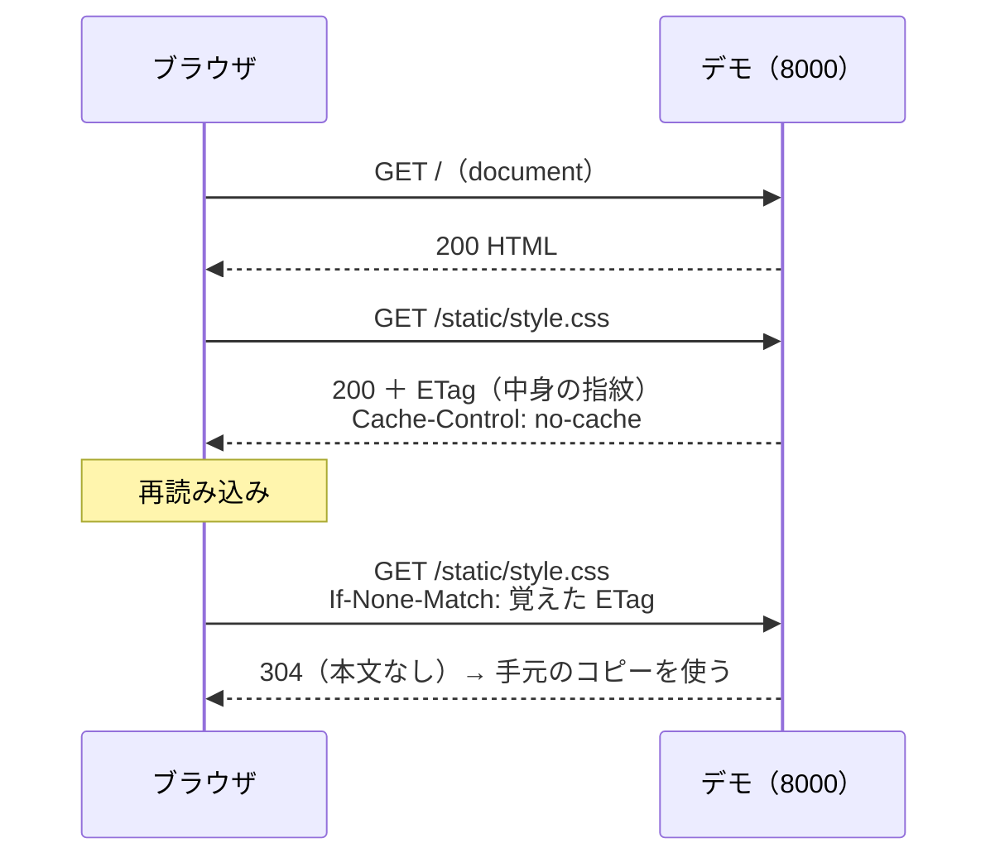
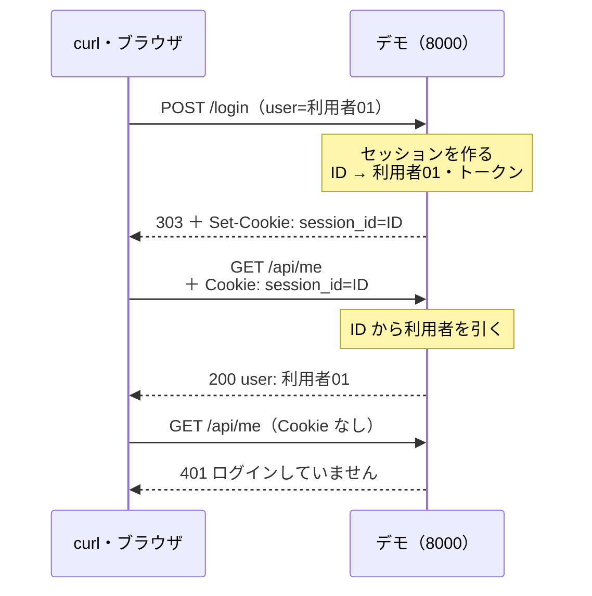
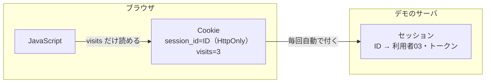
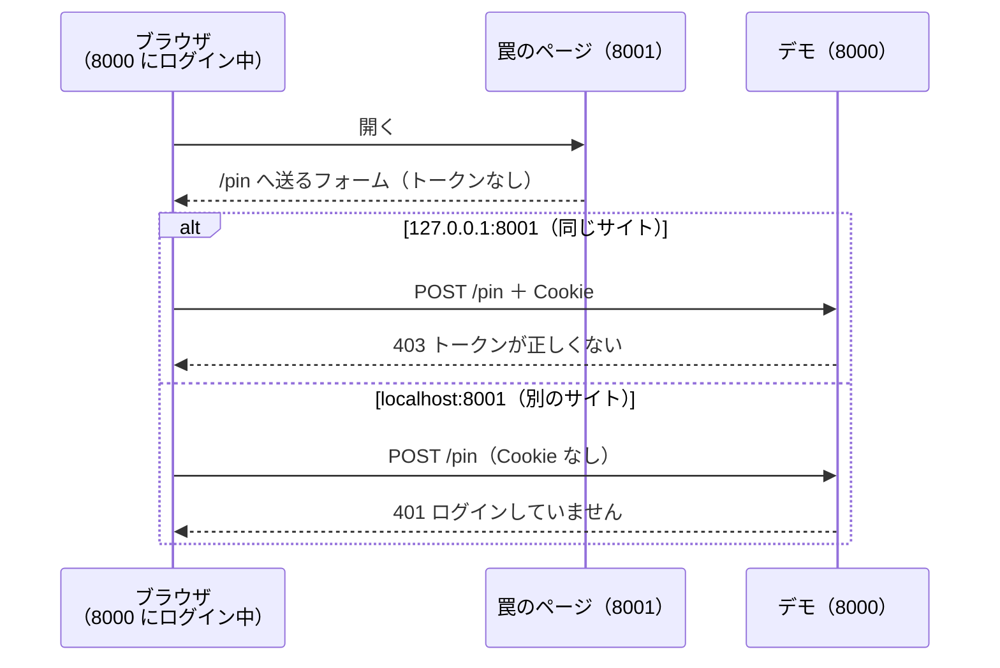
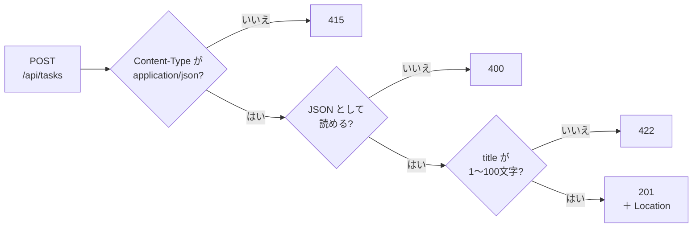
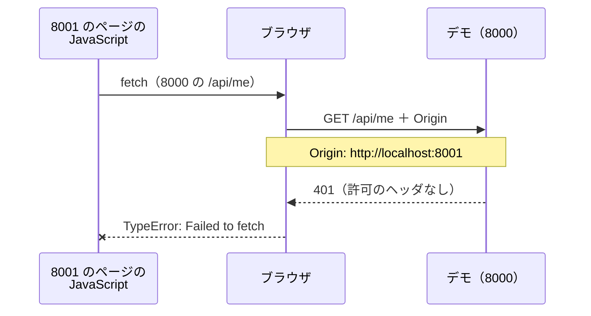
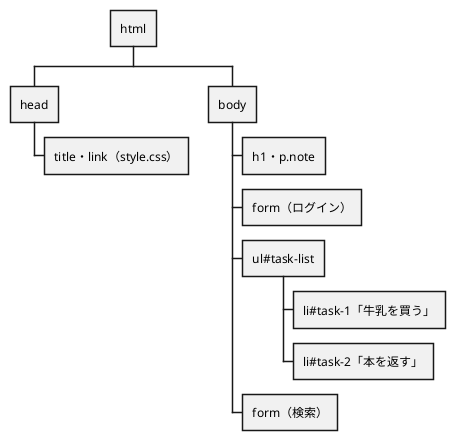

# 第3回 Web 通信の基礎（HTTP・Cookie・Web API）
tag: http, web-ブラウザ, sec
前提タグ: linux-シェル, linux-ネットワーク
所要: 座学15分 / ハンズオン45分

## ゴール

- リクエストとレスポンスの主なヘッダ（Host・Accept・Content-Type・Location・Cache-Control・ETag・Set-Cookie・Origin など）を、curl と開発者ツールで読んで意味を言える
- Cookie とセッションでログインを保つ仕組みを説明し、`HttpOnly`・`SameSite`・CSRF のトークンが何を防ぐかを動かして確かめられる
- Web API を curl で呼び、メソッドとステータスコード（200・201・204・304・400・404・405・415・422）の使い分けと JSON を読める
- CORS で止めるのはブラウザで、リクエストはサーバに届くことを確かめられる
- DOM と fetch をコンソールで触り、`innerHTML` に入力を入れると XSS になることを説明できる

## 事前準備

- 第2回を終えていること（社内ではプロキシの環境変数と `no_proxy` に `localhost,127.0.0.1`、apt のプロキシの設定が済んでいる）
- ブラウザは Windows の Chrome か Edge。開発者ツールは `F12`
- 社内では、Windows のプロキシ設定の例外に `127.0.0.1;localhost` が入っていること（[open-questions.md](../open-questions.md) の Q1）
- 素材: [assets/web_demo.py](assets/web_demo.py)（デモのサーバ。Ubuntu の `python3` の標準ライブラリだけで動く）

## まとめ

冒頭の座学で使います。ハンズオンでは、デモのサーバを相手に curl とブラウザの開発者ツールで、ヘッダ・Cookie・JSON の実物を読みます。第1回で見た `curl -v` の「リクエスト行・ヘッダ・空行・本文」の形が前提です。

### 主なヘッダ（http-構成）

| ヘッダ | 向き | 意味 | 見る手順 | 参照 |
| --- | --- | --- | --- | --- |
| `Host` | 要求 | どのサイト宛てか（1台のサーバが複数のサイトを持てる） | 1 | Web技術の基本 3章 |
| `User-Agent`・`Accept`・`Accept-Language` | 要求 | 送り手の種類、受け取れる形式と言語 | 1・2 | MDN HTTP ヘッダー |
| `Content-Type`・`Content-Length` | 両方 | 本文の形式（`text/html`・`application/json`・`application/x-www-form-urlencoded`）と長さ | 1・5 | MDN HTTP ヘッダー |
| `Location` | 応答 | 次に行く URL（303）、作ったものの URL（201） | 3・5 | MDN HTTP ヘッダー |
| `Cache-Control` | 応答 | `no-store` 保存しない、`no-cache` 使う前に毎回確かめる、`max-age=秒` その間は確かめない | 1・5 | MDN HTTP キャッシュ |
| `ETag`・`If-None-Match` | 応答・要求 | 中身の指紋。同じなら 304 で本文を省く | 2・5 | MDN HTTP キャッシュ |
| `Set-Cookie`・`Cookie` | 応答・要求 | 保存させる・送り返す | 3 | MDN HTTP Cookie の使用 |
| `Origin`・`Access-Control-Allow-Origin` | 要求・応答 | どのページの JavaScript からか、その JavaScript に読ませてよいか | 6 | MDN オリジン間リソース共有 (CORS) |

### ステータスコード

| コード | 意味 | このデモで出る場面 |
| --- | --- | --- |
| 200 OK・201 Created・204 No Content | 成功・作った（`Location` つき）・成功で本文なし | 一覧・追加・削除 |
| 303 See Other・304 Not Modified | `Location` を GET し直す・手元のコピーを使ってよい | ログイン・`If-None-Match` |
| 400・415・422 | 送った形が壊れている・`Content-Type` が違う・形は正しいが中身がだめ | 壊れた JSON・フォームで送る・空のタイトル |
| 401・403・404・405 | ログインが要る・権限がない・ない・その URL で使えないメソッド（`Allow` つき） | `/api/me`・CSRF・ない id・`DELETE /api/tasks` |
| 5xx | サーバ側の失敗 | （出ない） |

### Cookie・セッションとセキュリティ（sec）

| 用語 | 押さえること | 参照 |
| --- | --- | --- |
| Cookie | サーバが `Set-Cookie` で保存させ、ブラウザが同じサイトへのリクエストに自動で付ける。値は利用者が書き換えられる | Web技術の基本 3章、MDN HTTP Cookie の使用 |
| セッション | 中身（誰がログイン中か）はサーバに置き、ブラウザには推測できない ID だけを渡す。ログアウトでサーバ側を消す | Web技術の基本 6章 |
| 属性 | `HttpOnly` JavaScript から読めない／`SameSite=Lax` ほかのサイトからの POST に付けない／`Max-Age` 秒で消える／`Path`・`Secure`（https だけ） | MDN Set-Cookie |
| オリジンとサイト | オリジン＝スキーム＋ホスト＋ポート。サイト＝スキーム＋ドメイン（ポートを見ない） | MDN 同一オリジンポリシー |
| CSRF | Cookie は自動で付くので、ほかのページから送らせても通ってしまう。フォームに埋めたトークンを照合し、`SameSite` で Cookie を付けない | Web技術の基本 6章 |
| CORS | 別のオリジンへの fetch の結果を、許可（`Access-Control-Allow-Origin`）がなければブラウザが JavaScript に渡さない。リクエストは届く | MDN オリジン間リソース共有 (CORS) |
| XSS | 入力がそのまま HTML になってスクリプトが動く。エスケープと `textContent` で防ぐ。`HttpOnly` の Cookie は盗めない | Web技術の基本 6章 |

### Web API と JSON（http-基本）

| メソッドと URL | 意味 | 成功 | 失敗 |
| --- | --- | --- | --- |
| `GET /api/tasks`（`?done=false`） | 一覧（絞り込み） | 200・304 | — |
| `POST /api/tasks` | 追加 | 201 ＋ `Location` | 400・415・422 |
| `GET /api/tasks/{id}` | 1件 | 200・304 | 404 |
| `PATCH /api/tasks/{id}` | 送った項目だけ変える | 200 | 404・422 |
| `DELETE /api/tasks/{id}` | 消す | 204 | 404 |

- REST: URL で「もの」（リソース）を、メソッドで「すること」を表す。URL に動詞（`/addTask`）を入れない（Web技術の基本 5章）
- JSON: `{}` オブジェクト（`"名前": 値`）、`[]` 配列。値は文字列・数・`true`/`false`・`null`・オブジェクト・配列（Web技術の基本 4章、MDN JSON の操作）

### 開発者ツール（web-ブラウザ）

| パネル | 見るもの |
| --- | --- |
| ネットワーク | 1行＝1リクエスト。ステータス・タイプ（`document`・`stylesheet`・`fetch`）・ヘッダー・ペイロード・レスポンス。「ログを保持」でページを移っても消えない |
| アプリケーション | 「ストレージ」→「Cookie」で、保存された Cookie と属性 |
| コンソール | JavaScript を1行ずつ実行する。`await` がそのまま使える |
| 要素 | DOM の木 |

## ハンズオン

1ステップ1コマンド。各ステップは「🖋 やること → 📚 参考書・公式資料の節 → 📒 説明 → コマンドやコード」。作業場所は `~/handsoff/workspace/session03/`。ターミナルを2つ使う（①デモのサーバ、②コマンド）。

### 1. デモのサーバとヘッダの中身（7分）

#### 🖋 デモのサーバを起動する（ターミナル①）

📒 標準ライブラリだけで書いたサーバ。このサイト（8000）と別のサイト（8001）を同時に立て、1リクエストを1行のログに出す。データはメモリだけにあり、止めると消える

```sh
cd ~/handsoff/workspace/session03
python3 ~/handsoff/docs/session03/assets/web_demo.py
```

- `Address already in use` のときは `python3 … --port 8100 --other-port 8101` で番号を変え、以降の URL も読み替える

#### 🖋 リクエストとレスポンスのヘッダを読む（ターミナル②）

📚 Web技術の基本 3章 HTTPでやりとりする仕組み、MDN HTTP ヘッダー

📒 本文は `-o /dev/null` で捨て、ヘッダだけを見る

```sh
cd ~/handsoff/workspace/session03
curl -v -o /dev/null http://127.0.0.1:8000/
```

```text
> GET / HTTP/1.1
> Host: 127.0.0.1:8000                          ← 宛先のサイト（URL のホストとポート）
> User-Agent: curl/8.5.0                        ← 送り手
> Accept: */*                                   ← 何でも受け取る
>
< HTTP/1.1 200 OK
< Server: WebDemo/1.0                           ← サーバの種類
< Date: Tue, 13 Oct 2026 00:34:29 GMT           ← 時刻は世界標準時（GMT）
< Cache-Control: no-store                       ← 保存しない（毎回取り直す）
< Set-Cookie: visits=1; Path=/; Max-Age=86400; SameSite=Lax   ← Cookie を保存させる（手順3）
< Content-Type: text/html; charset=utf-8        ← 本文は HTML、文字コードは UTF-8
< Content-Length: 1231                          ← 本文のバイト数
```

#### 🖋 ヘッダだけを取る

📒 `-I` は HEAD メソッド。GET と同じヘッダが返り、本文は返らない

```sh
curl -I http://127.0.0.1:8000/
```

#### 🖋 送ったヘッダをサーバから見る

📒 `/headers` は、受け取ったリクエストヘッダを JSON で返す。`-H` で好きなヘッダを足せる

```sh
curl -s http://127.0.0.1:8000/headers
curl -s -H 'Accept-Language: ja' -H 'X-Hello: 1' http://127.0.0.1:8000/headers
```

### 2. ブラウザの Network タブ（5分）

#### 🖋 Network タブを開いてページを読む（ブラウザ）

📚 Web技術の基本 3章、MDN HTTP の概要

📒 `http://127.0.0.1:8000/` を開き、`F12` →「ネットワーク」→「ログを保持」に✓ → 再読み込み。HTML（`document`）を読んだ後、中の `<link>` を見て CSS（`stylesheet`）を取りに行く

- 開けない・社内のエラーページになるときは、Windows のプロキシ設定の例外を確かめる（事前準備）

#### 🖋 再読み込みで 304 を見る

📚 MDN HTTP キャッシュ

📒 もう一度再読み込みする。`style.css` が 304 になる。行をクリックして「ヘッダー」を開くと、応答の `ETag` と要求の `If-None-Match` が同じ値になっている



#### 🖋 ブラウザが送るヘッダを見る

📒 `http://127.0.0.1:8000/headers` を開き、手順1の curl と比べる。ブラウザは `Accept`（HTML を優先）・`Accept-Language`・`Sec-Fetch-*`（どんな操作で送ったか）・`Cookie` を自動で付ける

```text
"Accept": "text/html,application/xhtml+xml,...;q=0.9,*/*;q=0.8"   ← HTML を優先（q は優先度）
"Accept-Language": "ja,en-US;q=0.9,..."                           ← ブラウザの言語設定
"Sec-Fetch-Mode": "navigate"                                      ← ページの移動で送った
"Cookie": "visits=3"                                              ← 保存した Cookie を自動で付けた
```

### 3. Cookie とセッション（9分）

#### 🖋 Cookie を保存して送り返す（ターミナル②）

📚 Web技術の基本 3章、MDN HTTP Cookie の使用

📒 curl は `-c` で受け取った Cookie をファイルに保存し、`-b` でそのファイルから送る。2回目は `visits=1` を送ったので 2 になる

```sh
curl -s -c cookie.txt -b cookie.txt -o /dev/null http://127.0.0.1:8000/
curl -s -c cookie.txt -b cookie.txt http://127.0.0.1:8000/ | grep visits
cat cookie.txt      # ドメイン・パス・期限（UNIX 時刻）・名前・値
```

#### 🖋 Cookie を書き換える

📒 Cookie の値は利用者が自由に変えられる。だから「誰がログイン中か」を Cookie の値に入れてはいけない

```sh
curl -s -b 'visits=999' http://127.0.0.1:8000/ | grep visits     # 1000
```

#### 🖋 curl でログインする

📚 Web技術の基本 6章 セキュリティと認証、MDN Set-Cookie

📒 ログインすると、サーバはセッション（利用者とトークン）を自分のメモリに作り、その ID だけを Cookie で渡す。パスワードの確認はデモでは省いている

```sh
curl -si -c cookie.txt -b cookie.txt --data-urlencode user=利用者01 http://127.0.0.1:8000/login
```

```text
HTTP/1.1 303 See Other
Location: /                               ← 次はトップを GET する
Set-Cookie: session_id=aRVPP-wnci17Yh3oXeChXg; HttpOnly; Path=/; SameSite=Lax; Max-Age=1800
  session_id=…   ← セッション ID（推測できない乱数。人によって違う）
  HttpOnly       ← JavaScript から読めない
  Path=/         ← このサイトのどの URL にも付ける
  SameSite=Lax   ← ほかのサイトから送られた POST には付けない
  Max-Age=1800   ← 1800秒（30分）で消える
```

#### 🖋 Cookie を付けて API を呼ぶ

📒 同じ URL でも、Cookie の有無で答えが変わる。サーバは ID から利用者を引いている



```sh
curl -s -b cookie.txt http://127.0.0.1:8000/api/me    # "user": "利用者01"
curl -s http://127.0.0.1:8000/api/me                  # 401 "ログインしていません"
```

#### 🖋 ログアウトでセッションを消す

📒 ログアウトはブラウザの Cookie を消させる（`Max-Age=0`）だけでなく、サーバのセッションも消す。控えておいた古い ID を送っても、もう通らない

```sh
cp cookie.txt old-cookie.txt
curl -s -o /dev/null -b cookie.txt -c cookie.txt -X POST http://127.0.0.1:8000/logout
curl -s -b old-cookie.txt http://127.0.0.1:8000/api/me    # 401
```

#### 🖋 ブラウザでログインする（ブラウザ）

📒 `http://127.0.0.1:8000/` を開き、「利用者03」でログインする。ネットワークの `login`（303）の応答ヘッダーに `Set-Cookie`、次の `127.0.0.1`（GET）の要求ヘッダーに `Cookie`。「アプリケーション」→「Cookie」で `session_id` の HttpOnly に✓

#### 🖋 JavaScript から Cookie を読む

📒 「コンソール」で打つ。`visits` だけが見え、`HttpOnly` の `session_id` は見えない



```js
document.cookie   // 'visits=3'（session_id は出ない）
```

### 4. CSRF: 自動で付く Cookie の罠（5分）

#### 🖋 トークン付きのフォームでピン留めする（ブラウザ）

📚 Web技術の基本 6章、MDN Set-Cookie（SameSite）

📒 「牛乳を買う」をピン留めする。`Ctrl+U` でページのソースを開くと、フォームに `csrf_token` の hidden がある。値はセッションごとに違い、このページを開いた本人のフォームにだけ入っている

#### 🖋 同じサイトの罠のページから送る

📒 `http://127.0.0.1:8001/trap` を開いて「受け取る」を押す。ポートが違うのでオリジンは別だが、サイトは同じなので Cookie が付く（ネットワークの `pin` の要求ヘッダー）。トークンがないので 403

| 開く URL | 8000 から見たオリジン | 8000 から見たサイト | `SameSite=Lax` の Cookie |
| --- | --- | --- | --- |
| `http://127.0.0.1:8000` | 同じ | 同じ | 付く |
| `http://127.0.0.1:8001` | 違う（ポート） | 同じ（ポートを見ない） | 付く |
| `http://localhost:8001` | 違う | 違う（ドメインが違う） | POST には付かない |

#### 🖋 別のサイトの罠のページから送る

📒 `http://localhost:8001/trap` で同じことをする。別のサイトからの POST なので `SameSite=Lax` で Cookie が付かず、401。トークンと `SameSite` の2つで守っている



### 5. Web API と JSON（11分）

#### 🖋 一覧を取る（ターミナル②）

📚 Web技術の基本 5章 Webアプリケーションの基本（Web API）、4章 データ形式（JSON）

📒 本文は JSON。`Content-Type: application/json` で形式を伝える。`ETag` と `Cache-Control: no-cache` は手順2の CSS と同じ

```sh
curl -si http://127.0.0.1:8000/api/tasks
```

#### 🖋 jq を入れる

📒 `jq` は JSON を整形し、一部を取り出す道具。入れられないときは `python3 -m json.tool --no-ensure-ascii` で整形だけする

```sh
sudo apt install -y jq    # 社内ではプロキシの設定が要る（第2回）
```

#### 🖋 絞り込んで取り出す

📒 `?done=false` はクエリ文字列（URL の `?` の後ろ）で、未完了だけに絞る。`.[]` は配列の要素を1つずつ、`.title` はその中の項目

```sh
curl -s 'http://127.0.0.1:8000/api/tasks?done=false' | jq -r '.[].title'
```

#### 🖋 追加する

📚 MDN HTTP レスポンスステータスコード

📒 JSON を送るときは `Content-Type: application/json` を付ける。作れたら 201 と、作ったものの URL（`Location`）が返る

```sh
curl -si -X POST -H 'Content-Type: application/json' -d '{"title": "傘を持っていく"}' http://127.0.0.1:8000/api/tasks
```

```text
HTTP/1.1 201 Created
Location: /api/tasks/3                    ← 作ったタスクの URL
Content-Type: application/json

{
  "id": 3,                                ← 数
  "title": "傘を持っていく",               ← 文字列
  "done": false                           ← 真偽値（true／false）
}
```

#### 🖋 Location の URL を取る

```sh
curl -s http://127.0.0.1:8000/api/tasks/3
```

#### 🖋 更新して消す

📒 PATCH は送った項目だけを変える。DELETE の成功は 204 で本文なし。消した後に取ると 404

```sh
curl -s -X PATCH -H 'Content-Type: application/json' -d '{"done": true}' http://127.0.0.1:8000/api/tasks/3
curl -si -X DELETE http://127.0.0.1:8000/api/tasks/3 | head -1    # 204
curl -si http://127.0.0.1:8000/api/tasks/3 | head -1              # 404
```

#### 🖋 わざと失敗させる

📒 失敗の理由ごとにコードが違う。サーバは上から順に確かめ、最初に引っかかったコードを返す。本文の `detail` に理由がある



```sh
A=http://127.0.0.1:8000/api/tasks
curl -s -X POST -d 'title=x' $A                                          # 415 フォームの形で送った
curl -s -X POST -H 'Content-Type: application/json' -d '{"title": "x"' $A    # 400 } がない
curl -s -X POST -H 'Content-Type: application/json' -d '{"title": ""}' $A    # 422 空のタイトル
curl -si -X DELETE $A | grep -E '^HTTP|^Allow'                           # 405 と Allow: GET, POST
curl -s $A/99                                                            # 404
```

#### 🖋 変わっていなければ 304

📒 応答の `ETag` を `If-None-Match` で送ると、一覧が変わっていなければ 304 で本文なし。1件追加すると中身が変わるので 200 と新しい `ETag`

```sh
curl -si http://127.0.0.1:8000/api/tasks | grep -i etag
curl -si -H 'If-None-Match: "ここに ETag の値"' http://127.0.0.1:8000/api/tasks | head -1   # 304
```

#### 🖋 公開 API を呼ぶ

📒 JSONPlaceholder は練習用の公開 API で、`/todos` に TODO の例がある。社内では第2回のプロキシの環境変数で外に出る。つながらないときは、同じことをデモの `/api/tasks` で行う

```sh
curl -si https://jsonplaceholder.typicode.com/todos/1                   # content-type・etag・cache-control を読む
curl -s 'https://jsonplaceholder.typicode.com/todos?userId=1&completed=false' | jq length   # 9
curl -si -X POST -H 'Content-Type: application/json' -d '{"title": "牛乳を買う"}' https://jsonplaceholder.typicode.com/todos | grep -iE '^HTTP|^location'
curl -s -o /dev/null -w '%{http_code}\n' https://jsonplaceholder.typicode.com/todos/201    # 404（練習用なので保存しない）
```

### 6. CORS とプロキシ（4分）

#### 🖋 別のオリジンから fetch する（ブラウザ）

📚 MDN オリジン間リソース共有 (CORS)

📒 `http://localhost:8001/` を開き、コンソールで 8000 の `/api/me` を fetch する。コンソールに CORS のエラーが出るが、ターミナル①には `GET /api/me` と `Origin: http://localhost:8001` のログが出る。リクエストは届き、結果を JavaScript に渡すのをブラウザが止めた



```js
await fetch("http://127.0.0.1:8000/api/me")
// Access to fetch at 'http://127.0.0.1:8000/api/me' from origin 'http://localhost:8001'
// has been blocked by CORS policy: No 'Access-Control-Allow-Origin' header is present ...
```

#### 🖋 許可された API を読む

📒 `/api/tasks` は `Access-Control-Allow-Origin: http://localhost:8001` を返すので読める。ネットワークで応答ヘッダーを確かめる

```js
await (await fetch("http://127.0.0.1:8000/api/tasks")).json()
```

#### 🖋 curl では読めることを見る（ターミナル②）

📒 CORS はブラウザの中の読み取りの制限で、サーバを守る仕組みではない。curl は `Origin` を名乗っても読める。サーバの変更を防ぐのは、手順4のトークン

```sh
curl -s -H 'Origin: http://localhost:8001' http://127.0.0.1:8000/api/me
```

#### 🖋 プロキシを通っていないか確かめる

📒 `127.0.0.1` 宛ては、`no_proxy` によりプロキシを通さず直接つなぐ（第2回）。`Uses proxy` が出たら `no_proxy` を直す

```sh
curl -sv -o /dev/null http://127.0.0.1:8000/ 2>&1 | grep -iE 'proxy|trying'   # Trying 127.0.0.1:8000 だけ
curl -sv -o /dev/null https://jsonplaceholder.typicode.com/ 2>&1 | grep -iE 'proxy|trying'
```

### 7. DOM・fetch・XSS をコンソールで（4分）

#### 🖋 DOM の木を見る（ブラウザ）

📚 Web技術の基本 4章（HTML・DOM）、MDN DOM の紹介

📒 `http://127.0.0.1:8000/` で「要素」を開く。ブラウザは HTML から DOM という木を作り、画面はこの木を描いたもの。JavaScript はこの木を書き換える



#### 🖋 文字を書き換える

📒 画面は変わるが、変わったのはブラウザの中の DOM だけ。再読み込みでサーバの HTML に戻る

```js
document.querySelector("#task-list li").textContent = "書き換えた"
```

#### 🖋 fetch で追加して DOM に足す

📚 MDN フェッチ API の使用

📒 ページを移動せずに API に送り、返った JSON から `<li>` を作って足す。同じオリジンなので CORS は関係ない

```js
const res = await fetch("/api/tasks", {method: "POST", headers: {"Content-Type": "application/json"}, body: JSON.stringify({title: "コンソールから追加"})})
const task = await res.json()
const li = document.createElement("li"); li.textContent = task.title; document.querySelector("#task-list").append(li)
```

#### 🖋 textContent と innerHTML を比べる

📚 Web技術の基本 6章（XSS）

📒 `textContent` は文字として入れるので、タグがそのまま見える。`innerHTML` は HTML として解釈し、`onerror` のスクリプトが動いてダイアログが出る

```js
document.querySelector("#task-list li").textContent = ""
document.querySelector("#task-list li").innerHTML = ""
```

#### 🖋 エスケープしないページで XSS を起こす

📒 `/search-unsafe` は検索語をエスケープせずに HTML に入れる悪い例。ダイアログに出るのは `visits` だけで、`HttpOnly` の `session_id` は盗めない。`/search` はエスケープするので文字のまま出る

```text
http://127.0.0.1:8000/search-unsafe?q=
http://127.0.0.1:8000/search?q=
```

- 終わったら、ターミナル①のデモのサーバを `Ctrl+C` で止める

## 読む章

| 区分 | 資料 | 範囲 | 読み方 |
| --- | --- | --- | --- |
| 参考書 | [イラスト図解式 この一冊で全部わかるWeb技術の基本 第2版](https://www.maruzenjunkudo.co.jp/products/9784815625948)（Web技術の基本） | 3章 HTTPでやりとりする仕組み | 通読（第10回でも使う） |
| 参考書 | 同上 | 4章 データ形式（HTML・DOM・JSON）、5章 Webアプリケーションの基本（Web API）、6章 セキュリティと認証（Cookie・XSS・CSRF） | 該当章（4章は第12回、5章は第10〜12回でも使う） |
| 公式資料 | [MDN Web Docs](https://developer.mozilla.org/ja/) | HTTP の概要、HTTP ヘッダー、HTTP レスポンスステータスコード、HTTP キャッシュ、HTTP Cookie の使用、同一オリジンポリシー、オリジン間リソース共有 (CORS)、フェッチ API の使用、DOM の紹介、JSON の操作 | 引く |
| 紹介（副読本） | [Webを支える技術](https://www.kinokuniya.co.jp/f/dsg-01-9784774142043) | 第2部 URI、第3部 HTTP | 持っている人は該当章（第10回の API 設計でも使う） |
