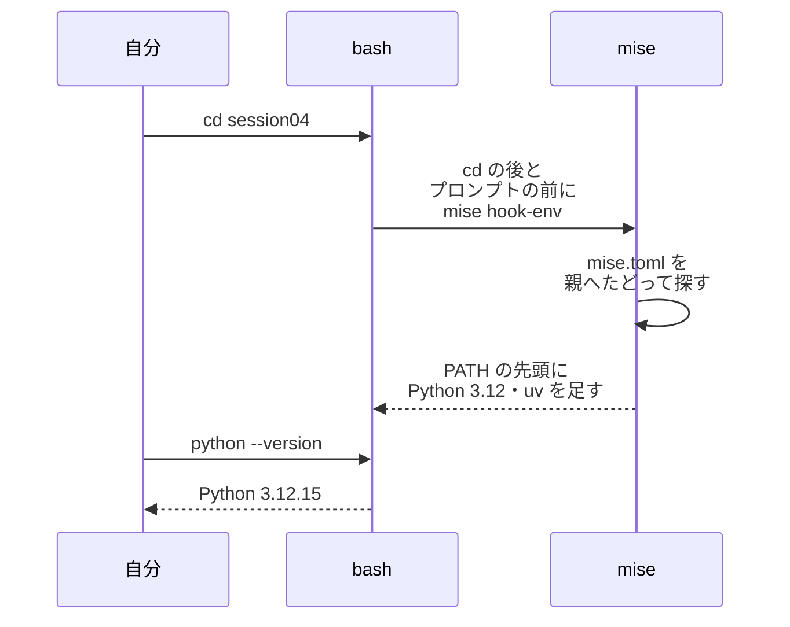
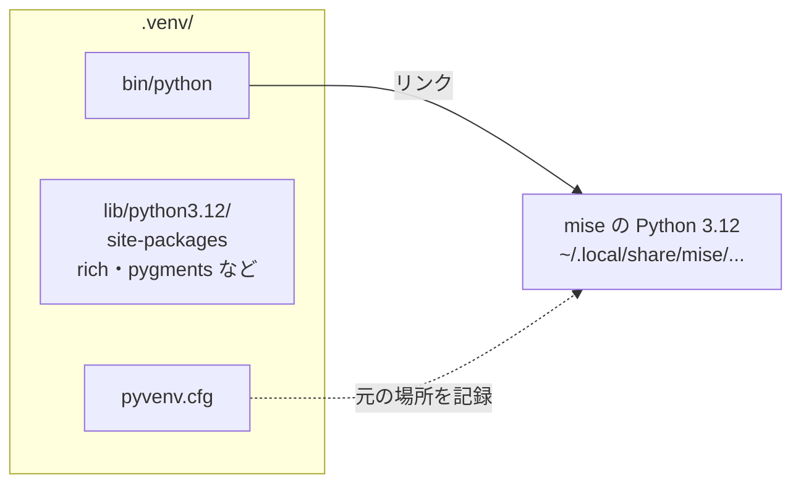
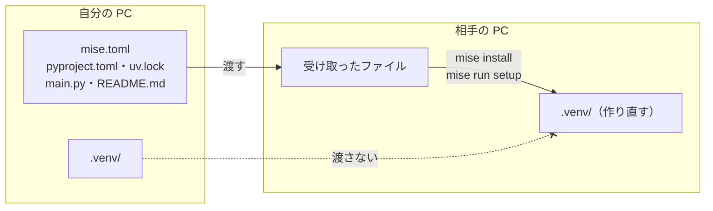

# 第4回 実行環境の整備
tag: env-mise, env-python
前提タグ: linux-シェル, linux-アプリ, linux-ネットワーク
所要: 座学15分 / ハンズオン45分

## ゴール

- システムの Python を直接使わない理由を、OS が使っていることとバージョンの違いから説明できる
- mise で Python と uv のバージョンをディレクトリごとに固定し、`cd` で切り替わる仕組みを説明できる
- uv で仮想環境を作り、`pyproject.toml` と `uv.lock` で依存パッケージを固定できる
- `mise.toml` に環境変数とタスクを書き、`mise run` で動かせる
- 渡すファイルと渡さないファイル（`.venv/`）を分け、隣の人が手順書（README）だけで再現できるように書ける

## 事前準備

- 第2回の環境設定手順書（`~/handsoff/workspace/session02/環境設定手順書.md`）の設定が済んでいること。社内ネットワークならプロキシの環境変数が `~/.bashrc` にある
- 講師から聞く: `mise.run`・`github.com`・`pypi.org` にプロキシ経由で届くか（[open-questions.md](../open-questions.md) の Q1・Q5）、社内 CA 証明書が要るか（Q3）

## まとめ

冒頭の座学で使います。ハンズオンで打ったコマンドと確認は、その場で環境構築手順書（README.md）に書いていきます。

### システムの Python を使わない理由

| 理由 | 中身 | 参照 |
| --- | --- | --- |
| OS の持ち物 | `/usr/bin/python3` は apt で入り、OS のツールが使う。パッケージを入れると OS のツールが動かなくなりうるので、Ubuntu は pip で入れるのを止めている（`EXTERNALLY-MANAGED`） | モダンLinux 6.5 |
| PC ごとに版が違う | 版は Ubuntu の版で決まる。「自分の PC では動く」の原因になる | Python 公式 チュートリアル 12.1 |
| 研修の方針 | プロジェクトごとに Python 3.12 に固定する。システムの Python には何も入れない | mise 公式 Getting Started |

### 3つの層

| 層 | 道具 | 固定するファイル | 固定するもの | 参照 |
| --- | --- | --- | --- | --- |
| OS | apt | — | システムの Python・git・curl | モダンLinux 6.5 |
| ツール | mise | `mise.toml` | Python・uv の版、環境変数、タスク | mise 公式 Configuration |
| パッケージ | uv | `pyproject.toml` | 直接使うパッケージ（`rich>=15.0.0`） | uv 公式 Managing dependencies |
| | | `uv.lock` | 間接的に使うものも含めた全パッケージの正確な版 | uv 公式 Locking and syncing |
| | | `.venv/` | 仮想環境（実物）。`uv.lock` から作り直せるので**渡さない** | Python 公式 venv |

### mise

| コマンド・書き方 | 意味 | 参照（mise 公式） |
| --- | --- | --- |
| `eval "$(~/.local/bin/mise activate bash)"` | `.bashrc` に書く。`cd` のたびとプロンプトの前に `mise.toml` を探して PATH を変える | Getting Started |
| `mise use --path . python@3.12` | このディレクトリの `mise.toml` に書いて入れる。`--path .` がないと親の `mise.toml` に書く | Getting Started |
| `mise install` | `mise.toml` に書いてある版を入れる（受け取った人が使う） | Dev Tools |
| `mise ls --current`・`mise config ls` | 今使う版とその出どころ／読んでいる `mise.toml` | Configuration |
| `[env]` | 環境変数。`_.python.venv` で `cd` したときに `.venv` を有効にする | Environments |
| `[tasks.名前]`・`mise tasks`・`mise run 名前` | よく打つコマンドに名前を付ける／一覧／実行 | Tasks |
| `mise trust` | コピー・受け取った `mise.toml` を中身を見てから信頼する。未信頼の間は `[env]` を読まない | Configuration |

### uv

| コマンド | 意味 | 参照（uv 公式） |
| --- | --- | --- |
| `uv init --app --vcs none --no-pin-python` | `pyproject.toml` と `main.py` を作る。Git は第5回、Python の版は `mise.toml` で決める | Creating projects |
| `uv add 名前` | `pyproject.toml` に書き、`uv.lock` を作り、`.venv` に入れるまでを一度に行う | Managing dependencies |
| `uv tree` | 依存パッケージの木 | Managing dependencies |
| `uv lock` | `pyproject.toml` から `uv.lock` を作り直す | Locking and syncing |
| `uv sync --locked` | `uv.lock` どおりに `.venv` を作る。`pyproject.toml` と食い違えば止まる | Locking and syncing |
| `uv run ファイル` | `.venv` の Python で動かす | Running commands |

### 社内で必要な設定

| 通信先・設定 | 中身 | 参照 |
| --- | --- | --- |
| `mise.run`・`github.com` | mise のインストールと、mise による Python・uv の取得 | open-questions Q5 |
| `pypi.org`・`files.pythonhosted.org` | uv によるパッケージの取得 | open-questions Q5 |
| プロキシ | mise・uv は `https_proxy` などの環境変数を読む（第2回で設定済み） | uv 公式 Environment variables |
| 社内 CA 証明書 | uv は既定では OS に登録した証明書を読まない。`export UV_NATIVE_TLS=1` を `~/.bashrc` に書く | uv 公式 Environment variables |

## ハンズオン

1ステップ1コマンド。各ステップは「🖋 やること → 📚 参考書・公式資料の節 → 📒 説明 → コマンド」。作業場所は `~/handsoff/workspace/session04/`。見本は [examples/session04/](../../examples/session04/README.md)。

### 1. システムの Python を確かめる（4分）

#### 🖋 作業場所に移る

```sh
cd ~/handsoff/workspace/session04
```

#### 🖋 システムの Python を見る

📚 Python 公式 チュートリアル 12.1 はじめに

📒 Ubuntu に最初から入っている Python は OS のもの。版は Ubuntu の版で決まり、隣の人と違うことがある

```sh
which -a python3; python3 --version   # 隣の人と比べる
```

#### 🖋 誰が使っているかを見る

📚 モダンLinux 6.5 パッケージとパッケージマネージャ

📒 apt や OS のツールが、この Python に頼っている。研修では3つの層（まとめの表）に分け、プロジェクトで使う Python とパッケージを OS から切り離す

```sh
dpkg -S /usr/bin/python3; apt-cache rdepends --installed python3 | head
```

#### 🖋 パッケージを入れさせない印を見る

📒 Ubuntu はこのファイルを置いて、システムの Python に pip でパッケージを入れるのを止めている

```sh
head -5 /usr/lib/python3*/EXTERNALLY-MANAGED
```

### 2. mise を入れる（7分）

#### 🖋 環境構築手順書を用意する

📒 第2回と同じく、打ったコマンドと確認をその場で書く。手順7で隣の人がこれだけを見て再現し、第5回でこのディレクトリをリポジトリにする

```sh
cp ~/handsoff/docs/session04/assets/環境構築手順書.md README.md; code README.md
```

- `code` が使えないときは `nano README.md`

#### 🖋 mise を入れる

📚 mise 公式 Getting Started

📒 mise は1つのファイルとして `~/.local/bin/mise` に入る。社内で止まったら、プロキシの環境変数を確かめる（第2回）

```sh
curl https://mise.run | sh
```

#### 🖋 入ったことを確かめる

```sh
~/.local/bin/mise --version
```

#### 🖋 .bashrc のコピーを取る

📒 第2回の `~/.bashrc.bak` は第2回の前の状態なので、上書きせずに別の名前で取る

```sh
cp ~/.bashrc ~/.bashrc.before-mise
```

#### 🖋 .bashrc に activate を書く

📚 mise 公式 Getting Started（Activate mise）

📒 activate すると、`cd` のたびとプロンプトを出す前に mise が動く。mise は今のディレクトリから親へたどって `mise.toml` を探し、PATH を書き換える



```sh
echo 'eval "$(~/.local/bin/mise activate bash)"' >> ~/.bashrc; exec bash
```

#### 🖋 mise と cd が関数になったのを見る

📒 activate は `mise` と `cd` を関数にする。第2回の探す順番では、関数は組み込みの `cd` より先に見つかる

```sh
mise --version; type -t mise cd   # function が2つ
```

- 書く: 「1. mise を入れる」（インストール → コピー → 追記 → `exec bash` → 確認は `mise --version`）

### 3. mise で Python と uv を固定する（7分）

#### 🖋 上の階層の mise.toml を見る

📚 mise 公式 Configuration

📒 `workspace/` には研修用の `mise.toml` がある。mise は今のディレクトリから親へたどり、近いほうの設定を優先する

```plantuml
@startwbs
* &#126;/handsoff/workspace
** mise.toml\npython 3.12
** session02
** session04（作業場所）
*** mise.toml（これから作る）\npython 3.12・uv 0.9\n近いほうを優先
@endwbs
```



```sh
cat ../mise.toml; mise config ls
```

#### 🖋 このディレクトリに固定する

📚 mise 公式 Getting Started（mise use）

📒 `mise use` は版を `mise.toml` に書き、まだなければ入れる。`--path .` を付けないと、いちばん近い `../mise.toml` に書き込む

```sh
mise use --path . python@3.12 uv@0.9
```

#### 🖋 できた mise.toml を見る

```sh
cat mise.toml; mise config ls   # session04/mise.toml が増える
```

#### 🖋 どの Python が動くかを見る

📒 mise は PATH の先頭に、入れた Python と uv のディレクトリを足す。`python` と打つと、`/usr/bin` より先にそこが見つかる

```sh
which python uv; python --version; mise ls --current
```

#### 🖋 外に出て比べる

📒 `cd` するだけで切り替わる。ディレクトリの外ではシステムの Python に戻り、uv は見つからない

```sh
cd ~; python3 --version; type uv; cd -
```

- 書く: 「2. Python と uv を入れる」。受け取った人は `mise use` ではなく、`mise.toml` に書いてある版を `mise install` で入れる。確認は `mise ls --current`

### 4. uv でパッケージを入れる（8分）

#### 🖋 プロジェクトを作る

📚 uv 公式 Creating projects

📒 `pyproject.toml` はプロジェクトの名前と、直接使うパッケージを書くファイル。Git は第5回で自分で作り、Python の版は `mise.toml` だけで決める（`.python-version` を作らない）

```sh
uv init --app --vcs none --no-pin-python --name hello-todo
ls; cat pyproject.toml
```

#### 🖋 パッケージを足す

📚 uv 公式 Managing dependencies

📒 `uv add` は、`pyproject.toml` への追記、`uv.lock` での版の固定、`.venv` へのインストールを一度に行う


```sh
uv add rich
```

#### 🖋 何が入ったかを見る

📒 rich が使うパッケージも一緒に入る。`uv.lock` は、この木にあるパッケージ全部の版を記録する

```sh
uv tree; grep -A1 '^name' uv.lock
```

#### 🖋 仮想環境の中を見る

📚 Python 公式 チュートリアル 12.2 仮想環境の作成

📒 `.venv` の `python` は、mise が入れた Python へのリンク。パッケージは `.venv` の中にだけ入るので、システムの Python とほかのプロジェクトは変わらない



```sh
ls -l .venv/bin/python; cat .venv/pyvenv.cfg
```

#### 🖋 動かす

📚 uv 公式 Running commands

📒 見本の `main.py` は rich でタスクの表を出し、最後の行に使った Python の場所を出す。`uv run` は `.venv` の Python で動かす

```sh
cp ~/handsoff/examples/session04/main.py .; uv run main.py
```

- 確認: 最後の行が `.../session04/.venv/bin/python`

### 5. mise.toml に環境変数とタスクを書く（8分）

#### 🖋 環境変数を書く

📚 mise 公式 Environments

📒 `UV_PYTHON_DOWNLOADS` で、uv が自分で Python を落とさないようにする（mise の Python だけを使う）。`_.python.venv` で、`cd` したときに `.venv` が有効になる

```sh
cat >> mise.toml <<'EOF'

[env]
UV_PYTHON_DOWNLOADS = "never"
_.python.venv = { path = ".venv", create = true }
EOF
```

#### 🖋 タスクを書く

📚 mise 公式 Tasks

📒 よく打つコマンドに名前を付けて `mise.toml` に残す。受け取った人は `mise tasks` で、何を打てばよいかがわかる

```sh
cat >> mise.toml <<'EOF'

[tasks.setup]
description = "依存パッケージを uv.lock どおりに入れる"
run = "uv sync --locked"

[tasks.hello]
description = "タスク一覧を表示する"
run = "python main.py"
EOF
```

#### 🖋 タスクを動かす

📒 `mise run` は `mise.toml` の版と環境変数を設定してからコマンドを動かす。`python` は `.venv` の Python になる

```sh
mise tasks; mise run hello; which python   # .venv/bin/python
```

#### 🖋 Python の版に上限を付ける

📚 uv 公式 Locking and syncing

📒 `>=3.12` だけでは、mise を通さずに新しいシステムの Python で動かしても気づけない。上限を付けて 3.12 だけにする

```sh
sed -i 's/^requires-python = ">=3.12"$/requires-python = ">=3.12,<3.13"/' pyproject.toml; grep requires-python pyproject.toml
```

#### 🖋 食い違ったまま setup する

📒 `--locked` は、`pyproject.toml` と `uv.lock` が食い違うと、`uv.lock` を書き換えずに止まる。受け取った人の手元で版が勝手に変わるのを防ぐ

```sh
mise run setup   # The lockfile at `uv.lock` needs to be updated ...
```

#### 🖋 uv.lock を作り直す

```sh
uv lock; mise run setup
```

- 書く: 「3. 依存パッケージを入れる」（`mise run setup`）と「4. 動かす」（`mise run hello`、確認は最後の行の Python の場所）

### 6. 渡すものを決め、別の場所で再現する（5分）

#### 🖋 渡すものと渡さないものを分ける

📚 Python 公式 チュートリアル 12.3 pip を使ったパッケージ管理

📒 `.venv` は `uv.lock` からいつでも作り直せる。中のリンクは自分の PC のパスを指すので、渡しても相手の PC では動かない



```sh
du -sh .venv; ls
```

- 書く: 「渡すファイルと渡さないファイル」

#### 🖋 別の場所にコピーする

📒 `workspace/` の外にコピーするので、`../mise.toml` には頼れない。`.venv` は渡さないのでコピーしない

```sh
mkdir ~/session04-check && cp mise.toml pyproject.toml uv.lock main.py README.md ~/session04-check/ && cd ~/session04-check
```

#### 🖋 中身を見て信頼する

📚 mise 公式 Configuration（mise trust）

📒 `[env]` と `[tasks]` はコマンドを動かせる。コピーした `mise.toml` は信頼するまで `[env]` を読まない（`is not trusted` と出る）。`mise run` は自動で信頼するので、その前に中身を見る

```sh
cat mise.toml; mise trust
```

#### 🖋 README の手順で動かす

```sh
mise install; mise run setup; mise run hello
```

- 確認: 最後の行が `~/session04-check/.venv/bin/python`。終わったら `cd ~/handsoff/workspace/session04; rm -rf ~/session04-check`

### 7. 隣の人の手順書で再現する（6分）

#### 🖋 渡すコピーを用意して席を替わる

📒 お互いに相手の PC の前に座り、相手の手順書だけを見て再現する。書いていないことは推測で補わず、止まった所と推測した所をメモして渡す。コピー先を手順6と別の名前にするので、信頼の手順も試せる

```sh
mkdir ~/session04-try && cp mise.toml pyproject.toml uv.lock main.py README.md ~/session04-try/
```

#### 🖋 前提を確かめる（隣の人の PC で）

📒 第2回の設定は済んでいるので、隣の人の環境設定手順書の「確認」だけを打ち、前提がそろっているかを見る

```sh
type hello; env | grep -i _proxy   # 隣の人の手順書の「確認」の行を打つ
```

#### 🖋 README だけで再現する（隣の人の PC で）

📒 新しいターミナルで、README の「2. Python と uv を入れる」から順に打つ。ディレクトリは `~/session04-try` に読み替える

```sh
cd ~/session04-try   # この後は README のとおりに
```

#### 🖋 指摘を手順書に直す

📒 自分の席に戻り、メモを受け取って README を直す。止まった所は「うまくいかないとき」に書く

```sh
rm -rf ~/session04-try; grep -c '（書く）' README.md   # 0 になるまで埋める
```

- 書く: 「うまくいかないとき」と「元に戻す方法」（`cp ~/.bashrc.before-mise ~/.bashrc`）

## 読む章

| 区分 | 資料 | 範囲 | 読み方 |
| --- | --- | --- | --- |
| 無料 | [mise 公式](https://mise.jdx.dev/) | Getting Started、Configuration、Environments、Tasks | 主な資料（引く） |
| 無料 | [uv 公式](https://docs.astral.sh/uv/) | Concepts の Projects（Creating projects、Managing dependencies、Locking and syncing、Running commands）、Environment variables | 主な資料（引く） |
| 無料 | [Python 公式ドキュメント](https://docs.python.org/ja/3/) | チュートリアル 12章 仮想環境とパッケージ、標準ライブラリ venv | 該当章 |
| 参考書 | [入門 モダンLinux](https://www.oreilly.co.jp/books/9784814400218/)（モダンLinux） | 6章 アプリケーション、パッケージ管理、コンテナ（6.4、6.5） | 該当章（第2回の続き） |
| 紹介（副読本） | [Effective Python 第2版](https://www.oreilly.co.jp/books/9784873119175) | 10章 項目83 仮想環境 | 持っている人は該当章 |
| 紹介（副読本） | [達人プログラマー 第2版](https://www.hanmoto.com/bd/isbn/9784274226298) | 基本ツール（シェル、プレーンテキスト、バージョン管理） | 持っている人は通読（第1〜5回で基本ツールの範囲） |

本で補いたい人は、候補: [改訂新版 Python実践レシピ](https://gihyo.jp/book/2026/978-4-297-15489-9)
