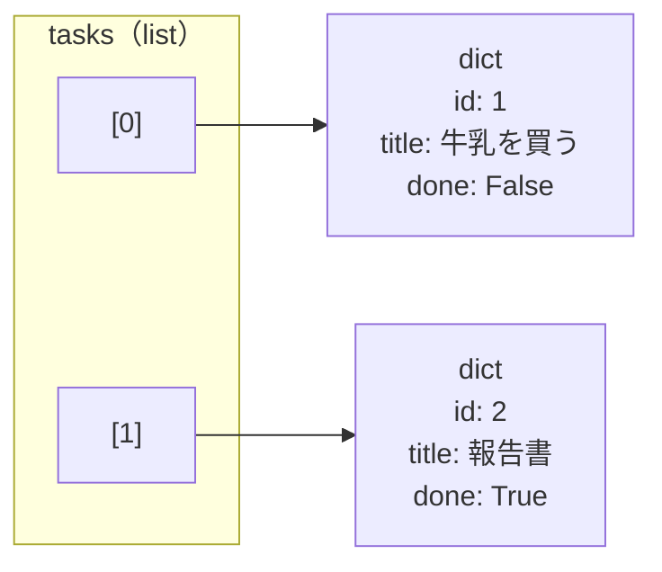
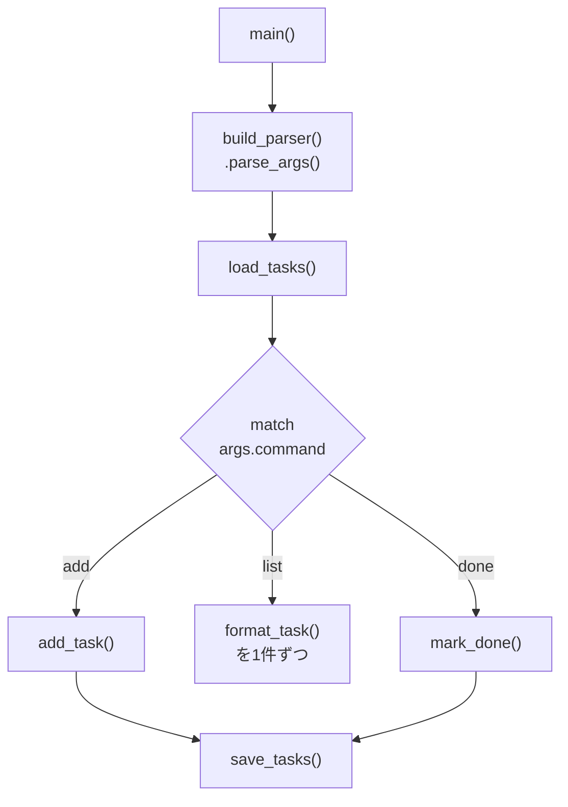
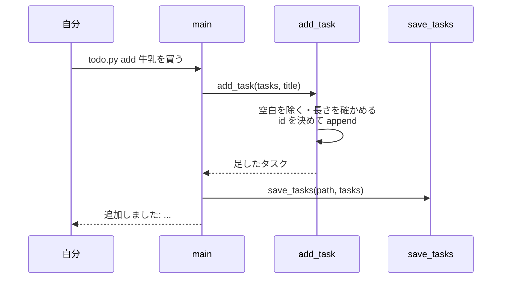
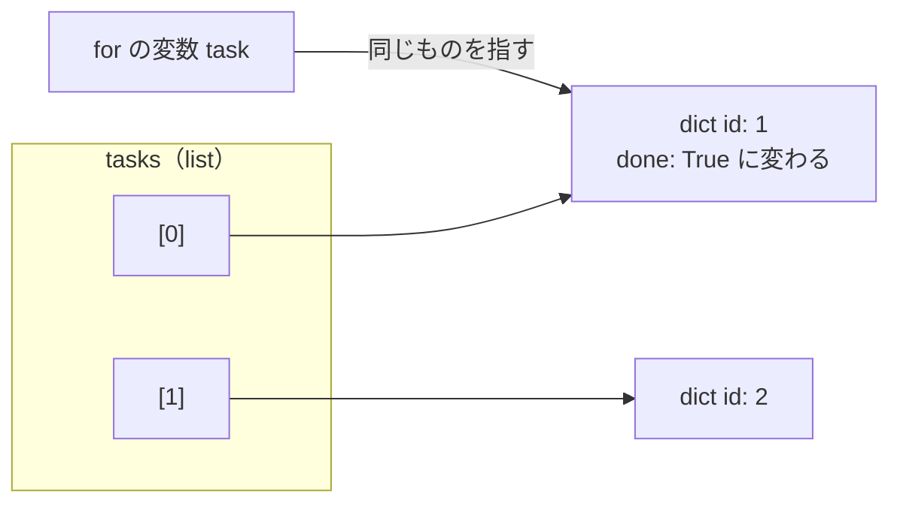
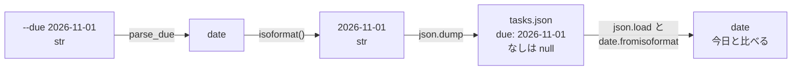
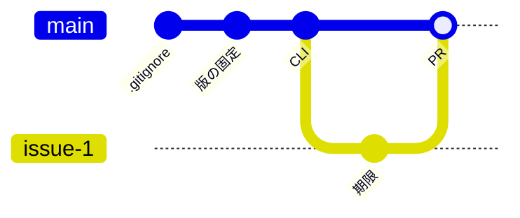

# 第6回 Python の基本
tag: python-構文
前提タグ: env-python, git-基礎, git-github
所要: 座学15分 / ハンズオン45分

## ゴール

- list と dict で TODO のデータを持ち、`d["k"]` と `d.get("k")`・内包表記・f-string を使い分けられる
- 型ヒント付きの関数を書き、データの操作と表示を別の関数に分けられる
- `pathlib`・`with`・`json` でタスクをファイルに保存し、読み直せる
- 起こりうる例外だけを `try`／`except` で扱い、利用者向けの文言と終了コードにできる
- `argparse` と `match` でサブコマンド（add / list / done）を振り分けられる
- アプリのリポジトリ `todo-app` を作って push し、機能の追加（`--due` と `list --overdue`）を Issue → ブランチ → PR → セルフレビュー → マージで入れられる

## 事前準備

- 第4回の mise が使え、`~/handsoff/workspace` で `python --version` が 3.12
- 第5回の Git の設定と push の認証（トークン）が済んでいる。`<Gitホスティング>` に新しい非公開リポジトリを作れる（[open-questions.md](../open-questions.md) の Q4）

## まとめ

冒頭の座学で使います。ハンズオンでは雛形の関数の中身を順に書き、TODO の CLI を作ってアプリのリポジトリに入れます。

### 書き方

| 書き方 | 例 | 意味 | 参照（Python 公式） |
| --- | --- | --- | --- |
| list | `[1, 2]`、`tasks[0]`、`tasks.append(x)` | 順番のある並び。番号（0から）で取り出す | チュートリアル 3.1.3、5.1 |
| dict | `{"id": 1, "done": False}`、`task["id"]` | キーで値を引く表 | チュートリアル 5.5 |
| `d["k"]`／`d.get("k")` | `task.get("due")` | ないと `KeyError`／ないと `None`（`d.get("k", 既定値)`） | ライブラリ `dict` |
| 内包表記 | `[t for t in tasks if not t["done"]]` | 条件に合うものだけの新しいリスト | チュートリアル 5.1.3 |
| f-string | `f"{task['id']:>3} [{status}]"` | 文字列に値を埋め込む。`:>3` は3桁で右寄せ | チュートリアル 7.1.1 |
| 型ヒント | `def add_task(tasks: list[Task], title: str) -> Task:` | 引数と戻り値の型。実行には影響せず、読む人と mypy（第7回）が使う | チュートリアル 4.9.8、ライブラリ `typing` |
| 型の別名 | `type Task = dict[str, Any]` | 型に名前を付ける（3.12 の書き方） | ライブラリ `typing` |
| `with` | `with path.open(encoding="utf-8") as f:` | ブロックを出るとき、例外が起きても必ず閉じる | チュートリアル 7.2、8.8 |
| `pathlib` | `Path("tasks.json")` | パスを文字列ではなくオブジェクトで扱う | ライブラリ `pathlib` |
| `json` | `json.load(f)`／`json.dump(obj, f, ensure_ascii=False, indent=2)` | ファイルから読む／ファイルに書く | チュートリアル 7.2.2 |
| 例外 | `try:` … `except FileNotFoundError:`、`raise ValueError("文言")` | 起こりうる失敗を捕まえる／自分で知らせる | チュートリアル 8.3、8.4 |
| `argparse` | `sub.add_parser("add")`、`type=int` | 引数の解釈・`--help`・誤りの表示（終了コード 2）を自動で | argparse チュートリアル |
| `match` | `match args.command:` → `case "add":` | 値で処理を振り分ける | チュートリアル 4.7 |
| `if __name__ == "__main__":` | `sys.exit(main())` | ファイルを直接実行したときだけ動く（import では動かない） | ライブラリ `__main__` |
| `datetime.date` | `date.fromisoformat("2026-11-01")`、`d.isoformat()` | 日付。文字列との変換と大小の比較ができる | ライブラリ `datetime` |

### JSON と Python の対応

| JSON（`tasks.json`） | Python（`json.load` の結果） |
| --- | --- |
| オブジェクト `{"id": 1}` | dict |
| 配列 `[...]` | list |
| 文字列 `"牛乳を買う"` | str |
| 数 `1` | int |
| `true`／`false` | `True`／`False` |
| `null` | `None` |
| （日付の型はない） | `date` は `"2026-11-01"` の文字列にして保存する |

### TODO の CLI（今日作るもの）

| コマンド | 動き |
| --- | --- |
| `python todo.py add "牛乳を買う"` | 前後の空白を除き、1〜100文字なら追加。id は最大＋1 |
| `python todo.py add "レポートを出す" --due 2026-11-01` | 期限付きで追加（手順7） |
| `python todo.py list` | `  1 [未着手] 牛乳を買う`。0件なら `タスクはありません` |
| `python todo.py list --overdue` | 未完了で期限が今日より前（`[期限切れ]`）のものだけ（手順7） |
| `python todo.py done 1` | 完了にする。無い id は `タスクが見つかりません: 1` で終了コード 1 |

### 判断の基準

| 場面 | 基準 | 参照 |
| --- | --- | --- |
| ファイルがない | 初回は普通に起こる。`except FileNotFoundError:` で空のリストにする。`except:` だけは書かない（打ち間違いまで隠れる） | Python 公式 チュートリアル 8.3 |
| 後から足したキー | 古いデータにはない。`task.get("due")` で読む | Python 公式 チュートリアル 5.5 |
| 操作と表示 | データの操作（`add_task`）は値を返し、`print` は `main` だけで行う（第8回でテストしやすい） | SE基礎 3章 |
| エラーの出し方 | 利用者向けの文言を `sys.stderr` に出し、終了コード 1。引数の誤りは argparse が終了コード 2 で止める | Python 公式 ライブラリ `sys` |
| 今日の日付 | `main` で1回だけ `date.today()` を取り、引数で渡す（第8回で日付を固定してテストできる） | SE基礎 3章 |
| リポジトリ | 最初の数コミットだけ main に直接入れ、機能の追加からは Issue → ブランチ → PR → セルフレビュー → マージ（第5回） | [研修の規約](../session05/assets/commit-convention.md) |

## ハンズオン

1ステップ1コマンド。各ステップは「🖋 やること → 📚 参考書・公式資料の節 → 📒 説明 → コマンドやコード」。作業場所は `~/handsoff/workspace/todo-app/`（手順2で作るアプリのリポジトリ）。見本は [examples/session06/](../../examples/session06/README.md)。コードは雛形の同じ名前の関数を、まるごと置き換える。

### 1. REPL で list と dict を試す（4分）

#### 🖋 REPL を起動する

📚 Python 公式 チュートリアル 3 形式ばらない Python の紹介

📒 REPL は1行ずつ打って結果を見る対話モード。`workspace` の中なら mise の Python 3.12 が動く

```sh
cd ~/handsoff/workspace; python
```

#### 🖋 タスクのリストを作る

📚 Python 公式 チュートリアル 3.1.3 リスト型、5.5 辞書型

📒 タスク1件を dict、全体を dict の list で持つ。list は番号で、dict はキーで取り出す



```python
tasks = [{"id": 1, "title": "牛乳を買う", "done": False}, {"id": 2, "title": "報告書", "done": True}]
```

#### 🖋 キーで値を取り出す

📚 Python 公式 チュートリアル 5.5 辞書型

📒 `d["k"]` はキーがないと `KeyError` で止まる。`d.get("k")` は `None` を返す。後から足すキー（手順7の `due`）は、古いデータにないので `get` で読む

```python
tasks[0]["title"]; tasks[0].get("due"); tasks[0]["due"]   # 最後は KeyError: 'due'
```

#### 🖋 内包表記で絞り込む

📚 Python 公式 チュートリアル 5.1.3 リストの内包表記

📒 `[式 for 要素 in リスト if 条件]` で、条件に合う要素だけの新しいリストを作る。元の `tasks` は変わらない

```python
[t["title"] for t in tasks if not t["done"]]   # ['牛乳を買う']
```

#### 🖋 次の番号を決める

📒 `max` に `default=0` を渡すと、空のリストでも 0 になり、最初の id が 1 になる

```python
max((t["id"] for t in tasks), default=0) + 1; max((t["id"] for t in []), default=0) + 1   # 3 と 1
```

#### 🖋 f-string で1行にする

📚 Python 公式 チュートリアル 7.1.1 フォーマット済み文字列リテラル

📒 `{}` の中に式を書く。`:>3` は3桁で右寄せ。外側を `"` にしたので、中のキーは `'` で囲む

```python
f"{tasks[1]['id']:>3} [{'完了' if tasks[1]['done'] else '未着手'}] {tasks[1]['title']}"
exit()
```

> 座学: `d["k"]` と `d.get("k")` の使い分け（→ まとめ「判断の基準」）

### 2. アプリのリポジトリを作る（5分）

#### 🖋 作業場所を作る

📒 第7〜12回もこのディレクトリで作業する。`git init` の前に `pwd` で確かめる（第5回の手順2）

```sh
mkdir ~/handsoff/workspace/todo-app; cd ~/handsoff/workspace/todo-app; pwd
```

#### 🖋 設定ファイルを見本からコピーする

📚 uv 公式 Working on projects

📒 `mise.toml`・`uv.lock` は第4回と同じ形。`.gitignore` には、自分のタスクのデータ `tasks.json` も入れる

```sh
cp ~/handsoff/examples/todo-app-snapshots/session-06/{.gitignore,mise.toml,pyproject.toml,uv.lock} .; ls -a
```

#### 🖋 pyproject.toml を読む

📚 uv 公式 Configuring projects（Project packaging）

📒 `[tool.uv]` の `package = false` は、このプロジェクトをパッケージとして `.venv` に入れず、`todo.py` をそのまま実行するという意味。第4回の `uv init --app` の既定と同じで、第7回でパッケージにするときに消す

```sh
cat pyproject.toml
```

#### 🖋 .venv を作る

📒 コピーした `mise.toml` は中身を見てから信頼する（第5回の手順2）

```sh
mise trust; mise run setup
```

#### 🖋 リポジトリにして、設定をコミットする

📚 Pro Git 2.1 Gitリポジトリの取得、2.2 変更内容のリポジトリへの記録

📒 第5回と同じく、`.gitignore` を最初に1つでコミットする

```sh
git init
git add .gitignore; git commit -m ".venv と tasks.json を Git の管理から外す" -m "仮想環境は作り直せ、tasks.json は自分のデータでコードではないため。"
git add mise.toml pyproject.toml uv.lock; git commit -m "Python のバージョンと依存パッケージを固定する"
```

### 3. 雛形を置いて読む（4分）

#### 🖋 雛形をコピーする

📒 雛形には関数の名前・型ヒントと `main` だけが書いてあり、関数の中身は `raise NotImplementedError`

```sh
cp ~/handsoff/docs/session06/assets/todo_starter.py todo.py
```

#### 🖋 ヘルプを出す

📚 Python 公式 argparse チュートリアル

📒 `--help` と使い方の表示は argparse が作る。`build_parser` の `add_parser` の数だけサブコマンドが並ぶ

```sh
python todo.py --help; python todo.py add --help
```

#### 🖋 main を読む

📚 Python 公式 チュートリアル 4.7 match 文、4.8 関数を定義する

📒 `main` は引数を解釈して `tasks.json` を読み、`match` でサブコマンドごとの関数を呼ぶ。最後の `if __name__ == "__main__":` で、直接実行したときだけ `main` が動く



```sh
less todo.py   # main と build_parser を読む。q で終わる
```

#### 🖋 動かして止まる所を見る

📒 トレースバックは下から読む。最後の行がエラーの種類と文言、その上がどこで起きたか

```sh
python todo.py list   # NotImplementedError: 手順4で書く
```

### 4. 読み込みと保存: with・pathlib・JSON（7分）

#### 🖋 load_tasks を書く

📚 Python 公式 チュートリアル 7.2 ファイルを読み書きする、8.3 例外を処理する

📒 ファイルがあるかを先に確かめず、開いてみて `FileNotFoundError` だけを捕まえる。`with` を抜けると、例外のときもファイルは閉じる

```python
def load_tasks(path: Path) -> list[Task]:
    """保存したタスクを読む。ファイルがまだなければ空のリスト。"""
    try:
        with path.open(encoding="utf-8") as f:
            tasks: list[Task] = json.load(f)
    except FileNotFoundError:
        return []
    return tasks
```

#### 🖋 空の一覧を出す

📚 Python 公式 ライブラリ `pathlib`

📒 `Path("tasks.json")` は相対パスなので、コマンドを打ったディレクトリの `tasks.json` を見る

```sh
python todo.py list   # タスクはありません
```

#### 🖋 save_tasks を書く

📚 Python 公式 チュートリアル 7.2.2 json による構造化されたデータの保存

📒 `json.dump` は Python の値を JSON にして書き、`json.load` はその逆を行う。`ensure_ascii=False` で日本語をそのまま、`indent=2` で読みやすく書く

```python
def save_tasks(path: Path, tasks: list[Task]) -> None:
    # ensure_ascii=False: 日本語を "\u3042" のようなエスケープ表記にせず、そのまま書く
    with path.open("w", encoding="utf-8") as f:
        json.dump(tasks, f, ensure_ascii=False, indent=2)
```

#### 🖋 変換の結果を見る

📒 `json.dumps` は、ファイルではなく文字列にする。`False` が `false`、`None` が `null` になる

```sh
python -c 'import json; print(json.dumps({"title": "牛乳", "done": False, "due": None}, ensure_ascii=False))'
```

### 5. add・list・done を書く（8分）

#### 🖋 format_task を書く

📚 Python 公式 チュートリアル 7.1.1 フォーマット済み文字列リテラル

📒 表示の形を1か所にまとめる。add・list・done のどれもこの関数で1行にする

```python
def format_task(task: Task) -> str:
    status = "完了" if task["done"] else "未着手"
    return f"{task['id']:>3} [{status}] {task['title']}"
```

#### 🖋 add_task を書く

📚 Python 公式 チュートリアル 4.8 関数を定義する、8.4 例外を送出する

📒 `add_task` は入力を確かめてリストに足し、足したタスクを返す。`print` も保存もしない。表示と保存は `main` が行う



```python
def add_task(tasks: list[Task], title: str) -> Task:
    title = title.strip()
    if not 1 <= len(title) <= TITLE_MAX:
        raise ValueError(f"タイトルは1〜{TITLE_MAX}文字で指定してください")
    new_id = max((t["id"] for t in tasks), default=0) + 1
    task: Task = {"id": new_id, "title": title, "done": False}
    tasks.append(task)
    return task
```

#### 🖋 追加して一覧を見る

```sh
python todo.py add "牛乳を買う"; python todo.py add "報告書を書く"
python todo.py list; cat tasks.json
```

#### 🖋 mark_done を書く

📚 Python 公式 チュートリアル 4.2 for 文

📒 `for` で取り出した `task` は、リストの中の dict そのもの（コピーではない）。`task["done"] = True` でリストの中身も変わり、それを保存する



```python
def mark_done(tasks: list[Task], task_id: int) -> Task:
    for task in tasks:
        if task["id"] == task_id:
            task["done"] = True
            return task
    raise KeyError(task_id)
```

#### 🖋 完了にする

```sh
python todo.py done 1; python todo.py list   #   1 [完了] 牛乳を買う
```

### 6. エラーを確かめて push する（4分）

#### 🖋 空のタイトルを渡す

📚 Python 公式 チュートリアル 8.3 例外を処理する

📒 `add_task` が送出した `ValueError` を `main` の `except` が捕まえ、文言を標準エラー出力に出して 1 を返す。`sys.exit(main())` で、その値が終了コードになる

```sh
python todo.py add "   "; echo $?   # タイトルは1〜100文字で指定してください / 1
```

#### 🖋 無い番号を渡す

```sh
python todo.py done 99; echo $?    # タスクが見つかりません: 99 / 1
```

#### 🖋 数でない番号を渡す

📒 `type=int` で変換できない値は、`main` に届く前に argparse が止める

```sh
python todo.py done abc; echo $?   # invalid int value: 'abc' / 2
```

#### 🖋 todo.py をコミットする

📒 `tasks.json` は `.gitignore` にあるので、`git status` に出ない

```sh
git status --short; git add todo.py; git commit -m "TODO の CLI（add・list・done）を作る"
```

#### 🖋 空のリポジトリを作る（ブラウザ）

📒 `<Gitホスティング>` に非公開のリポジトリ `todo-app` を、初期ファイルを付けずに作る（第5回の手順5）

#### 🖋 push する

📚 Pro Git 2.5 リモートでの作業

```sh
git remote add origin <リポジトリのURL>; git push -u origin main
```

- 確認: ブラウザで3つのコミットが見える

> 座学: 例外を捕まえる場所と、捕まえてよい種類（→ まとめ「判断の基準」）

### 7. 期限を足す: Issue とブランチ（8分）

#### 🖋 Issue を立てる（ブラウザ）

📚 Pro Git 6.2 プロジェクトへの貢献

📒 ここからは第5回と同じく、main に直接コミットしない

| Issue | タイトル | 目的 | 完了条件 |
| --- | --- | --- | --- |
| #1 | 期限を付け、期限切れだけを表示できるようにする | 締め切りのあるタスクを見落とさない | `add --due` で期限を保存でき、`list --overdue` で期限切れだけが出る |

#### 🖋 ブランチを作る

```sh
git switch -c issue-1-due
```

#### 🖋 期限を日付に変える関数を書く

📚 Python 公式 ライブラリ `datetime`（`date.fromisoformat`）

📒 JSON に日付の型はないので、`"2026-11-01"` の文字列で保存し、比べるときに `date` に戻す。`parse_due` は argparse の `type=` に渡し、形が違えば `ArgumentTypeError` で知らせる。import の行に `from datetime import date` を足し、`save_tasks` の下に書く



```python
def parse_due(text: str) -> date:
    """--due の値を日付にする。argparse の type に渡す。"""
    try:
        return date.fromisoformat(text)
    except ValueError:
        raise argparse.ArgumentTypeError(
            f"期限は YYYY-MM-DD の形で指定してください: {text}"
        ) from None
```

#### 🖋 期限切れを判定する関数を書く

📒 完了したもの・期限がないもの・期限が今日のものは期限切れにしない。`today` は引数で受け取る（→ まとめ「判断の基準」）

```python
def is_overdue(task: Task, today: date) -> bool:
    """期限切れか。完了したものと、期限がないものは期限切れにならない。"""
    due = task.get("due")  # 期限のないタスクは None
    return not task["done"] and due is not None and date.fromisoformat(due) < today
```

#### 🖋 format_task と add_task を変える

📒 `date | None` は「日付か None」の型。手順5の `tasks.json` には `due` のキーがないので、`task.get` で読む

```python
def format_task(task: Task, today: date) -> str:
    if task["done"]:
        status = "完了"
    elif is_overdue(task, today):
        status = "期限切れ"
    else:
        status = "未着手"
    due = task.get("due")
    due_text = f"（期限 {due}）" if due else ""
    return f"{task['id']:>3} [{status}] {task['title']}{due_text}"


def add_task(tasks: list[Task], title: str, due: date | None) -> Task:
    title = title.strip()
    if not 1 <= len(title) <= TITLE_MAX:
        raise ValueError(f"タイトルは1〜{TITLE_MAX}文字で指定してください")
    new_id = max((t["id"] for t in tasks), default=0) + 1
    task: Task = {
        "id": new_id,
        "title": title,
        "due": due.isoformat() if due else None,
        "done": False,
    }
    tasks.append(task)
    return task
```

#### 🖋 引数を足す

📚 Python 公式 argparse チュートリアル

📒 `action="store_true"` の引数は、付けると `True`、付けないと `False` になる。`list` は組み込み関数の名前なので、変数は `list_` にする

```python
    add.add_argument("--due", type=parse_due, help="期限（YYYY-MM-DD）")   # add.add_argument("title", ...) の下

    list_ = sub.add_parser("list", help="タスクの一覧を表示する")             # sub.add_parser("list", ...) の行を置き換える
    list_.add_argument("--overdue", action="store_true", help="期限切れだけを表示する")
```

#### 🖋 main を変える

📒 `today` を1回だけ取り、`format_task` に渡す。`--overdue` のときは内包表記で絞り込む

```python
def main(argv: list[str] | None = None) -> int:
    args = build_parser().parse_args(argv)
    tasks = load_tasks(TASKS_FILE)
    today = date.today()

    # どのコマンドかで処理を振り分ける（パターンマッチ）
    match args.command:
        case "add":
            try:
                task = add_task(tasks, args.title, args.due)
            except ValueError as e:
                print(e, file=sys.stderr)
                return 1
            save_tasks(TASKS_FILE, tasks)
            print(f"追加しました: {format_task(task, today)}")
        case "list":
            shown = tasks
            if args.overdue:
                shown = [t for t in tasks if is_overdue(t, today)]
            if not shown:
                print("タスクはありません")
            for task in shown:
                print(format_task(task, today))
        case "done":
            try:
                task = mark_done(tasks, args.id)
            except KeyError:
                print(f"タスクが見つかりません: {args.id}", file=sys.stderr)
                return 1
            save_tasks(TASKS_FILE, tasks)
            print(f"完了にしました: {format_task(task, today)}")
    return 0
```

#### 🖋 期限付きで追加する

```sh
python todo.py add "レポートを出す" --due 2026-04-01; python todo.py add "本を返す" --due 2030-03-31
```

#### 🖋 一覧と期限切れを見る

📒 手順5で足した `due` のないタスクも、そのまま表示される

```sh
python todo.py list; python todo.py list --overdue   # 後のほうは [期限切れ] の1件だけ
```

#### 🖋 形の違う期限を渡す

```sh
python todo.py add "テスト" --due 2026/11/1; echo $?   # 期限は YYYY-MM-DD の形で… / 2
```

### 8. PR を出してマージする（5分）

#### 🖋 コミットして push する

📚 Pro Git 3.5 リモートブランチ

```sh
git diff --stat; git commit -am "期限と期限切れだけの一覧を足す" -m "締め切りのあるタスクを見落とさないようにする。"
git push -u origin issue-1-due
```

#### 🖋 PR を作り、セルフレビューしてマージする（ブラウザ）

📚 SE基礎 2章 コードを読む、3章 コードを書く

📒 本文は[テンプレート](../templates/pull_request.md)の目的（`Closes #1`）・変更点・確認方法で書く。確認方法には手順7で打ったコマンドと結果を書く。差分を他人のつもりで読み、`[確認]` の行コメントを1件以上残してからマージする

#### 🖋 手元の main をそろえる

📚 Pro Git 2.5 リモートでの作業、3.2 ブランチとマージの基本

📒 main への変更は、最初の3つのコミットのあとは PR のマージコミットだけを通る。第7回からもこの形で足していく。図ではブランチ名を `issue-1` と略す



```sh
git switch main; git pull; git branch -d issue-1-due; git log --oneline --graph
```

- 確認: Issue #1 が Closed。`python todo.py list --overdue` が main でも動く

## 読む章

| 区分 | 資料 | 範囲 | 読み方 |
| --- | --- | --- | --- |
| 無料 | [Python 公式ドキュメント](https://docs.python.org/ja/3/)（チュートリアル） | 3章 形式ばらない Python の紹介、4章 その他の制御フローツール（4.7 `match` 文、4.8〜4.9 関数）、5章 データ構造、7章 入力と出力、8章 エラーと例外 | 通読（第7回の前に） |
| 無料 | 同上（ライブラリと HOWTO） | `pathlib`、`json`、`datetime.date`、`typing`、argparse チュートリアル、用語集（EAFP・LBYL） | 引く（困ったとき） |
| 無料 | [uv 公式ドキュメント](https://docs.astral.sh/uv/) | Configuring projects（Project packaging、`package = false`） | 引く（第7回でパッケージにするとき） |
| 参考書 | [ソフトウェアエンジニアリングの基礎](https://www.oreilly.co.jp/books/9784814401789/)（SE基礎） | 3章 コードを書く | 該当章（関数の分け方。第7回でも使う） |
| 紹介（副読本） | [Effective Python 第2版](https://www.oreilly.co.jp/books/9784873119175) | 1〜2章（項目16 `dict.get` など）、8章 項目65〜66（例外と `with`） | 持っている人は該当章 |
| 紹介（候補） | [改訂新版 Python実践レシピ](https://gihyo.jp/book/2026/978-4-297-15489-9) | 型ヒント・pathlib・json・argparse の章 | 本で補いたい人は |
