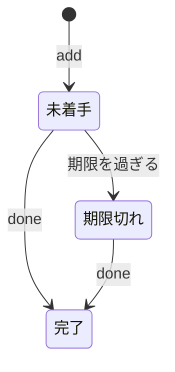
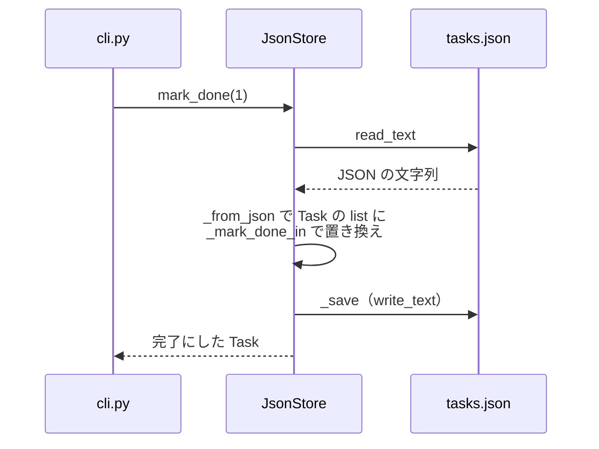
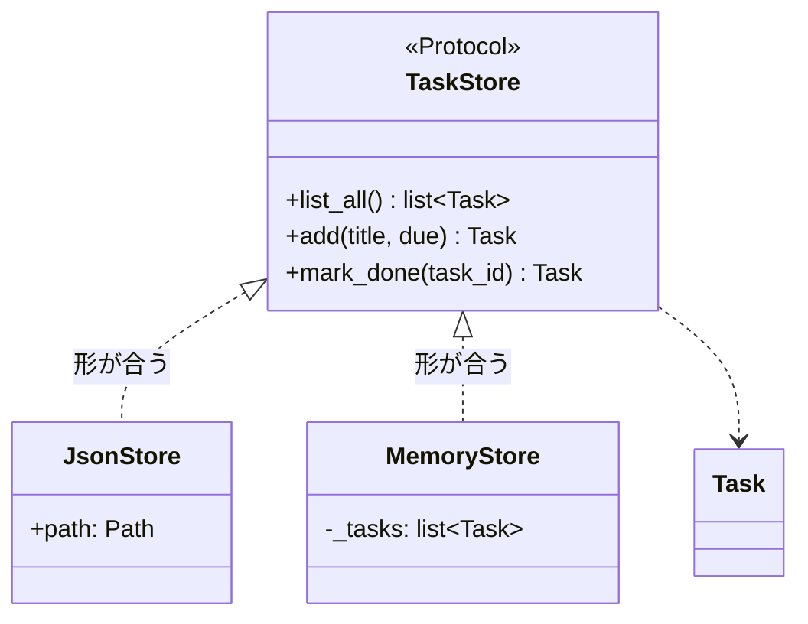
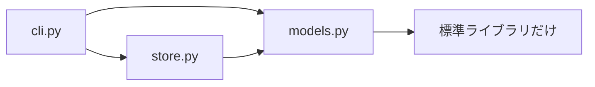
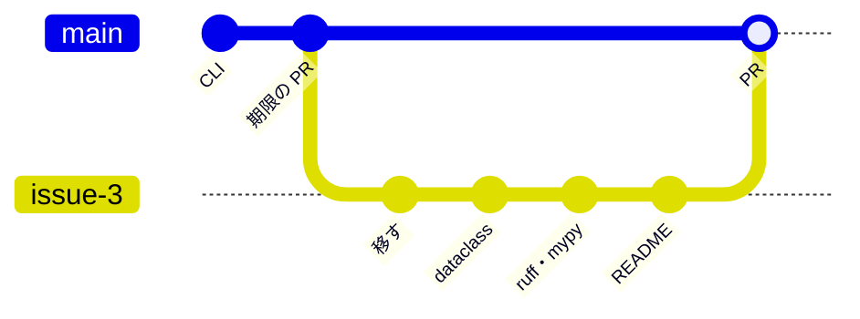

# 第7回 読みやすく壊れにくい Python
tag: python-oop, python-可読性, test-静的解析, 標準
前提タグ: python-構文, env-python, git-github
所要: 座学15分 / ハンズオン45分

## ゴール

- 1ファイルの CLI を `src/todo/` パッケージ（models・store・cli）に分け、`uv run todo` で動かせる
- `dataclass(frozen=True)` と `Enum` でタスクと状態を表し、属性の打ち間違いを実行前に mypy で見つけられる
- `typing.Protocol` で保存先の約束を書き、継承しなくても形が合えば差し替えられること（ダックタイピング）を説明できる
- ruff・mypy の設定（機械が確かめる規約）と README（人が見る規約）をリポジトリに入れ、`mise run check` が通る
- 整理を目的ごとのコミットに分け、Issue → ブランチ → PR → セルフレビュー → マージで入れられる

## 事前準備

- 第6回のハンズオンの最後（手順8のマージ）まで済み、`~/handsoff/workspace/todo-app` の main が `<Gitホスティング>` と同じ
- 遅れた人: [session-06/](../../examples/todo-app-snapshots/session-06/) を [examples/README.md](../../examples/README.md#遅れた人が追いつく方法) の手順でコピーし、push してから始める
- 社内ネットワークでは PyPI に届く（手順5の `uv add`。[open-questions.md](../open-questions.md) の Q5）

## まとめ

冒頭の座学で使います。ハンズオンでは、第6回の `todo.py` を動きを変えずに分け、ruff と mypy で確かめてから PR でマージします。

### 第6回 → 第7回

| 第6回 | 第7回 | 参照 |
| --- | --- | --- |
| `{"id": 1, "title": ..., "done": False}` | `Task(id=1, title=...)`（`dataclass`。属性の打ち間違いは mypy が指摘） | Python 公式 `dataclasses` |
| `task["done"] = True`（中身を書き換える） | `task.mark_done()` が新しい `Task` を返す（`frozen=True`、`replace`） | Python 公式 `dataclasses` |
| 文字列 `"期限切れ"` | `Status.OVERDUE`（`Enum`。取りうる値が3つに決まる） | Python 公式 `enum` |
| `load_tasks`／`save_tasks` を `main` が直接呼ぶ | `main` は `TaskStore` を満たすもの（`JsonStore`／`MemoryStore`）を受け取る | Python 公式 `typing.Protocol` |
| 1ファイル `todo.py` | `src/todo/models.py`・`store.py`・`cli.py` | SE基礎 3章 |
| `python todo.py list` | `uv run todo list`（`[project.scripts]` の `todo = "todo.cli:main"`） | uv 公式 |
| エラーの文言は関数ごと、`--due` の誤りは終了コード 2 | 文言は `models.py` の1か所にまとめる。`--due` の誤りも終了コード 1 | SE基礎 3章 |

### 用語と考え方

| 用語 | ひとことで | 参照 |
| --- | --- | --- |
| パッケージ | `__init__.py` のあるディレクトリ。`from todo.models import Task` で読める。`src/` の下に置くと、入れたものだけが import できる | uv 公式、Python 公式 チュートリアル 6.4 |
| dataclass | 属性を並べるだけで `__init__` と表示を作るクラス | Python 公式 `dataclasses` |
| イミュータブル | 作った後に変えられない。どこで変わったかを追わなくてよい | Python 公式 `dataclasses`（frozen） |
| Enum | 取りうる値を列挙した型。`Status.DONE.value` が `"完了"` | Python 公式 `enum` |
| ダックタイピング | 型（クラス）ではなく、持っているメソッド（振る舞い）で扱う | Python 公式 用語集 |
| `Protocol` | 「このメソッドを持つこと」を型にする。継承しなくても、形が合えば mypy が認める | Python 公式 `typing`、mypy 公式 |
| 早期 return（ガード節） | 例外的な場合を先に `return`／`raise` して、入れ子を浅くする | SE基礎 3章 |
| `ruff check`／`ruff format` | リント（規約違反・バグになりやすい書き方）／整形 | Ruff 公式 |
| `mypy`（strict） | 型ヒントの食い違いを実行前に見つける。型ヒントのない関数も指摘する | mypy 公式 |

### パッケージの形

| ファイル | 持つもの | 知らないこと |
| --- | --- | --- |
| `models.py` | `Status`、`Task`、`validate_title`、`parse_due`、`InvalidTaskError` | 保存先・画面 |
| `store.py` | `TaskStore`（Protocol）、`JsonStore`、`MemoryStore`、`TaskNotFoundError` | 画面・引数 |
| `cli.py` | 引数の解釈・表示・終了コード（`main(argv, store, today)`） | JSON の形 |

### 規約の置き場所

| 規約 | 置き場所 | 確かめ方 |
| --- | --- | --- |
| 書き方の形（字下げ・行の長さ・import の順・未使用・命名） | `pyproject.toml` の `[tool.ruff]` | `mise run lint`（直すのは `mise run fmt`） |
| 型（型ヒントを書く・食い違いがない） | `pyproject.toml` の `[tool.mypy]` | `mise run typecheck` |
| 名前の意味・関数の分け方・コメント（なぜ）・データの持ち方 | `README.md` の「コーディング規約」 | セルフレビュー |

### 判断の基準

| 場面 | 基準 | 参照 |
| --- | --- | --- |
| 規約を足す | 機械で確かめられるものは ruff・mypy の設定にする。README には人が見ることだけを書く | Ruff 公式、リーダブルコード |
| 指摘を黙らせる | `# noqa: F401` や `# type: ignore[...]` は、理由をコメントに書けるときだけ | Ruff 公式、mypy 公式 |
| 状態の判定 | `Task.status(today)` の1か所に置く。`cli.py` で `"期限切れ"` を組み立てない | SE基礎 3章 |
| 入力チェック | 入口（`cli.py` の `run_add`）で `validate_title`・`parse_due` を呼ぶ。文言は `models.py` に1か所（第11回の Web でも使う） | SE基礎 3章 |
| 差し替え | `main` は保存先と「今日」を引数で受け取り、省略したときだけ `JsonStore` と `date.today()` にする（第8回のテスト） | SE基礎 3章 |
| コミット | 移す・作り直す・道具を入れる・文書を書くを別のコミットにする。移すだけのコミットは動きを変えない | [研修の規約](../session05/assets/commit-convention.md) |

## ハンズオン

1ステップ1コマンド。各ステップは「🖋 やること → 📚 参考書・公式資料の節 → 📒 説明 → コマンドやコード」。作業場所は `~/handsoff/workspace/todo-app/`。見本は [session-07/](../../examples/todo-app-snapshots/session-07/)（[examples/session07/](../../examples/session07/README.md)）。

### 1. Issue を立て、todo.py をパッケージに移す（7分）

#### 🖋 Issue を立てる（ブラウザ）

📚 Pro Git 6.2 プロジェクトへの貢献

📒 第6回の PR が #2 なので、この Issue は #3 になる（GitLab では番号の付き方が違うので、出た番号を使う）

| Issue | タイトル | 目的 | 完了条件 |
| --- | --- | --- | --- |
| #3 | todo.py を読みやすく壊れにくい形に整理する | 打ち間違いを実行前に見つけ、保存先を差し替えられるようにする | `uv run todo list` が第6回と同じ表示で、`mise run check` が通る |

#### 🖋 ブランチを作る

```sh
cd ~/handsoff/workspace/todo-app
git switch main; git pull; git switch -c issue-3-package
```

#### 🖋 パッケージのディレクトリを作る

📚 Python 公式 チュートリアル 6.4 パッケージ

📒 1つのファイルを、役割ごとの3つのモジュール（`models.py`・`store.py`・`cli.py`）に分ける（→ まとめ「パッケージの形」）

```sh
mkdir -p src/todo; echo '"""TODO・タスク管理アプリ。"""' > src/todo/__init__.py
```

#### 🖋 todo.py を移す

📚 Pro Git 2.2 変更内容のリポジトリへの記録（ファイルの移動）

📒 `git mv` で移すと、Git は「名前が変わった」と記録する。中身は手順4で `cli.py` に置き換える。それまでは第6回のコードのまま動く

```plantuml
@startwbs
* todo-app
** src/todo/
*** &#95;&#95;init&#95;&#95;.py\n手順1
*** models.py\n手順2
*** store.py\n手順3
*** cli.py\n手順1で移す・手順4で置き換える
** pyproject.toml・uv.lock\n手順1・5
** mise.toml・.gitignore\n手順5
** README.md\n手順6
** tasks.json\nコミットしない
@endwbs
```



```sh
git mv todo.py src/todo/cli.py; git status --short
```

#### 🖋 pyproject.toml を書き換える

📚 uv 公式 Configuring projects（Entry points、Build systems）、The uv build backend（Modules）

📒 `package = false` を消し、パッケージとして `.venv` に入れる。`[project.scripts]` で `todo` というコマンドを作る。プロジェクト名は `todo-app` で、モジュール名 `todo` と違うので `module-name` で指定する

```toml
[project]
name = "todo-app"
version = "0.1.0"
description = "TODO・タスク管理アプリ"
# 上限も付けて 3.12 に固定する（mise を通さずにほかの Python で動かしてしまうのを防ぐ）
requires-python = ">=3.12,<3.13"
dependencies = []

# uv run todo ... で todo.cli の main() を呼ぶ
[project.scripts]
todo = "todo.cli:main"

[build-system]
requires = ["uv_build>=0.9,<0.10"]
build-backend = "uv_build"

[tool.uv.build-backend]
module-name = "todo"
```

#### 🖋 .venv に入れ直す

📚 uv 公式 Locking and syncing

📒 `pyproject.toml` を変えたので、`mise run setup`（`--locked`）は止まる（第4回の手順5）。`uv sync` で `uv.lock` を直し、`todo-app` を `.venv` に入れる

```sh
uv sync
```

#### 🖋 uv run todo で動かす

📒 `uv run todo` は `.venv/bin/todo` を動かし、それが `todo.cli` の `main()` を呼ぶ。`.venv` には `src/todo` への参照が入るので、編集はすぐ反映される

```sh
uv run todo list; uv run todo --help   # 第6回と同じ一覧。usage の名前が todo になる
```

#### 🖋 移しただけでコミットする

📒 動きを変えないコミットを先に分けておくと、後のコミットの差分が読みやすい

```sh
git add -A; git status --short; git commit -m "todo.py をパッケージ src/todo に移す" -m "uv run todo で動かし、役割ごとのモジュールに分ける準備をする。"
```

### 2. models.py: Task と Status（8分）

#### 🖋 Status と InvalidTaskError を書く

📚 Python 公式 ライブラリ `enum`、チュートリアル 8.6 ユーザー定義例外

📒 `Enum` で状態を3つに限る。`InvalidTaskError` は `ValueError` を継承し、その文言をそのまま利用者に見せる。エディタで `src/todo/models.py` を新しく作り、下を書く

```python
"""タスクと、その状態の決まり。保存先や画面には依存しない。"""

from dataclasses import dataclass, replace
from datetime import date
from enum import Enum

TITLE_MAX = 100


class Status(Enum):
    TODO = "未着手"
    DONE = "完了"
    OVERDUE = "期限切れ"  # 完了していない・期限が今日より前


class InvalidTaskError(ValueError):
    """入力が正しくない。メッセージはそのまま利用者に見せる。"""
```

#### 🖋 Task を書く

📚 Python 公式 ライブラリ `dataclasses`（frozen、`replace`）

📒 状態は保存せず、`today` と比べてその都度決める。完了したタスクは期限切れにならない

```python
@dataclass(frozen=True)
class Task:
    """タスク1件。frozen=True なので作った後は変えられない（変えるときは新しく作る）。"""

    id: int
    title: str
    due: date | None = None
    done: bool = False

    def status(self, today: date) -> Status:
        if self.done:
            return Status.DONE  # 完了したものは期限切れにならない
        if self.due is not None and self.due < today:
            return Status.OVERDUE
        return Status.TODO

    def mark_done(self) -> "Task":
        """完了にしたタスクを返す（自分自身は変えない）。"""
        return replace(self, done=True)
```

#### 🖋 入力チェックを書く

📚 SE基礎 3章 コードを書く

📒 タイトルと期限の決まりと文言を、この2つの関数に集める。どちらも、先に例外の場合を `raise` する（ガード節）

```python
def validate_title(raw: str) -> str:
    """前後の空白を除いたタイトルを返す。1〜100文字でなければ InvalidTaskError。"""
    title = raw.strip()
    if not title:
        raise InvalidTaskError("タイトルを入力してください")
    if len(title) > TITLE_MAX:
        raise InvalidTaskError(f"タイトルは{TITLE_MAX}文字以内で入力してください")
    return title


def parse_due(raw: str) -> date | None:
    """期限の文字列（YYYY-MM-DD）を日付にする。空なら期限なし（None）。"""
    raw = raw.strip()
    if not raw:
        return None
    try:
        return date.fromisoformat(raw)
    except ValueError:
        raise InvalidTaskError("期限は YYYY-MM-DD の形で入力してください") from None
```

#### 🖋 Task を作って変えてみる

📒 `frozen=True` なので、属性に代入すると `FrozenInstanceError` になる。変えるときは `replace` で新しい `Task` を作る

```sh
uv run python -c "from todo.models import Task; t = Task(id=1, title='牛乳を買う'); print(t); t.done = True"
```

#### 🖋 状態を確かめる

📒 状態は保存しない。同じタスクでも、渡す日付で状態が変わる



```sh
uv run python -c "from datetime import date; from todo.models import Task; t = Task(1, 'レポート', due=date(2026, 4, 1)); print(t.status(date(2026, 3, 1)), t.status(date(2026, 10, 1)), t.mark_done().status(date(2026, 10, 1)))"
```

- 確認: `Status.TODO Status.OVERDUE Status.DONE`

#### 🖋 入力チェックを確かめる

```sh
uv run python -c "from todo.models import validate_title; print(repr(validate_title('  牛乳を買う  '))); validate_title('   ')"
```

- 確認: `'牛乳を買う'` の後に `InvalidTaskError: タイトルを入力してください`

### 3. store.py: Protocol で保存先を約束する（8分）

#### 🖋 素材をコピーして JsonStore を読む

📚 Python 公式 ライブラリ `typing`（Protocol）、用語集（ダックタイピング）

📒 `JsonStore` は第6回の `load_tasks`・`save_tasks` の役割を引き継ぐ。`_from_json` は、古いタスクに `due` のキーがなくても読める

```sh
cp ~/handsoff/docs/session07/assets/store.py src/todo/store.py; less src/todo/store.py
```

#### 🖋 JsonStore の流れを追う

📒 `JsonStore` は呼ばれるたびにファイルを読み、変えたリストを丸ごと書き直す。探して置き換える処理は `_mark_done_in` にまとめ、`MemoryStore` と共有する



#### 🖋 TaskStore を書く

📚 mypy 公式 Protocols and structural subtyping

📒 `Protocol` には、保存先が持つべきメソッドの形だけを書く。中身は `...` でよい。「手順3: ここに TaskStore」のコメントの行を置き換える

```python
class TaskStore(Protocol):
    def list_all(self) -> list[Task]:
        """全タスクを id の順に返す。"""
        ...

    def add(self, title: str, due: date | None) -> Task:
        """新しい id を付けて保存し、保存したタスクを返す。"""
        ...

    def mark_done(self, task_id: int) -> Task:
        """完了にして返す。なければ TaskNotFoundError。"""
        ...
```

#### 🖋 MemoryStore を書く

📒 メモリに持つだけの保存先。`TaskStore` を継承しないが、同じ3つのメソッドを持つ。「手順3: ここに MemoryStore」のコメントの行を置き換える



```python
class MemoryStore:
    """メモリに持つだけの保存先。プログラムが終わると消える（テスト用）。"""

    def __init__(self, tasks: list[Task] | None = None) -> None:
        self._tasks = list(tasks or [])

    def list_all(self) -> list[Task]:
        return list(self._tasks)

    def add(self, title: str, due: date | None) -> Task:
        task = Task(id=_next_id(self._tasks), title=title, due=due)
        self._tasks.append(task)
        return task

    def mark_done(self, task_id: int) -> Task:
        self._tasks, done = _mark_done_in(self._tasks, task_id)
        return done
```

#### 🖋 2つの保存先で同じ操作をする

📒 `MemoryStore` はファイルを作らない。`JsonStore` は第6回の `tasks.json` をそのまま `Task` のリストにする

```sh
uv run python -c "from todo.store import MemoryStore; s = MemoryStore(); s.add('牛乳を買う', None); s.mark_done(1); print(s.list_all())"
uv run python -c "from pathlib import Path; from todo.store import JsonStore; print(JsonStore(Path('tasks.json')).list_all())"
```

> 座学: `JsonStore` も `MemoryStore` も `TaskStore` を継承していない。それでも `TaskStore` として渡せる理由（→ まとめ「用語と考え方」）

### 4. cli.py を置き換える（6分）

#### 🖋 素材で cli.py を置き換える

📚 SE基礎 2章 コードを読む

📒 `cli.py` は `models` と `store` を使い、`models` はほかのモジュールを使わない。依存は一方向で、`cli.py` は JSON の形を知らない



```sh
cp ~/handsoff/docs/session07/assets/cli.py src/todo/cli.py; git diff --stat
```

#### 🖋 main を読む

📒 `main` は保存先と「今日」を引数で受け取る。省略すると `JsonStore` と `date.today()` を使う。第8回のテストでは `MemoryStore` と固定の日付を渡す

```sh
less src/todo/cli.py   # main と run_list の早期 return を読む。q で終わる
```

#### 🖋 前と同じ一覧が出るか確かめる

```sh
uv run todo list; uv run todo list --overdue
```

- 確認: 手順1の `uv run todo list` と同じ表示

#### 🖋 エラーの出方を確かめる

📒 エラーの文言は `models.py` で決めたものになる。`--due` は `cli.py` で `parse_due` を呼ぶので、形の誤りも終了コード 1 になる

```sh
uv run todo add "   "; echo $?                 # タイトルを入力してください / 1
uv run todo add "テスト" --due 2026/11/1; echo $?   # 期限は YYYY-MM-DD の形で入力してください / 1
uv run todo done 99; echo $?                    # タスクが見つかりません: 99 / 1
```

#### 🖋 作り直しをコミットする

```sh
git add src; git commit -m "タスクを dataclass に、保存先を Protocol にする" -m "dict のキーの打ち間違いを実行前に見つけ、保存先を差し替えられるようにする。"
```

### 5. ruff と mypy で確かめる（9分）

#### 🖋 開発用の道具を入れる

📚 uv 公式 Managing dependencies（Development dependencies）

📒 `--dev` で入れたものは、アプリの実行には要らない開発用の依存（`[dependency-groups]` の `dev`）になる

```sh
uv add --dev ruff mypy
```

#### 🖋 キャッシュを .gitignore に足す

📒 ruff と mypy は、結果のキャッシュをリポジトリの中に作る。見本の `.gitignore` は、第6回のものに2行を足したもの

```sh
cp ~/handsoff/examples/todo-app-snapshots/session-07/.gitignore .; git diff .gitignore
```

#### 🖋 規約を pyproject.toml に書く

📚 Ruff 公式 Configuring Ruff・Rules、mypy 公式 The mypy command line（--strict）、PEP 8

📒 `select` のルールには、1行ずつ選んだ理由をコメントで書く。`pyproject.toml` の末尾に足す

```toml
# ---- コーディング規約（自動で確かめられるものは ruff と mypy に任せる） ----

[tool.ruff]
line-length = 100
target-version = "py312"

[tool.ruff.lint]
select = [
    "E",    # pycodestyle（PEP 8 の書き方）
    "W",    # pycodestyle の警告
    "F",    # pyflakes（未使用の import・変数など）
    "I",    # import の並び順
    "N",    # 命名規則（pep8-naming）
    "UP",   # 新しい書き方への置き換え（pyupgrade）
    "B",    # バグになりやすい書き方（flake8-bugbear）
    "SIM",  # もっと簡単に書ける箇所
    "E722", # 例外の種類を書かない except（握りつぶし）
]

[tool.mypy]
python_version = "3.12"
# 型ヒントのない関数や Any の混入も指摘する
strict = true
files = ["src"]
```

#### 🖋 確かめるタスクを mise.toml に書く

📚 mise 公式 Tasks

📒 `check` は `lint` と `typecheck` の両方を動かす。PR を出す前に必ず通す。`mise.toml` の末尾に足す

```toml
[tasks.lint]
description = "ruff でリントとフォーマットを確かめる"
run = ["ruff check .", "ruff format --check ."]

[tasks.fmt]
description = "ruff でフォーマットし、直せるリントを直す"
run = ["ruff format .", "ruff check --fix ."]

[tasks.typecheck]
description = "mypy で型を確かめる"
run = "mypy"

[tasks.check]
description = "PR を出す前の確認（リント・型）"
depends = ["lint", "typecheck"]
```

#### 🖋 check を通す

```sh
mise run check
```

- 確認: `All checks passed!` と `Success: no issues found`。指摘が出たら `mise run fmt` の後にもう一度

#### 🖋 わざと属性を打ち間違える

📒 dict の `task["titel"]` は、その行を実行したときに初めて `KeyError` になる。dataclass の `task.titel` は、実行する前に mypy が見つける

```sh
sed -i 's/{task.title}{due}/{task.titel}{due}/' src/todo/cli.py; mise run typecheck   # "Task" has no attribute "titel"; maybe "title"?
git restore src/todo/cli.py
```

#### 🖋 JsonStore のメソッドの名前を変えてみる

📒 `JsonStore` の `mark_done` だけを `finish` にすると、`TaskStore` の形に合わなくなる。`list` は動くので、mypy がなければ `done` を打つまで気づかない

```sh
sed -i '/^class JsonStore/,$ s/def mark_done(/def finish(/' src/todo/store.py; mise run typecheck   # cli.py の store に JsonStore を渡せない
uv run todo done 1                                  # AttributeError: 'JsonStore' object has no attribute 'mark_done'
git restore src/todo/store.py
```

#### 🖋 使っていない import を足して ruff に直させる

📒 未使用の import（F401）と並び順（I001）は、`mise run fmt` が直す。直せないものは指摘だけが残る

```sh
sed -i 's/^from enum import Enum/from enum import Enum\nimport os/' src/todo/models.py; mise run lint   # I001 と F401
mise run fmt; git diff src   # 差分なし（元に戻った）
```

#### 🖋 道具と規約をコミットする

📒 `.mypy_cache/` と `.ruff_cache/` は `git status` に出ない

```sh
git status --short; git add -A; git commit -m "ruff と mypy でコーディング規約と型を確かめる" -m "形と型は機械に任せ、レビューでは名前と分け方を見る。"
```

### 6. README に人が見る規約を書く（3分）

#### 🖋 見本の README をコピーして読む

📚 SE基礎 3章 コードを書く、PEP 8（命名規約）

📒 README には、開発環境・使い方・コードの構成と、ruff・mypy では確かめられない規約を書く。自分の決まりがあれば「コーディング規約」の表に足す

```sh
cp ~/handsoff/examples/todo-app-snapshots/session-07/README.md .; less README.md
```

#### 🖋 README をコミットする

```sh
git add README.md; git commit -m "README に開発環境・使い方・コーディング規約を書く"
```

### 7. PR を出し、セルフレビューしてマージする（4分）

#### 🖋 push する

📚 Pro Git 3.5 リモートブランチ

```sh
git log --oneline main..; git push -u origin issue-3-package
```

#### 🖋 PR を作り、セルフレビューする（ブラウザ）

📚 SE基礎 2章 コードを読む、3章 コードを書く

📒 本文は[テンプレート](../templates/pull_request.md)で書き、変更点に「変えたこと（エラーの文言・終了コード）」と「変えていないこと（一覧の表示・`tasks.json` の形）」を分けて書く。差分を他人のつもりで読み、`[確認]` の行コメントを1件以上残す（見本: [examples/session07/pr-description.md](../../examples/session07/pr-description.md)）

#### 🖋 マージして手元の main をそろえる

📒 1本の PR に、目的の違う4つのコミットが並ぶ。図ではブランチ名を `issue-3` と略す



```sh
git switch main; git pull; git branch -d issue-3-package; mise run check; uv run todo list
```

- 確認: Issue #3 が Closed。main で `mise run check` が通る

## 読む章

| 区分 | 資料 | 範囲 | 読み方 |
| --- | --- | --- | --- |
| 参考書 | [ソフトウェアエンジニアリングの基礎](https://www.oreilly.co.jp/books/9784814401789/)（SE基礎） | 2章 コードを読む、3章 コードを書く | 通読 |
| 無料 | [Python 公式ドキュメント](https://docs.python.org/ja/3/) | チュートリアル 6.4 パッケージ、ライブラリ `dataclasses`・`enum`・`typing`（Protocol）、用語集（ダックタイピング） | 該当章 |
| 無料 | [PEP 8](https://pep8-ja.readthedocs.io/)・[Ruff](https://docs.astral.sh/ruff/)・[mypy](https://mypy.readthedocs.io/) 公式 | PEP 8 の命名規約／Ruff の Configuring Ruff とルール一覧／mypy の Protocols and structural subtyping、`--strict` | 該当章（ルールは困ったときに引く） |
| 無料 | [uv 公式ドキュメント](https://docs.astral.sh/uv/) | Configuring projects（Entry points、Build systems）、The uv build backend、Managing dependencies（Development dependencies） | 引く |
| 紹介（副読本） | [Effective Python 第2版](https://www.oreilly.co.jp/books/9784873119175) | 5章 クラスと継承、10章 項目90 静的解析 | 持っている人は該当章 |
| 紹介（副読本） | [リーダブルコード](https://www.oreilly.co.jp/books/9784873115658/) | 2〜6章 名前とコメント、7〜9章 制御フローと変数 | 持っている人は通読 |
