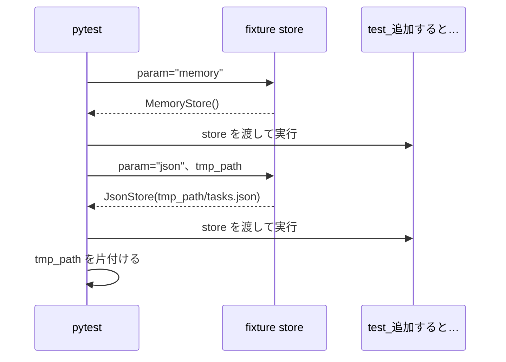
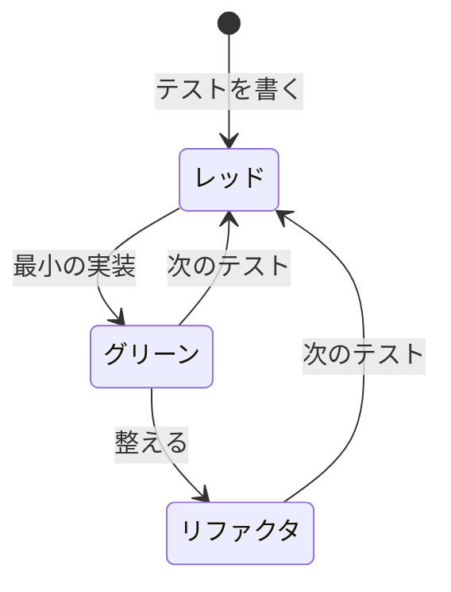

# 第8回 テストと TDD
tag: test-自動, test-CI
前提タグ: python-oop, test-静的解析, git-github
所要: 座学15分 / ハンズオン45分

## ゴール

- pytest の `assert`・`parametrize`・fixture・`tmp_path`・`capsys` でテストを書き、失敗の表示を読める
- 機能を足す前に、今の動作をテストで固定できる
- 「期限が近い順に並べる」をレッド → グリーン → リファクタリングの順で足し、テストと実装のコミットを分けられる
- push のたびに ruff・mypy・pytest を GitHub Actions で動かし、CI が通ってから PR をマージできる

## 事前準備

- 第7回のハンズオンの最後（手順7のマージ）まで済み、`~/handsoff/workspace/todo-app` の main で `mise run check` が通る
- 遅れた人: [session-07/](../../examples/todo-app-snapshots/session-07/) を [examples/README.md](../../examples/README.md#遅れた人が追いつく方法) の手順でコピーし、push してから始める
- アプリのリポジトリで GitHub Actions が使える（[open-questions.md](../open-questions.md) の Q11。GitLab は Q4）。社内ネットワークでは PyPI に届く（手順1の `uv add`。Q5）

## まとめ

冒頭の座学で使います。ハンズオンでは、今の動作をテストで固定し、CI を置いてから、「期限が近い順に並べる」をテストを先に書いて足します。

### テストの種類

| 種類 | このアプリでは | 速さ・数 | 参照 |
| --- | --- | --- | --- |
| 単体テスト | `test_models.py`・`test_sort.py`（関数1つ。ファイルも日付も使わない） | 速い。一番多く書く | SE基礎 5章 |
| 結合テスト | `test_store.py`（`JsonStore` が本当にファイルに書く）、`test_cli.py`（`main` から保存先まで通す） | 少し遅い | SE基礎 5章 |
| E2E テスト | 第11回の `test_web.py`（HTTP で画面まで） | 遅い。少なく | SE基礎 5章 |

### pytest の書き方

| 書き方 | 意味 | 参照 |
| --- | --- | --- |
| `tests/test_*.py` の `def test_*():` | テストとして集められる。`mise run test`（`uv run pytest -v` で1件ずつ、`-k 語` で名前を絞る） | pytest 公式 Get Started |
| `assert 実際 == 期待` | 失敗すると、両辺の値と違う所を表示する | pytest 公式 assertions |
| `with pytest.raises(例外, match="文言"):` | 例外が出ることと、その文言を確かめる | pytest 公式 assertions |
| `@pytest.mark.parametrize` | 同じテストを、入力と期待の組ごとに別のテストとして動かす | pytest 公式 parametrize |
| `@pytest.fixture` | 準備を関数にし、テストは引数名で受け取る。`params=` で準備ごとに繰り返す | pytest 公式 fixtures |
| `tmp_path` | テストごとに新しい空の一時ディレクトリ（`Path`） | pytest 公式 tmp_path |
| `capsys` | `print` の出力を受け取る（`capsys.readouterr().out`・`.err`） | pytest 公式 capture |

### テストしやすい形

| 形 | このアプリでは | 参照 |
| --- | --- | --- |
| 判定を関数に分ける | `Task.status(today)`、`sort_by_due(tasks)` | SE基礎 5章 |
| 「今日」と保存先を外から渡す | `main(argv, store=MemoryStore(...), today=date(2026, 11, 1))`（第7回の手順4） | SE基礎 5章 |
| 同じテストを保存先ごとに | `MemoryStore` と `tmp_path` の `JsonStore`。両方で通れば、どちらも `TaskStore` の約束を守っている | SE基礎 5章 |
| 境目をテストにする | 期限の当日・期限なし・同じ期限。間違いは境目に出やすい | SE基礎 5章 |
| テスト名で仕様を書く | `test_期限なしは最後に並べる`（日本語でよい） | リーダブルコード 14章 |

### TDD

| 決まり | 理由・やり方 | 参照 |
| --- | --- | --- |
| レッド → グリーン → リファクタリング | テストを書いて失敗を見る → 通る最小の実装 → 通ったまま整える | SE基礎 5章 |
| 先に失敗を見る | 最初から通るテストは、何も確かめていないことがある | SE基礎 5章 |
| グリーンは一番簡単な実装でよい | 次のテストで本物に近づける（三角測量） | SE基礎 5章 |
| コミットを分け、1行目の頭に `テスト:` `レッド:` `グリーン:` `リファクタ:` | PR の履歴で順序を追える。テストと実装は別々に `git add` する | [研修の規約](../session05/assets/commit-convention.md) |

並び順の仕様: 期限が近い順、期限なしは最後、期限が同じなら id の順

### CI

| 項目 | 内容 | 参照 |
| --- | --- | --- |
| CI | push・PR のたびに、GitHub の用意した PC で `mise run setup` と `mise run check` を動かす | SE基礎 10章 |
| 置き場所 | `.github/workflows/check.yml`（GitLab は `.gitlab-ci.yml` に読み替え） | GitHub Actions 公式、mise 公式 |
| 判断 | CI が赤の PR はマージしない。ログの失敗した行を読み、手元の `mise run check` で再現して直す | SE基礎 10章 |

## ハンズオン

1ステップ1コマンド。各ステップは「🖋 やること → 📚 参考書・公式資料の節 → 📒 説明 → コマンドやコード」。作業場所は `~/handsoff/workspace/todo-app/`。見本は [session-08/](../../examples/todo-app-snapshots/session-08/)（[examples/session08/](../../examples/session08/README.md)）。

### 1. Issue とブランチを作り、pytest を入れる（5分）

#### 🖋 Issue を立てる（ブラウザ）

📚 Pro Git 6.2 プロジェクトへの貢献

📒 第7回の PR が #4 なので、この Issue は #5 になる（GitLab では出た番号を使う）

| Issue | タイトル | 目的 | 完了条件 |
| --- | --- | --- | --- |
| #5 | 一覧を期限が近い順に並べる | 締め切りの近いタスクを先に見る。今の動作をテストで固定し、push のたびに自動で確かめる | `uv run todo list` が期限が近い順（期限なしは最後）。`mise run check` が手元と CI で通る |

#### 🖋 ブランチを作る

```sh
cd ~/handsoff/workspace/todo-app
git switch main; git pull; git switch -c issue-5-sort
```

#### 🖋 pytest を入れる

📚 SE基礎 5章 自動テスト、uv 公式 Managing dependencies（Development dependencies）

📒 速い単体テストを多く書き、遅いテストは少なくする。今日は単体と結合を書く（第11回で E2E）

```sh
uv add --dev pytest
```

#### 🖋 キャッシュを .gitignore に足す

📒 pytest は `.pytest_cache/` を作る。見本の `.gitignore` は、第7回のものに1行を足したもの

```sh
cp ~/handsoff/examples/todo-app-snapshots/session-08/.gitignore .; git diff .gitignore
```

#### 🖋 pytest と ruff・mypy の設定を書く

📚 pytest 公式 Configuration、Ruff 公式 Configuring Ruff（per-file-ignores）

📒 テストは `tests/` に置く。テスト名の日本語を命名規則（N802）が指摘するので、`tests/` だけ外す。mypy はテストの型も確かめる。`[tool.mypy]` の `files` を `["src", "tests"]` に変え、`pyproject.toml` の末尾に下を足す

```toml
[tool.ruff.lint.per-file-ignores]
# テスト関数名には確かめたいことを日本語で書く。N802 は英小文字以外を指摘するため外す
"tests/**" = ["N802"]

[tool.pytest.ini_options]
testpaths = ["tests"]
```

#### 🖋 test タスクを mise.toml に足す

📚 mise 公式 Tasks

📒 `check` に `test` を足す。PR を出す前の確認が、リント・型・テストの3つになる。`[tasks.check]` を書き換え、`[tasks.test]` を末尾に足す

```toml
[tasks.check]
description = "PR を出す前の確認（リント・型・テスト）"
depends = ["lint", "typecheck", "test"]

[tasks.test]
description = "自動テスト（pytest）"
run = "pytest"
```

#### 🖋 テストがないときの結果を見る

📒 テストが1件もないと、pytest は `no tests ran` で失敗する（終了コード 5）。テストを書き忘れたまま「通った」ことにはならない

```sh
mkdir tests; mise run test
```

### 2. assert と parametrize（7分）

#### 🖋 状態のテストを書く

📚 pytest 公式 How to parametrize fixtures and test functions、How to write and report assertions in tests

📒 1つのテスト関数が、組の数（6つ）だけ別のテストとして動く。エディタで `tests/test_models.py` を新しく作り、下を書く

```python
"""タスクの状態と入力チェック（models.py）。"""

from datetime import date

import pytest

from todo.models import InvalidTaskError, Status, Task, validate_title

TODAY = date(2026, 11, 1)


@pytest.mark.parametrize(
    ("due", "done", "expected"),
    [
        (None, False, Status.TODO),  # 期限なし
        (date(2026, 11, 2), False, Status.TODO),  # 期限は明日
        (TODAY, False, Status.TODO),  # 期限の当日はまだ期限切れではない
        (date(2026, 10, 31), False, Status.OVERDUE),  # 期限は昨日
        (date(2026, 10, 31), True, Status.DONE),  # 完了したものは期限切れにならない
        (None, True, Status.DONE),
    ],
)
def test_状態は完了と期限と今日で決まる(due: date | None, done: bool, expected: Status) -> None:
    task = Task(id=1, title="牛乳を買う", due=due, done=done)

    assert task.status(TODAY) is expected
```

#### 🖋 例外のテストを書く

📒 `pytest.raises` の中で例外が出なければ、テストは失敗する。`match` で文言も確かめる。同じファイルの末尾に足す

```python
@pytest.mark.parametrize("title", ["", "   "])
def test_タイトルが空ならエラー(title: str) -> None:
    with pytest.raises(InvalidTaskError, match="タイトルを入力してください"):
        validate_title(title)
```

#### 🖋 テストを動かす

```sh
mise run test; uv run pytest -v   # 8 passed。-v では組ごとに [due1-False-Status.TODO] のような名前が付く
```

#### 🖋 わざと壊して、失敗の表示を読む

📒 期限の当日（境目）を間違えると、当日の組だけが落ちる。`>` の行が落ちた `assert`、`E` の行が実際の値と期待の値。読んだら元に戻す

```sh
sed -i 's/self.due < today/self.due <= today/' src/todo/models.py; mise run test
git restore src/todo/models.py
```

- 確認: `FAILED tests/test_models.py::test_状態は完了と期限と今日で決まる[due2-False-Status.TODO]` と `assert <Status.OVERDUE: '期限切れ'> is <Status.TODO: '未着手'>`

> 座学: 失敗の表示のどこを見るか。境目のテストがなければ、この間違いに気づけたか（→ まとめ「テストしやすい形」）

### 3. fixture と tmp_path（6分）

#### 🖋 保存先のテストをコピーする

📚 pytest 公式 How to use fixtures（Parametrizing fixtures）、How to use temporary directories and files in tests

📒 テストは引数名 `store` で fixture を受け取る。`params` が2つなので、各テストが `MemoryStore` と `JsonStore` で1回ずつ動く。`tmp_path` はテストごとに新しい空のディレクトリで、手元の `tasks.json` には触れない



```sh
cp ~/handsoff/docs/session08/assets/test_store.py tests/; less tests/test_store.py
```

#### 🖋 保存先ごとに動くのを見る

📒 同じテストが両方で通れば、どちらも `TaskStore` の約束（`list_all`・`add`・`mark_done`）を守っている

```sh
uv run pytest -v tests/test_store.py   # [memory] と [json] が並ぶ
```

#### 🖋 「最初は空」のテストを書く

📒 「手順3: ここに test_最初は空 を書く」のコメントの行を置き換える。fixture を使うので、これも2回動く

```python
def test_最初は空(store: TaskStore) -> None:
    assert store.list_all() == []
```

```sh
mise run test   # 18 passed
```

> 座学: `JsonStore` のテストが手元の `tasks.json` を書き換えない理由と、`MemoryStore` と同じテストが通る意味（→ まとめ「テストしやすい形」）

### 4. CLI の動作を固定する（5分）

#### 🖋 CLI のテストをコピーして読む

📚 pytest 公式 How to capture stdout/stderr output

📒 `run` は `main` に `MemoryStore` と固定の「今日」（2026-11-01）を渡す。表示は `capsys` で受け取って比べる

```sh
cp ~/handsoff/docs/session08/assets/test_cli.py tests/; less tests/test_cli.py
```

#### 🖋 ない番号の done のテストを書く

📒 「手順4: ここに test_doneでない番号なら終了コード1 を書く」の行を置き換える。エラーは標準エラー出力なので `.err` を見る

```python
def test_doneでない番号なら終了コード1(
    store: MemoryStore, capsys: pytest.CaptureFixture[str]
) -> None:
    assert run(store, "done", "9") == 1

    assert "タスクが見つかりません: 9" in capsys.readouterr().err
```

#### 🖋 check を通す

```sh
mise run check   # 24 passed。指摘が出たら mise run fmt の後にもう一度
```

#### 🖋 テストをコミットする

📒 動作は変えていないので `テスト:` を付ける。この後の変更で今の動作を壊すと、このテストが落ちる

```sh
git status --short; git add .gitignore pyproject.toml uv.lock mise.toml tests; git commit -m "テスト: 今の動作をテストで固定する" -m "期限の順に並べる機能を足す前に、add・list・done と保存先の今の動きを確かめておく。"
```

### 5. CI を置いて push する（5分）

#### 🖋 ワークフローをコピーして読む

📚 GitHub Actions 公式 ワークフロー構文、mise 公式 Continuous Integration

📒 GitHub の用意した PC で、手元と同じ `mise run setup` と `mise run check` を動かす。`mise-action` が `mise.toml` の Python と uv を入れる

```sh
cp -r ~/handsoff/examples/todo-app-snapshots/session-08/.github .; less .github/workflows/check.yml
```

```yaml
name: check
on:
  push:
  pull_request:
jobs:
  check:
    runs-on: ubuntu-latest
    env:
      MISE_TRUSTED_CONFIG_PATHS: ${{ github.workspace }}   # mise trust に当たる
    steps:
      - uses: actions/checkout@v5
      - uses: jdx/mise-action@v3   # mise.toml の Python・uv を入れる
        with:
          version: 2026.10.7
      - run: mise run setup        # uv.lock どおりに入れる
      - run: mise run check        # ruff・mypy・pytest
```

#### 🖋 コミットして push する

📚 SE基礎 10章 本番環境へ

📒 push すると、GitHub がワークフローを動かす。結果は数分で出るので、待たずに手順6へ進む

```sh
git add .github; git commit -m "PR ごとに mise run check を GitHub Actions で実行する"; git push -u origin issue-5-sort
```

### 6. TDD: 期限が近い順に並べる（10分）

#### 🖋 レッド: 最初のテストを書く

📚 SE基礎 5章 自動テスト

📒 `sort_by_due` はまだない。エディタで `tests/test_sort.py` を新しく作り、下を書く



```python
"""期限が近い順に並べる（第8回に TDD で足した機能）。"""

from datetime import date

from todo.models import Task, sort_by_due


def test_期限が近い順に並べる() -> None:
    tasks = [
        Task(id=1, title="a", due=date(2026, 11, 3)),
        Task(id=2, title="b", due=date(2026, 11, 1)),
        Task(id=3, title="c", due=date(2026, 11, 2)),
    ]

    assert [t.id for t in sort_by_due(tasks)] == [2, 3, 1]
```

#### 🖋 失敗を見て、レッドを push する

📒 `ImportError: cannot import name 'sort_by_due'` で落ちれば、テストが本当に `sort_by_due` を確かめている。テストのファイルだけをコミットし、CI が赤になるのも見る

```sh
mise run test; git add tests/test_sort.py; git commit -m "レッド: 期限が近い順に並べるテスト"; git push
```

#### 🖋 グリーン: 一番簡単な実装

📒 `models.py` の `Task` クラスの後に足す。期限なしのことはまだ考えない

```python
def sort_by_due(tasks: list[Task]) -> list[Task]:
    """期限が近い順に並べる。"""
    return sorted(tasks, key=lambda t: t.due)
```

```sh
mise run test; git add src; git commit -m "グリーン: 期限の順に並べる最小の実装"   # 25 passed
```

#### 🖋 Actions の結果を見る（ブラウザ）

📚 GitHub Actions 公式 ワークフロー実行ログの使用

📒 リポジトリの Actions タブを開く。手順5の push は緑、レッドの push は赤で、ログの `mise run check` に手元と同じ `ImportError` が出ている

#### 🖋 mypy の指摘を見る

📒 テストは通ったが、mypy は `t.due` が `None` のときに比べられないことを指摘する。次のテストで確かめる

```sh
mise run typecheck   # Argument "key" to "sorted" has incompatible type "Callable[[Task], date | None]" ...
```

#### 🖋 レッド: 期限なしのテストを書く

📒 `test_sort.py` の末尾に足す。`TypeError: '<' not supported between instances of 'datetime.date' and 'NoneType'` で落ちる

```python
def test_期限なしは最後に並べる() -> None:
    tasks = [
        Task(id=1, title="a"),
        Task(id=2, title="b", due=date(2026, 12, 31)),
    ]

    assert [t.id for t in sort_by_due(tasks)] == [2, 1]
```

```sh
mise run test; git add tests/test_sort.py; git commit -m "レッド: 期限なしは最後に並べるテスト"
```

#### 🖋 グリーン: 期限なしを最後にする

📒 キーをタプル `(期限なしか, 期限)` にする。`False < True` なので期限ありが先。`t.due or date.min` は、期限なしでも比べられるようにするための値

```python
    return sorted(tasks, key=lambda t: (t.due is None, t.due or date.min))
```

```sh
mise run check; git add src; git commit -m "グリーン: 期限なしを最後にする"   # mypy の指摘も消える
```

#### 🖋 レッド: 同じ期限のテストを書く

📒 期限が同じものは元の並び（3 → 1）のまま残り、`assert [3, 1, 4, 2] == [1, 3, 2, 4]` で落ちる。テストを足すたびに、キーが本物に近づく（三角測量）

```python
def test_期限が同じなら番号の順() -> None:
    tasks = [
        Task(id=3, title="c", due=date(2026, 11, 1)),
        Task(id=1, title="a", due=date(2026, 11, 1)),
        Task(id=4, title="d"),
        Task(id=2, title="b"),
    ]

    assert [t.id for t in sort_by_due(tasks)] == [1, 3, 2, 4]
```

```sh
mise run test; git add tests/test_sort.py; git commit -m "レッド: 期限が同じなら番号の順のテスト"
```

#### 🖋 グリーン: キーに id を足す

📒 タプルは前の要素から順に比べ、同じなら次の要素で比べる。`(False, 11/1, 1)` → `(False, 11/1, 3)` → `(True, min, 2)` → `(True, min, 4)` の順になる。`sort_by_due` を下に置き換える

```python
def sort_by_due(tasks: list[Task]) -> list[Task]:
    """期限が近い順に並べる。期限なしは最後、期限が同じなら id の順。"""
    # タプルは前の要素から順に比べる: (期限なしか, 期限, id)。False < True なので期限ありが先
    return sorted(tasks, key=lambda t: (t.due is None, t.due or date.min, t.id))
```

```sh
mise run test; git add src; git commit -m "グリーン: 期限が同じなら番号の順にする"   # 27 passed
```

#### 🖋 リファクタ: テストの重複をまとめる

📒 3つのテストに同じ `[t.id for t in ...]` がある。`ids` にまとめ、テストが通ったままであることを確かめる。`import` の下に関数を足し、3か所を `ids(sort_by_due(tasks))` に置き換える

```python
def ids(tasks: list[Task]) -> list[int]:
    return [t.id for t in tasks]
```

```sh
mise run check; git commit -am "リファクタ: テストの番号の取り出しを ids にまとめる"
```

> 座学: 最小の実装で最初のテストが通ってしまったこと。次のテストと mypy で気づいたこと（→ まとめ「TDD」）

### 7. TDD: 一覧を期限が近い順に表示する（4分）

#### 🖋 レッド: list のテストを書く

📒 `tests/test_cli.py` の「手順7: ここに …」の行を置き換える。今は id の順（1 → 2 → 3）に出るので落ちる

```python
def test_listは期限が近い順に表示する(
    store: MemoryStore, capsys: pytest.CaptureFixture[str]
) -> None:
    assert run(store, "list") == 0

    assert capsys.readouterr().out.splitlines() == [
        "  2 [期限切れ] 牛乳を買う（期限 2026-10-30）",
        "  1 [未着手] レポートを出す（期限 2026-11-05）",
        "  3 [未着手] 本を返す",
    ]
```

```sh
mise run test; git add tests/test_cli.py; git commit -m "レッド: list を期限が近い順に表示するテスト"
```

#### 🖋 グリーン: run_list で並べる

📒 `cli.py` の `from todo.models import ...` に `sort_by_due` を足し、`run_list` の1行目を置き換える。期限切れだけの表示も、並べた後に絞るので同じ順になる

```python
    tasks = sort_by_due(store.list_all())
```

```sh
mise run check; git add src; git commit -m "グリーン: list を期限が近い順に表示する"   # 28 passed
uv run todo list
```

### 8. PR を出し、CI が通ってからマージする（4分）

#### 🖋 README を更新する

📒 見本の README は、`mise run check` にテストが入ったこと、CI、`tests/`、テストの規約を足したもの

```sh
cp ~/handsoff/examples/todo-app-snapshots/session-08/README.md .; git diff README.md; git add README.md; git commit -m "README にテストと CI を書く"
```

#### 🖋 履歴を確かめて push する

📒 テスト → CI → レッドとグリーンの繰り返し → リファクタ → README の順に並ぶ

```sh
git log --oneline main..; git push
```

#### 🖋 PR を作り、セルフレビューする（ブラウザ）

📚 SE基礎 2章 コードを読む、10章 本番環境へ

📒 本文は[テンプレート](../templates/pull_request.md)で書き、目的に `Closes #5`、確認方法に `mise run check` と `uv run todo list` を書く。Commits タブでレッドとグリーンの順を確かめ、`[確認]` の行コメントを1件以上残す

#### 🖋 CI が緑になってからマージする

📒 PR の下のチェック `check` が緑になるのを待つ。赤なら、ログの失敗した行を読み、手元の `mise run check` で再現して直す

```sh
git switch main; git pull; git branch -d issue-5-sort; mise run check; uv run todo list
```

- 確認: Issue #5 が Closed。main で `mise run check` が通り、`uv run todo list` が期限が近い順

## 読む章

| 区分 | 資料 | 範囲 | 読み方 |
| --- | --- | --- | --- |
| 参考書 | [ソフトウェアエンジニアリングの基礎](https://www.oreilly.co.jp/books/9784814401789/)（SE基礎） | 5章 自動テスト、10章 本番環境へ（CI） | 通読（5章は第11・12回でも使う） |
| 無料 | [pytest 公式](https://docs.pytest.org/) | Get Started、How-to（assertions、fixtures、parametrize、tmp_path、capture） | 該当章 |
| 無料 | [GitHub Actions 公式](https://docs.github.com/ja/actions)・[mise 公式](https://mise.jdx.dev/) | ワークフロー構文、ワークフロー実行ログ／Continuous Integration（mise-action） | 困ったときに引く |
| 紹介（副読本） | [リーダブルコード](https://www.oreilly.co.jp/books/9784873115658/) | 14章 テストと読みやすさ | 持っている人は通読 |
