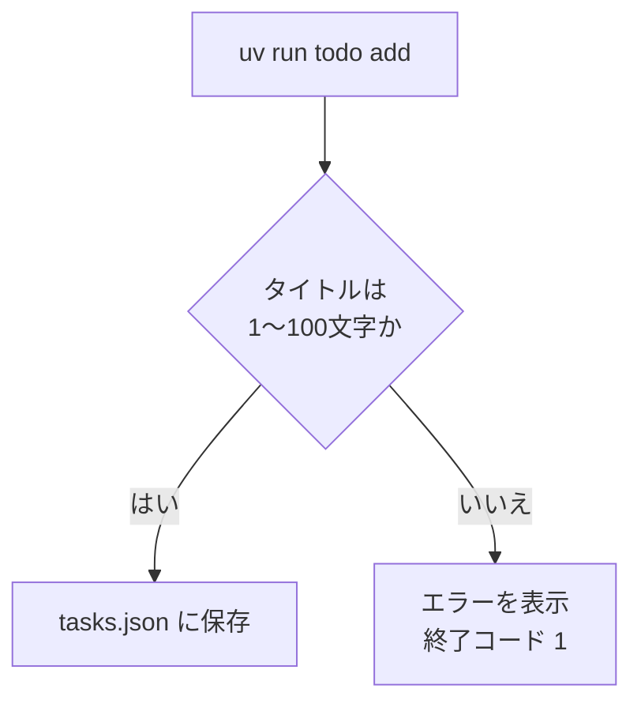
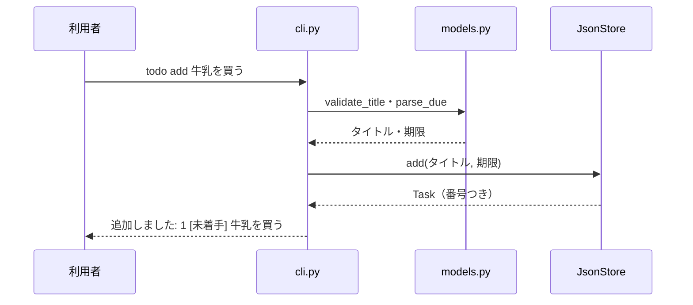
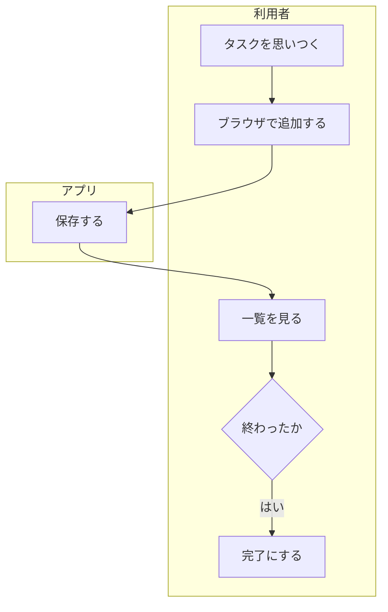
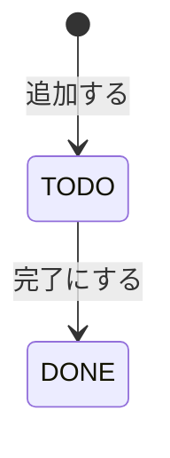

# 第9回 要件と図
tag: 設計-要件, pm-見積, pm-進捗
前提タグ: python-構文, test-自動, git-github
所要: 座学15分 / ハンズオン45分

## ゴール

- 伝えたいことに合わせて図の種類を選び、Mermaid で Markdown に書いてプレビューできる
- 曖昧な依頼から質問で「なぜ・誰が・何を・どのくらい」を引き出し、要件メモ（業務フロー図・状態遷移図・非機能要件・対象外）に書ける
- ユーザーストーリーと、確かめられる形の受け入れ条件を書ける
- ストーリーをタスクに分けて幅で見積もり、Issue・ラベル・マイルストーンで管理できる

## 事前準備

- 第8回のハンズオンの最後（手順8のマージ）まで済み、`~/handsoff/workspace/todo-app` の main で `mise run check` が通る
- 遅れた人: [session-08/](../../examples/todo-app-snapshots/session-08/) を [examples/README.md](../../examples/README.md#遅れた人が追いつく方法) の手順でコピーし、push してから始める
- VS Code で Markdown の Mermaid をプレビューできる（拡張機能 Markdown Preview Mermaid Support）。入れられなければ GitHub に push して画面で見る

## まとめ

冒頭の座学で使います。ハンズオンでは、Mermaid を CLI の図で練習してから、講師の依頼「**CLI の TODO を Web でも使いたい**」を要件メモとストーリーにし、Issue に登録します。

### 設計書の考え方

| 項目 | 内容 | 参照 |
| --- | --- | --- |
| 設計書の役割 | 作る前に「何を・どう作るか」を決め、残す | SE基礎 4章 |
| 合格基準 | **実装者が質問せずに作れるか** | SE基礎 4章 |
| 書くもの | ストーリー（Issue）・要件メモ（第9回）、API・DB設計書・システム構成図（第10回） | — |
| 書かないもの | 画面設計書・テスト仕様書。細かい振る舞いは TDD のテストで示す | SE基礎 5章 |
| 置き場所 | リポジトリの `docs/` に Markdown で置く。図も Mermaid の文字で書くので、PR で差分を読める | Mermaid 公式 |
| 社外サービスに貼らない | mermaid.live などに社内の内容を貼らない。プレビューは手元の VS Code か社内の GitHub | — |

### 図の種類と使い分け

| 伝えたいこと | 図 | Mermaid | 書く設計書（回） | 参照 |
| --- | --- | --- | --- | --- |
| 誰が・どの順に・何を。分かれ道 | 業務フロー図・処理の流れ | `flowchart` | 要件メモ（第9回） | SE基礎 4章 |
| 状態と、変わるきっかけ | 状態遷移図 | `stateDiagram-v2` | 要件メモ（第9回） | SE基礎 4章 |
| 誰と誰が何をどの順にやり取りするか | シーケンス図 | `sequenceDiagram` | API設計書（第10回）、第11〜12回 | SE基礎 4章 |
| データの持ち方と関係 | ER図 | `erDiagram` | DB設計書（第10回） | SE基礎 4章 |
| 部品・通信経路・ポート | 構成図 | `flowchart`（`subgraph`） | システム構成図（第10回） | SE基礎 9章 |
| クラスと依存の向き | クラス図 | `classDiagram` | （第7回で見た） | SE基礎 4章 |

### Mermaid の書き方

| 書き方 | 意味 | 参照 |
| --- | --- | --- |
| ` ```mermaid ` 〜 ` ``` ` | Markdown の中に図を書く。1行目で図の種類を決める | Mermaid 公式 Syntax Reference |
| `flowchart TD` / `A[文字]` / `B{文字}` | 上から下へ（`LR` は左から右）／四角（処理）／菱形（分かれ道） | Mermaid 公式 Flowcharts |
| `A --> B` / `A -- はい --> B` / `A -.-> B` | 矢印／ラベル付き／点線 | Mermaid 公式 Flowcharts |
| `A["記号(あり)"]`、`<br/>` | 記号を含む文字は `"` で囲む。長い文字は `<br/>` で折る | Mermaid 公式 Flowcharts |
| `subgraph 利用者` 〜 `end` | 枠（人ごとのレーン、部品のまとまり） | Mermaid 公式 Flowcharts |
| `participant C as cli` / `C->>M: 呼ぶ` / `M-->>C: 返す` | シーケンス図の登場人物／呼び出し／戻り | Mermaid 公式 Sequence diagrams |
| `[*] --> TODO : 追加する` | 状態遷移図の開始と、きっかけ付きの遷移 | Mermaid 公式 State diagrams |

### 図のレビュー観点

- 1つの図に1つの目的。何を伝える図か、図の上の1文で言える
- 名前が設計書の中で一貫している（「完了」と「済み」が混ざらない）
- 分かれ道・矢印のきっかけが、質問せずに読める

### ユーザーストーリーと受け入れ条件

```text
<利用者>として、<したいこと>したい。なぜなら<理由>から。
受け入れ条件:
- [ ] (1) <前提>のとき、<操作>すると、<結果（数字・文言・境目）>
```

| 項目 | 内容・例 | 参照 |
| --- | --- | --- |
| ストーリー | 利用者として、ブラウザでタスクを追加したい。なぜなら、ターミナルを開かずに書き留めたいから | — |
| 受け入れ条件 | 全部満たせば完了、という条件。数字・文言・境目で書く（「101文字以上なら追加せず『…』と出る」） | — |
| 番号 | (1)〜(15) は全ストーリーの通し番号。1つの条件が第11回でテスト1本以上になり、テスト名の頭に番号を付ける | — |
| Issue | 1ストーリー = 1 Issue。タイトルは `S-01 タスクを追加する`、ラベル `ストーリー`（[テンプレート](../templates/issue_story.md)） | — |
| 確かめる観点 | 誰が嬉しいか言える／作り方まで決めていない／確かめられる／半日〜1日で終わる大きさ | — |

### 要件メモ（[テンプレート](../templates/requirements.md)）

| 項目 | 書くこと | 例 | 参照 |
| --- | --- | --- | --- |
| 目的・背景 | 何に困り、何を解決するか。業務フロー図・状態遷移図 | ターミナルを開かないとタスクを見られない | SE基礎 4章 |
| 非機能要件 | **どのくらい** よくあるべきか（性能・セキュリティ・運用）を数字や確かめられる形で | 1,000件で一覧を1秒以内 | SE基礎 9章 |
| 制約 | 変えられない前提 | Python 3.12・FastAPI・SQLite | — |
| 対象外 | **今回やらないこと** と理由 | ログイン（自分の PC だけで使う） | — |
| ストーリー一覧 | Issue の一覧へのリンクと控え（`docs/stories.md`） | — | — |

### 見積（pm-見積）

| 考え方 | ひとことで | 参照 |
| --- | --- | --- |
| タスクに分ける | ストーリーを半日以内の作業に分ける（土台・保存・画面・入力チェックなど） | 達人プログラマー 見積もり |
| 幅で見積もる | 見積は約束ではなく予測。「2〜4時間」のように幅で書く。幅が広いところが不確かなところ | 達人プログラマー 見積もり |
| 根拠を一言 | 「CLI の add と同じ」「初めてなので上を広く」など | — |
| 記録しない | 実績との比較はしない。見積の根拠を言葉にする練習 | — |

### Issue での管理（pm-進捗）

| 道具 | 使い方 | 参照 |
| --- | --- | --- |
| Issue | ストーリー1件・タスク1件ずつ（[ストーリー用](../templates/issue_story.md)／[タスク用](../templates/issue_task.md)） | Pro Git 6.2 |
| ラベル | 種類で絞り込む: `ストーリー`・`タスク`（第12回で `不具合`） | GitHub Docs ラベルを管理する |
| マイルストーン | 期日までに閉じる Issue の束。`Web 版`（期日は第12回）。進み具合が閉じた数で見える | GitHub Docs マイルストーンについて |
| 閉じ方 | PR の本文に `Closes #番号`。マージで閉じる（ストーリーは第11回の PR #16 で閉じる） | Pro Git 6.2 |

## ハンズオン

1ステップ1コマンド。各ステップは「🖋 やること → 📚 参考書・公式資料の節 → 📒 説明 → コマンドや書くもの」。作業場所は `~/handsoff/workspace/todo-app/`。見本は [session-09/](../../examples/todo-app-snapshots/session-09/)（[examples/session09/](../../examples/session09/README.md)）。

### 1. Issue とブランチを作る（3分）

#### 🖋 Issue を立てる（ブラウザ）

📚 Pro Git 6.2 プロジェクトへの貢献

📒 第8回の PR が #6 なので、この Issue は #7 になる（GitLab では出た番号を使う）。本文は[タスク用テンプレート](../templates/issue_task.md)で書き、見積に「1〜2時間（要件を書くのは初めて）」のように幅と根拠を入れる

| Issue | タイトル | 目的 | 完了条件 |
| --- | --- | --- | --- |
| #7 | Web 版の要件メモとストーリーを書く | 作る前に、何を作るかを依頼人と合わせる | `docs/requirements.md`・`docs/stories.md` が main にあり、ストーリーが Issue に登録されている |

#### 🖋 ブランチを作る

📒 今日は文書を書くだけで、コードは変えない。今日の要件メモとストーリーをもとに、第10回で設計書を、第11回でテストを書く

```sh
cd ~/handsoff/workspace/todo-app
git switch main; git pull; git switch -c issue-7-requirements
```

### 2. Mermaid の基本: CLI を図にする（7分）

#### 🖋 練習のファイルを開く

📚 Mermaid 公式 Flowcharts Syntax

📒 練習はリポジトリの外のファイルで行う。図は ` ```mermaid ` のコードブロックに書き、`Ctrl+Shift+V`（横に並べるなら `Ctrl+K V`）でプレビューする

```sh
mkdir -p ~/handsoff/workspace/session09; code ~/handsoff/workspace/session09/practice.md
```

#### 🖋 処理の流れを flowchart で書く

📒 `uv run todo add` の流れ。四角が処理、菱形が分かれ道、矢印のラベルが分かれる条件。下を書いてプレビューし、図のように描かれるのを確かめる

````markdown

````


#### 🖋 期限の分かれ道を足す

📒 `--due` が日付の形でないときもエラーになる（`parse_due`）。`B` と `C` の間に菱形を1つ足し、`D` に矢印をつなぐ。図が崩れたら、記号を含む文字を `"` で囲んだか確かめる

#### 🖋 やり取りを sequenceDiagram で書く

📚 Mermaid 公式 Sequence diagrams

📒 同じ `add` を「誰が誰を呼ぶか」で見る。flowchart では見えなかった `cli.py`・`models.py`・`store.py` の分担が見える。同じファイルの下に書き足す

````markdown

````


#### 🖋 図を選ぶ

📚 SE基礎 4章 モデル

📒 図は「何を伝えたいか」で選ぶ。動き（順番・やり取り・状態。`flowchart`・`sequenceDiagram`・`stateDiagram-v2`）を伝える図と、形（データ・部品。`erDiagram`・構成図・`classDiagram`）を伝える図がある。今日は業務フロー図と状態遷移図を書き、残りは第10回で書く

> 座学: 同じ `add` を flowchart とシーケンス図で描くと、それぞれ何が見えて何が見えないか（→ まとめ「図の種類と使い分け」）

### 3. 依頼を聞き、質問する（7分）

#### 🖋 要件メモのテンプレートを置く

📒 要件メモには、ストーリーに書けないこと（目的・非機能要件・制約・対象外）だけを書く。聞いた答えは、要件メモの各節に振り分けてメモする

```sh
mkdir docs; cp ~/handsoff/docs/templates/requirements.md docs/requirements.md
```

#### 🖋 依頼を聞く

📒 講師が依頼人の役。最初の一言は「第6回から作っている CLI の TODO、ブラウザでも使いたいんです」だけ。依頼人は聞かれたことにだけ答える

#### 🖋 質問する

📚 SE基礎 4章 モデル、9章 ソフトウェアアーキテクチャ

📒 欲しい機能からではなく、困りごとから聞く。量や速さは「何件」「何秒」「何文字」のように数字で聞く。最後に「やらないこと」を確かめる

- 聞く順: なぜ（今の困りごと）→ 誰が・どこから使うか → 何をしたいか（CLI との違い）→ どのくらい（何件・何秒・何文字）→ やらないこと（編集・ログインなど）
- 聞き漏らしやすい観点: 期限は必須か／編集・削除は要るか／ログインは要るか／スマホから使うか／CLI のデータは移すか／いつまでに

#### 🖋 答えを要件メモに書く

📒 決まっていないことは「6. 未定」に書く。答えが8件以上集まったら次へ進む

| 聞いたこと | 書く節 |
| --- | --- |
| 困りごと・誰が使うか | 1 目的・背景 |
| 何件・何秒・どこから見えてよいか・データの置き場所 | 3 非機能要件 |
| 言語・期日など変えられないこと | 4 制約 |
| 「要らない」と言われたこと（理由も） | 5 対象外 |

> 座学: 欲しい機能を直接聞くと、今の CLI をそのまま画面にしただけになる。対象外を書く理由（→ まとめ「要件メモ」）

### 4. 業務フロー図と状態遷移図を書く（6分）

#### 🖋 業務フロー図を書く

📚 SE基礎 4章 モデル

📒 導入後の利用者の1日の流れ。`subgraph` で人とアプリのレーンに分け、アプリが受け持つところを分ける。テンプレートの図（下）に「朝に一覧を開く → 期限切れはあるか」の分かれ道を足す。図の上には、この図で何を伝えるかを1文で書く



#### 🖋 状態遷移図を書く

📚 Mermaid 公式 State diagrams

📒 テンプレートの図（下）には `TODO` と `DONE` しかない。期限切れ（`OVERDUE`）と、そこへ移るきっかけ・そこから出るきっかけを足し、下の表の「条件」を不等号まで埋める



- 確認: 「完了したタスクは期限切れになるか」「期限の当日は期限切れか」「期限なしのタスクは」に図と表で答えられる

> 座学: 期限切れを DB に保存するか、表示するときに計算するか（第10回の DB設計書につながる。→ まとめ「図の種類と使い分け」）

### 5. ストーリーと受け入れ条件を書く（7分）

#### 🖋 ストーリーの控えを作る

📒 ストーリーは Issue に書き、`docs/stories.md` に控えを残す。テンプレートは Issue 1件分の形

```sh
cp ~/handsoff/docs/templates/issue_story.md docs/stories.md
```

#### 🖋 したいことを書き出す

📒 依頼人の「したいこと」を1つずつに分け、`S-01` から番号を付ける。1つが半日〜1日で終わる大きさにする。「要らない」と言われたことは要件メモの「対象外」へ移す

#### 🖋 S-01 を1文で書く

📒 `<利用者>として、<したいこと>したい。なぜなら<理由>から。` の形で、ストーリーの節に書く。「なぜなら」には、手順3で聞いた困りごとを入れる

#### 🖋 S-01 の受け入れ条件を書く

📒 受け入れ条件の節に3〜6行書く。依頼人が言った数字（100文字など）、うまくいかない場合（空のタイトル、日付でない期限）、そのときの文言を入れる。1行が第11回でテスト1本以上になる

- 確認: 受け入れ条件だけ読めば、来月の自分が依頼人に質問せずに作れるか

> 座学: 「追加できる」だけでは確かめられない。数字・文言・境目で書く（→ まとめ「ユーザーストーリーと受け入れ条件」）

### 6. タスクに分けて幅で見積もる（4分）

#### 🖋 S-01 をタスクに分ける

📚 達人プログラマー 見積もり

📒 半日以内の作業に分け、それぞれ「1〜2時間」のように幅で見積もる。下は第6回の「期限を足す」を分けた例。初めての作業は幅を広く取る

| タスク | 幅 | 根拠 |
| --- | --- | --- |
| `parse_due` | 0.5〜1時間 | — |
| `--due` の引数 | 0.5〜1時間 | — |
| `list --overdue` | 1〜2.5時間 | 判定が初めて |
| 合計 | 2〜4.5時間 | — |

#### 🖋 見積の表を埋める

📒 `docs/stories.md` の「見積」の表に、タスク・幅・根拠を1行ずつ書き、最後に合計の行を足す。根拠は「似た作業は何か」「初めてのことは何か」で書く

- 確認: いちばん幅が広いタスクと、その理由を言える

> 座学: 幅が広いところが不確かなところ。見積は約束ではない（→ まとめ「見積」）

### 7. 見本と合わせてコミットする（3分）

#### 🖋 自分の版をコミットする

📒 自分で書いた版をまずコミットして残す。次のステップで見本に置き換えても、自分の版は履歴に残る

```sh
git add docs; git commit -m "Web 版の要件メモとストーリー S-01 を書く"
```

#### 🖋 見本に置き換えて違いを見る

📒 見本は、講師（依頼人）と合わせた版。ストーリーは S-01〜S-04、受け入れ条件は通し番号 (1)〜(15)。第10回・第11回はこの番号と文言を使うので、見本に置き換える。`git diff` で自分の版との違いを読む

```sh
cp ~/handsoff/examples/todo-app-snapshots/session-09/docs/*.md docs/; git diff --stat; git diff docs/stories.md
```

#### 🖋 README と一緒にコミットする

📒 見本の README は、ドキュメントの表に `docs/` の2つを足したもの

```sh
cp ~/handsoff/examples/todo-app-snapshots/session-09/README.md .; git add README.md docs; git commit -m "依頼人と合わせた要件メモとストーリー S-01〜S-04 にする"
```

### 8. Issue・ラベル・マイルストーンで管理する（5分）

#### 🖋 ラベルを作る（ブラウザ）

📚 GitHub Docs ラベルを管理する

📒 Issues → Labels → New label で `ストーリー` と `タスク` を作り、Issue #7 に `タスク` を付ける（GitLab は Manage → Labels）

#### 🖋 マイルストーンを作る（ブラウザ）

📚 GitHub Docs マイルストーンについて

📒 Issues → Milestones → New milestone で `Web 版` を作り、期日に第12回の日を入れる（GitLab は Plan → Milestones）

#### 🖋 ストーリーを Issue に登録する（ブラウザ）

📒 `docs/stories.md` の S-01〜S-04 を1件ずつ Issue にする。タイトルは `S-01 タスクを追加する` の形、本文は各節の「ストーリー」から「関連」までをコピーし、ラベル `ストーリー` とマイルストーン `Web 版` を付ける。番号は #8〜#11 になる

#### 🖋 絞り込んで見る（ブラウザ）

📒 Issue の一覧で `label:ストーリー` と絞り込むと4件が出る。マイルストーン `Web 版` を開くと、閉じた数（0/4）と期日が見える

#### 🖋 Issue の番号を控えに書く

📒 `docs/stories.md` の一覧の表の「Issue」の列は見本では `#8`〜`#11`。番号が違ったら直してコミットする

```sh
git diff --stat; git commit -am "ストーリーの Issue の番号を控えに書く"   # 直したときだけ
```

### 9. PR を出してマージする（3分）

#### 🖋 push して PR を作る

📚 Pro Git 6.2 プロジェクトへの貢献

📒 本文は[テンプレート](../templates/pull_request.md)で書き、目的に `Closes #7`、確認方法に「GitHub の画面で図が描かれる」と書く。Files changed で `docs/requirements.md` を開き、表示を切り替えて図を見る。`[確認]` の行コメントを1件以上残す

```sh
git push -u origin issue-7-requirements
```

#### 🖋 CI が緑になってからマージする

📒 コードは変えていないが、CI（`check`）が緑になるのを待ってからマージする。Issue #7 は閉じ、ストーリーの #8〜#11 は第11回の PR #16 で閉じる

```sh
git switch main; git pull; git branch -d issue-7-requirements; ls docs
```

- 確認: Issue #7 が Closed、#8〜#11 が Open でマイルストーン `Web 版` に入っている。main に `docs/requirements.md`・`docs/stories.md` がある

## 読む章

| 区分 | 資料 | 範囲 | 読み方 |
| --- | --- | --- | --- |
| 参考書 | [ソフトウェアエンジニアリングの基礎](https://www.oreilly.co.jp/books/9784814401789/)（SE基礎） | 4章 モデル（どの図が必要か） | 通読（第10回でも使う） |
| 参考書 | 同上 | 9章 ソフトウェアアーキテクチャ（品質特性・非機能要件） | 通読（第10回でも使う） |
| 無料 | [Mermaid 公式](https://mermaid.js.org/) | Syntax Reference（Flowcharts、Sequence diagrams、State diagrams） | 図を書くときに引く |
| 無料 | [Pro Git（日本語版）](https://git-scm.com/book/ja/v2)・[GitHub Docs](https://docs.github.com/ja/issues) | 6.2 プロジェクトへの貢献／ラベルを管理する、マイルストーンについて | Issue・ラベルで困ったときに引く |
| 紹介（副読本） | [達人プログラマー 第2版](https://www.hanmoto.com/bd/isbn/9784274226298) | 見積もり | 持っている人は通読 |
| 紹介（副読本） | [ソフトウェアアーキテクチャの基礎 第2版](https://www.oreilly.com/library/view/-/9784814401550/) | アーキテクチャ特性（非機能要件）の考え方 | 持っている人は |
