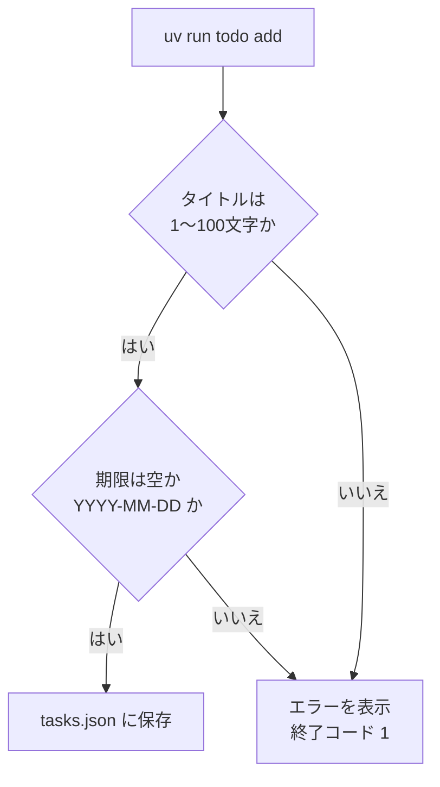
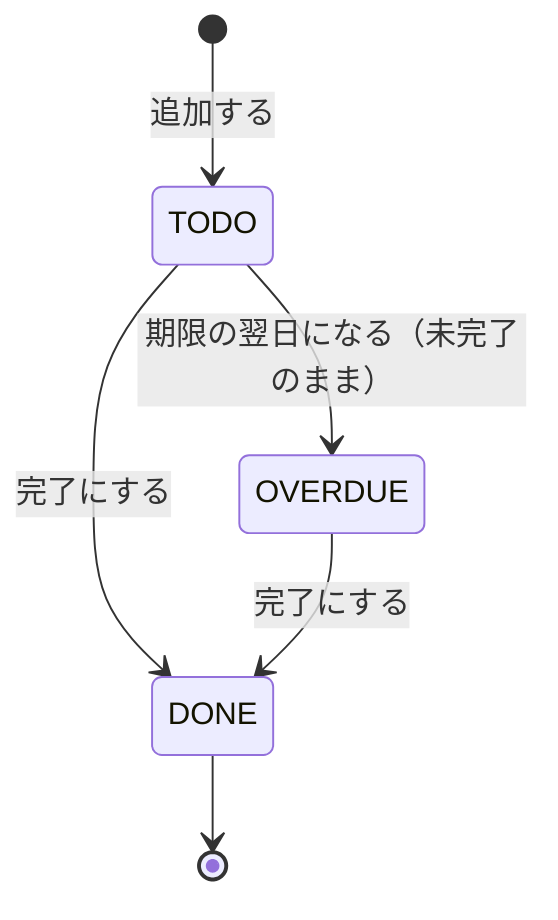

# 第9回 要件と図（講師用）
tag: 設計-要件, pm-見積, pm-進捗
前提タグ: python-構文, test-自動, git-github
所要: 座学15分 / ハンズオン45分

<!-- 講師用。受講者に配るときはこのファイルを除く -->

## 進行メモ

各自が「Issue #7 → ブランチ → Mermaid の練習 → 依頼人への質問 → 要件メモの図 → S-01 と見積 → 自分の版をコミット → 見本に置き換えて比べる → ストーリーを Issue #8〜#11 に登録 → PR → マージ」までを通します。第10回は `docs/requirements.md`・`docs/stories.md` が main にある状態から、第11回は受け入れ条件 (1)〜(15) の番号と文言を使って始めるので、手順7（見本に置き換えてコミット）までは全員が終えることを優先します。

| 時刻 | 内容 | メモ |
| --- | --- | --- |
| 0:00 | 座学: まとめ（15分） | 最初の1分で第8回の PR #6 を開き、`test_期限なしは最後に並べる` のようなテスト名で仕様が読めることを見せて、今日の受け入れ条件（1行がテスト1本になる）につなぐ。「設計書の考え方」（2分）は合格基準と、書くもの・書かないもの。「図の種類と使い分け」「Mermaid の書き方」（4分）は講師の画面で1つプレビューして見せる。「ユーザーストーリーと受け入れ条件」（3分）、「要件メモ」（2分、特に対象外）、「見積」（2分、実績は記録しないと最初に伝える）、「Issue での管理」（1分） |
| 0:15 | ハンズオン 1 Issue とブランチ（3分） | Issue の本文はタスク用テンプレート。見積の欄に幅と根拠を書かせ、今日最初の見積にする |
| 0:18 | ハンズオン 2 Mermaid の基本（7分） | 全員が flowchart をプレビューで描けるのを確かめてから進む。拡張機能がない人は、隣の人の画面か講師の画面で見る（社外の mermaid.live には貼らせない）。期限の分かれ道は各自で足させ、解答例を画面に出す。「> 座学:」で flowchart とシーケンス図の違いを1分 |
| 0:25 | ハンズオン 3 依頼を聞き、質問する（7分） | 講師は依頼人役。最初の一言だけ話し、あとは下の台本で「聞かれたことだけ」答える。答えは講師の画面のメモにも書いて全員で共有する（聞けなかった人も要件メモを埋められるように）。8件集まらない人は台本の「聞き漏らしやすい観点」から聞かせる |
| 0:32 | ハンズオン 4 業務フロー図と状態遷移図（6分） | 状態遷移図を優先する。`OVERDUE` を足せたら、「期限の当日は」「完了したものは」を2〜3人に聞く。業務フロー図は分かれ道が1つ入れば十分。「> 座学:」で期限切れを保存しない理由を1分 |
| 0:38 | ハンズオン 5 ストーリーと受け入れ条件（7分） | S-01 だけでよい。受け入れ条件に数字や文言がない人に「依頼人は何と言っていましたか」と聞く |
| 0:45 | ハンズオン 6 見積（4分） | 根拠が「なんとなく」の人に「似た作業は何か」「どこでつまずきそうか」を聞く |
| 0:49 | ハンズオン 7 見本と合わせる（3分） | `git diff docs/stories.md` で、自分の版になかった条件（(2) 前後の空白、(6) 入力が残る、(10) `<script>` など）を探させる。見本に置き換えるのは、第10回・第11回が番号と文言を前提にしているためと伝える |
| 0:52 | ハンズオン 8 Issue・ラベル・マイルストーン（5分） | ラベルとマイルストーンは講師の画面で先に作って見せる。Issue の登録は S-01 だけ全員で行い、S-02〜S-04 は同じ操作なので手早く。番号が #8〜#11 からずれた人は控えの表を直す |
| 0:57 | ハンズオン 9 PR とマージ（3分） | Files changed で図が描かれるのを1人の画面で見せる。CI が緑になるまで待つ間にセルフレビュー |

時間が押したら、手順2の sequenceDiagram と手順4の業務フロー図を講師の画面で見せるだけにし、手順8は S-01 の Issue だけ登録して残り3件は第10回の冒頭に回します。手順9のマージが授業中に終わらなかった人は、第10回の前に済ませるよう伝えます。

第9回は振り返り・宿題・発展課題を設けません。元の宿題は次のように扱いました。

| 元の宿題 | 扱い |
| --- | --- |
| `docs/requirements.md` を仕上げる（目的・業務フロー図・状態遷移図・非機能要件・制約・対象外） | 手順3・4で自分の版を書き、手順7で見本（依頼人と合わせた版）に置き換えてコミットする |
| 残りのストーリーを Issue に登録し、`docs/stories.md` に控える | 手順5で S-01 を書き、手順7で見本の S-01〜S-04 に置き換え、手順8で4件とも Issue に登録する |
| PR の説明に「依頼人に確かめたいこと」を書く | 見本の要件メモの「6. 未定」にある。PR は手順9で出す（`Closes #7`） |

元の発展課題（うまくいかない場合の受け入れ条件を足す、アーキテクチャ特性で見直す、Issue テンプレートを置く）は「講師が見せる補足（任意）」に移しました。うまくいかない場合は見本の (3)〜(6) に入っています。

### 事前に確認すること

- 受講者のリポジトリが第8回の終わりの状態（main に `tests/`・`.github/workflows/check.yml`、PR #6 がマージ済み）か。遅れた人は [session-08/](../../examples/todo-app-snapshots/session-08/) をコピーしてよい
- VS Code の Mermaid プレビューの拡張機能が社内で入れられるか。入れられない場合は、手順9で push してから GitHub の画面で図を確かめる（社外の mermaid.live は使わない）
- ラベルとマイルストーンを作る権限（自分のリポジトリなら通常は作れる。Organization の設定で制限されていないか。[open-questions.md](../open-questions.md) の Q4）
- 講師の画面で見せるデモ用のリポジトリ（ラベル・マイルストーンを作る前の状態）

### 依頼人役の台本

見本（[要件メモ](../../examples/todo-app-snapshots/session-09/docs/requirements.md)・[ストーリー](../../examples/todo-app-snapshots/session-09/docs/stories.md)）と矛盾しない答えです。食い違ったら見本を正とし、台本を直してください。**聞かれたことだけに答えます**。

最初の一言は次のとおりです。

> 第6回から作っている CLI の TODO、便利なんですが、ブラウザでも使いたいんです。よろしくお願いします。

| 聞かれたら | 答え |
| --- | --- |
| なぜ Web で使いたいか／何に困っているか | ターミナルを開かないとタスクを見られない。期限切れに気づくのが遅れる。一覧をぱっと見て、期限切れがすぐわかるとよい |
| 誰が使うか | 自分ひとり。自分の PC のブラウザから |
| 何ができればよいか | CLI と同じ: 一覧を見る、追加する（期限は任意）、完了にする、期限切れだけを見る |
| タイトルの長さ | 1〜100文字。前後の空白は無視してよい。空白だけは困る |
| 期限は必須か | 任意。期限なしのタスクは一覧の最後でよい |
| 並び順 | CLI と同じ（期限が近い順、期限なしは最後、同じなら古い順） |
| 期限切れの定義 | 期限の日を過ぎて、まだ完了していないもの。期限の当日はまだ期限切れではない。完了したものは期限切れにしない |
| 入力を間違えたとき | 追加しないで、何が悪いかを日本語で出してほしい。打ったものは消さないでほしい |
| 編集・削除は要るか | 今回は要らない（対象外） |
| ログインは要るか | 自分の PC だけで使うので要らない（対象外）。外から見えないようにはしてほしい |
| スマホから使うか | 今回は使わない（対象外） |
| CLI の `tasks.json` のデータを移すか | 移さなくてよい（対象外）。Web 版は新しく始める |
| 何件くらい／速さ | 数百件。多くても1,000件。一覧が（「何秒」と聞かれたら）1秒以内に出れば十分 |
| データの保存 | PC を再起動しても消えないこと。保存先の場所は設定で変えられるとうれしい |
| 通知・メールは要るか | 要らない。一覧で期限切れがわかればよい |
| いつまでに | 研修の第12回までに動くもの。第12回で見せてほしい |

想定外の質問には「それは決めていないので、提案してください」と答えます。

## つまずきやすい点

| 症状 | 原因 | 対処 |
| --- | --- | --- |
| 図がプレビューされずコードのまま | ` ```Mermaid ` と大文字、拡張機能がない、`.md` 以外のファイル | 小文字にする。拡張機能と拡張子を確かめる |
| flowchart で `Parse error` | ラベルの `(`・`:`・`#` などの記号、`end` という語、`subgraph` の `end` 忘れ | 記号を含む文字は `["..."]` と `"` で囲む。`end` は `終了` などに変える |
| 状態遷移図で `Syntax error` | 遷移のラベルに `:` を2つ書いた、状態名に空白 | 状態名は `TODO` のように英字、ラベルは `: ` の後に1つ |
| 図の文字が枠からはみ出す | ラベルが長い | `<br/>` で折る |
| 「どんな機能が欲しいですか」とだけ聞いて終わる | 困りごとから入っていない | 「今いちばん困っていることは」から聞き直させる |
| 数字のない要件（「速く」「たくさん」） | 数字で聞いていない | 「何件」「何秒」「何文字」で聞き直させる |
| 非機能要件が「安全にする」だけ | 何をもって安全かが書かれていない | 「127.0.0.1 だけで待ち受ける」「入力は HTML として解釈せず表示する」「DB の場所は環境変数」のように確かめられる形にさせる |
| 対象外が空 | やらないことを決める発想がない | 依頼人が「要らない」と言ったこと（編集・削除・ログイン・スマホ・データ移行）を拾わせる |
| 状態遷移図に `DONE --> OVERDUE` がある／`OVERDUE --> DONE` がない | 期限切れの定義を確かめていない | 「完了したものは期限切れにならない」を台本どおり答え、図を直させる。期限を延ばす操作は今回ない（編集は対象外）ので、`OVERDUE --> TODO` は書かなくてよい |
| ストーリーが「システムは〜する」になる | 利用者の立場で書いていない | 「誰として」から書き直させる |
| 「なぜなら」が空、または「必要だから」 | 困りごとと結び付いていない | 依頼人の困りごと（ターミナルを開かないと見られない、期限切れに気づかない）から選ばせる |
| 受け入れ条件が「追加できる」だけ | 確かめられる形になっていない | 「何文字まで」「空ならどうなる」「どんな文言」と聞き、テストに書ける1行にさせる |
| 受け入れ条件に画面の細部（ボタンの色・配置） | 画面設計書の代わりにしようとしている | 確かめたい結果と文言だけにさせる |
| 見積が1つの値、または幅が極端（1〜40時間） | 幅の意味が伝わっていない／タスクが大きすぎる | 「うまくいったら」「つまずいたら」を聞く。幅が広すぎるならタスクを分けさせる |
| 手順7の `git diff` に何も出ない | 自分の版をコミットする前に見本をコピーした | 自分の版は上書きされて残っていない。見本のままコミットし、自分が書いた条件を思い出して見本と比べさせる |
| ラベル・マイルストーンを作れない | 権限、またはリモートに push していない | 講師が代わりに作るか、ラベルなしで Issue だけ登録させる |
| Issue の番号が #8〜#11 にならない | 途中で別の Issue を立てた、GitLab | 控えの表（`docs/stories.md` の一覧）の番号を直してコミットする |

## 解答例

### 手順2: 期限の分かれ道を足した flowchart



- flowchart では分かれ道と結果が、シーケンス図ではファイルごとの分担と呼ぶ順が見える。flowchart には `cli.py`・`models.py` の区別がなく、シーケンス図にはエラーの分かれ道がない

### 手順3: 質問の答えを書く節

見本の要件メモと見比べます。目安は次のとおりです。

| 答え | 見本の節 |
| --- | --- |
| ターミナルを開かないと見られない、期限切れに気づくのが遅れる、自分ひとり | 1 目的・背景 |
| 1,000件で1秒以内、外から見えない（127.0.0.1）、保存先を設定で変える、再起動で消えない | 3 非機能要件 |
| Python 3.12・FastAPI・SQLite、第12回までに動く | 4 制約 |
| 編集・削除、ログイン、通知、`tasks.json` の移行 | 5 対象外 |

### 手順4: 状態遷移図



- 見せたいところ: 状態は「完了したか（`done`）」と「期限（`due`）」と「今日」から決まる。`OVERDUE` は保存せず計算で求める（第10回の DB設計書で `done` だけを持つ理由。第8回のテスト `test_状態は完了と期限と今日で決まる` と同じ）
- 条件: `TODO` は「未完了かつ（期限なし または 期限 ≧ 今日）」、`OVERDUE` は「未完了かつ 期限 < 今日」

### 手順5〜6: S-01 と見積

見本の [stories.md](../../examples/todo-app-snapshots/session-09/docs/stories.md) の S-01 が解答例にあたります。受け入れ条件に「1〜100文字（前後の空白は除く）」「空ならエラーの文言」「101文字以上ならエラーの文言」「日付でない期限はエラー」が入っていれば十分です。(2) 前後の空白と (6) 入力が残ることは、手順7の `git diff` で気づく形でかまいません。

- 見積の例: 「FastAPI と Jinja2 の土台 1〜2時間（初めて）」「SQLite の保存先 1〜2時間（`JsonStore` と同じ約束）」「追加フォームと入力チェック 1時間（`validate_title`・`parse_due` を使う）」、合計 3〜5時間
- 手順6の表の例（第6回の「期限を足す」）は、`parse_due`・`--due`・`list --overdue` の3つに分けたもの。合計の幅は各タスクの下限の和〜上限の和

### 手順7〜9: コミットと Issue の例

```text
* Merge pull request #12 from <ユーザー名>/issue-7-requirements
* 依頼人と合わせた要件メモとストーリー S-01〜S-04 にする
* Web 版の要件メモとストーリー S-01 を書く
* Merge pull request #6 ...
```

| 番号 | 種類 | タイトル | ラベル | マイルストーン | 状態（第9回の終わり） |
| --- | --- | --- | --- | --- | --- |
| #7 | Issue | Web 版の要件メモとストーリーを書く | タスク | — | Closed（PR #12） |
| #8 | Issue | S-01 タスクを追加する | ストーリー | Web 版 | Open |
| #9 | Issue | S-02 タスクの一覧を見る | ストーリー | Web 版 | Open |
| #10 | Issue | S-03 タスクを完了にする | ストーリー | Web 版 | Open |
| #11 | Issue | S-04 期限切れのタスクだけを見る | ストーリー | Web 版 | Open |
| #12 | PR | Web 版の要件メモとストーリー（`Closes #7`） | — | — | Merged |

### 講師が見せる補足（任意）

時間が余ったときに講師の画面で見せます。受講者の課題にはしません。

- うまくいかない場合の受け入れ条件: 見本の (3)〜(6) のほかに、過去の期限 → 追加でき、すぐ期限切れとして表示（禁止するかは依頼人に確かめる論点）
- アーキテクチャ特性: 非機能要件を「保守性」「使いやすさ」「セキュリティ（自分の PC だけ）」で見直し、「スケーラビリティ」「可用性」の優先度を下げる理由を言う（副読本『ソフトウェアアーキテクチャの基礎』）
- Issue テンプレート: `docs/templates/issue_story.md` を `.github/ISSUE_TEMPLATE/story.md`（GitLab は `.gitlab/issue_templates/story.md`）に置くと、New issue で選べる

## 評価の観点

- ストーリーが「誰が・何を・なぜ」で書かれ、受け入れ条件が数字や文言で確かめられる形か
- 要件メモに目的・非機能要件・制約・対象外がそろい、図（業務フロー図・状態遷移図）に目的の1文があるか
- 見積が幅で書かれ、根拠を言葉で説明できるか
- ストーリーが Issue になり、ラベル・マイルストーンで絞り込めるか

## カリキュラムとの関係（報告事項）

- 2026-10-12 の改訂で、旧「図と設計書の書き方」と旧「ユーザーストーリーと見積」を1回にまとめた。見積は「タスクに分けて幅で見積もる」と根拠の一言だけにした（三点見積・WBS・Projects ボード・実績の記録は扱わない）
- 2026-10-13 の見直しで、所要を座学15分 / ハンズオン45分にし、宿題をハンズオンに入れた。Mermaid は CLI の `add` を flowchart とシーケンス図で描いて練習する。要件メモとストーリーは自分の版をコミットしてから見本（依頼人と合わせた版）に置き換える。第10回・第11回が受け入れ条件 (1)〜(15) の番号と文言を前提にしているため
- Issue・PR の番号は GitHub なら #12 まで使う（第10回は #13 から）。見本の `docs/stories.md` の一覧の Issue の列は `#8`〜`#11` にそろえた
