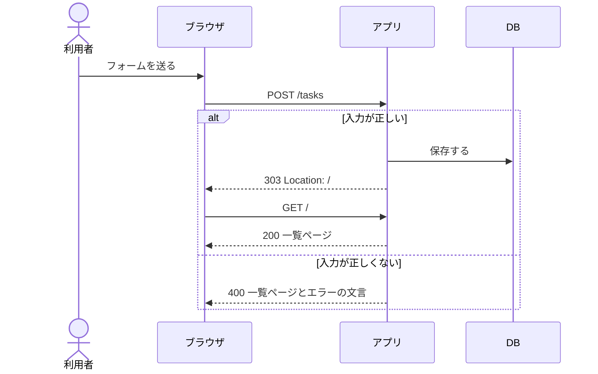
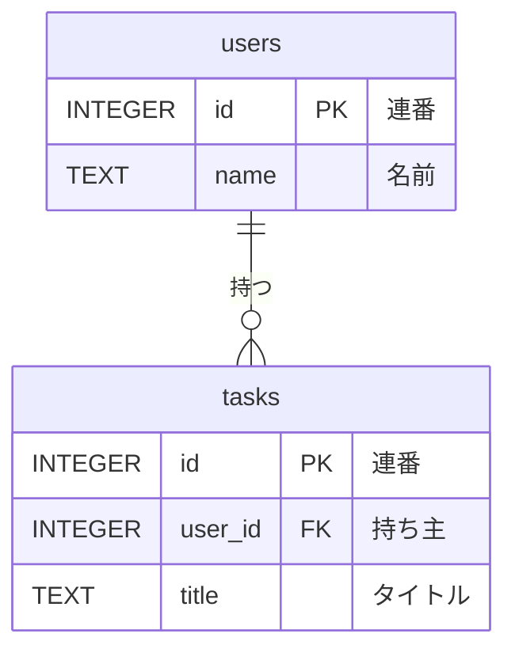

# 第10回 設計書作成
tag: 設計-詳細, 設計-構成, http-構成, db
前提タグ: 設計-要件, git-github
所要: 座学15分 / ハンズオン45分

## ゴール

- ストーリーの受け入れ条件と要件メモから、API設計書・DB設計書・システム構成図をテンプレートに沿って書ける
- エンドポイントを「URL・メソッド・リクエストとレスポンスの例・ステータスコード・入力チェックとエラーの文言」で決められる
- シーケンス図・ER図・構成図を Mermaid で書ける
- 設計書を隣の人と交換して「質問せずに作れるか」を確かめ、出た質問を設計書に書き足せる

## 事前準備

- 第9回のハンズオンの最後（手順9のマージ）まで済み、`~/handsoff/workspace/todo-app` の main に `docs/requirements.md`・`docs/stories.md` がある。ストーリーの Issue #8〜#11 が Open
- 遅れた人: [session-09/](../../examples/todo-app-snapshots/session-09/) を [examples/README.md](../../examples/README.md#遅れた人が追いつく方法) の手順でコピーし、push してから始める
- VS Code で Markdown の Mermaid をプレビューできる（第9回と同じ拡張機能）
- テンプレート: [API](../templates/api-design.md)・[DB](../templates/db-design.md)・[システム構成図](../templates/architecture.md)

## まとめ

冒頭の座学で使います。ハンズオンでは、第9回の受け入れ条件 (1)〜(15) と要件メモをもとに3つの設計書の自分の版を書き、隣の人と交換して確かめてから、見本と合わせて PR でマージします。

### 設計書と図

合格基準: **実装者が質問せずに作れるか**。画面設計書は作らない（画面は受け入れ条件と API設計書から組み立てる）。

| 設計書（置き場所） | 主な図 | 必ず書くこと | 元にするもの | 参照 |
| --- | --- | --- | --- | --- |
| API設計書（`docs/design/api.md`） | シーケンス図 | エンドポイント、メソッド、リクエスト・レスポンス例、ステータスコード、入力チェックとエラーの文言 | ストーリーと受け入れ条件 | Web技術の基本 3章・5章 |
| DB設計書（`docs/design/db.md`） | ER図 | テーブル定義（カラム・型・NULL 可否・キー）、制約、計算で求める値 | 状態遷移図、CLI の `Task` | SE基礎 8章 |
| システム構成図（`docs/design/architecture.md`） | 構成図 | 構成要素、通信経路とポート、ミドルウェアとバージョン、環境変数 | 非機能要件・制約 | Web技術の基本 5章・7章、SE基礎 9章 |

### エンドポイント（http-構成）

| 決まり | 例 | 参照 |
| --- | --- | --- |
| URL は名詞（もの）、操作はメソッド（第3回の REST と同じ） | `GET /` 一覧、`POST /tasks` 追加 | Web技術の基本 3章、MDN HTTP リクエストメソッド |
| フォーム送信の後は 303 で一覧へ | 再読み込みで二重に追加しない（POST → リダイレクト → GET） | MDN 303 See Other |
| 絞り込みはクエリ | `GET /?overdue=1` 期限切れだけ | Web技術の基本 3章 |
| 返すのは HTML | 一覧ページ全体。第12回で HTML 断片を返す URL を足す | Web技術の基本 5章 |

| エンドポイント | 内容 | 成功 | 失敗 |
| --- | --- | --- | --- |
| `GET /` | 一覧ページ（`?overdue=1` で期限切れだけ） | 200 | — |
| `POST /tasks` | 追加（フォーム: `title`, `due`） | 303 → `/` | 400（一覧ページにエラーの文言） |
| `POST /tasks/{id}/done` | 完了にする | 303 → `/` | 404（無い id） |

ステータスコードの意味は第3回の「ステータスコード」の表。このアプリで返す場面は次のとおり。

| コード | このアプリで返す場面 |
| --- | --- |
| 200 | 一覧ページ |
| 303 | 追加・完了のあと `/` へ |
| 400 | タイトルが空・101文字以上、期限が日付でない |
| 404 | `POST /tasks/999/done` |

### テーブル（db）

| 考え方 | ひとことで | 参照 |
| --- | --- | --- |
| 1行1件 | `tasks` テーブルの1行がタスク1件 | SE基礎 8章 |
| 型と NULL | `due` は NULL 可（期限なし）。NULL の意味を書く | SE基礎 8章 |
| 計算できる値は持たない | 期限切れ（`OVERDUE`）は `done` と `due` と今日から計算する | SE基礎 8章 |
| SQLite の型 | 日付は ISO 8601 の文字列（`2026-11-01`）、真偽値は 0／1 | SE基礎 8章 |
| 名前をそろえる | テーブル名・カラム名は英字。設計書・DB・コードで同じ名前 | SE基礎 8章 |

| カラム | 型 | NULL | キー・既定値 |
| --- | --- | --- | --- |
| `id` | INTEGER | 不可 | PK、AUTOINCREMENT |
| `title` | TEXT | 不可 | — |
| `due` | TEXT（`YYYY-MM-DD`） | 可（期限なし） | — |
| `done` | INTEGER（0／1） | 不可 | 既定 0 |
| `created_at` | TEXT | 不可 | — |

### 構成（設計-構成）

| 項目 | 値 | 参照 |
| --- | --- | --- |
| 経路 | ブラウザ → uvicorn（FastAPI＋Jinja2）→ SQLite ファイル | Web技術の基本 5章 |
| 待ち受け | `127.0.0.1:8000`（自分の PC だけ） | Web技術の基本 7章 |
| DB の場所 | 環境変数 `TODO_DB_PATH`（既定 `var/todo.db`） | SE基礎 9章 |
| バージョン | Python 3.12（`mise.toml`）、ライブラリは `pyproject.toml` と `uv.lock` | — |

### Mermaid（図ごとの書き方）

| 図 | 1行目 | 例 | 参照 |
| --- | --- | --- | --- |
| シーケンス図 | `sequenceDiagram` | `ブラウザ->>アプリ: POST /tasks`、`alt 入力が正しい` 〜 `else 正しくない` 〜 `end` | Mermaid 公式 Sequence diagrams |
| ER図 | `erDiagram` | `tasks { INTEGER id PK "連番" }`。名前は英字、説明は `"期限"`。関係は `users \|\|--o{ tasks : "持つ"` | Mermaid 公式 Entity Relationship Diagrams |
| 構成図 | `flowchart LR` | `subgraph U["uvicorn 127.0.0.1:8000"]`、`B -- "HTTP" --> A`、`D[(SQLite)]` | Mermaid 公式 Flowcharts |

### 設計書の確かめ方

- 「この設計書だけで実装するとしたら」質問したい箇所を全部書く。質問が少ないほど良い設計書
- 指摘は「どこが・なぜ困るか・どうしたらよいか」
- 出た質問には口で答えず、設計書に書き足す（次に読む人は書き手に聞けない）

| 設計書 | 観点 |
| --- | --- |
| 共通 | どのストーリー（Issue）のためかわかる。受け入れ条件がどれも、どこかの設計で満たせる。同じものを同じ名前で呼ぶ |
| API | 全操作に URL・メソッド・リクエスト例・レスポンス例。状況ごとのステータス。エラーの文言（そのまま）と表示場所 |
| DB | 全カラムに型・NULL 可否・キー。NULL の意味。計算で求める値の条件（不等号まで）。同じ情報を2か所に持たない |
| 構成図 | 構成要素・経路とポート・バージョン。設定を環境変数で切り替える方法 |

## ハンズオン

1ステップ1コマンド。各ステップは「🖋 やること → 📚 参考書・公式資料の節 → 📒 説明 → コマンドや書くもの」。作業場所は `~/handsoff/workspace/todo-app/`。見本は [session-10/](../../examples/todo-app-snapshots/session-10/)（[examples/session10/](../../examples/session10/README.md)）。

### 1. Issue とブランチ、テンプレートを置く（3分）

#### 🖋 Issue を立てる（ブラウザ）

📚 Pro Git 6.2 プロジェクトへの貢献

📒 第9回の PR が #12 なので、この Issue は #13 になる（GitLab では出た番号を使う）。本文は[タスク用テンプレート](../templates/issue_task.md)で書き、ラベル `タスク` を付ける

| Issue | タイトル | 目的 | 完了条件 |
| --- | --- | --- | --- |
| #13 | Web 版の API・DB設計書とシステム構成図を書く | 作る前に、どう作るかを決めて残す | `docs/design/` の3つが main にあり、隣の人の質問を反映している |

#### 🖋 ブランチを作る

📒 3つの設計書は、第9回の文書から作る。第11回は、この設計書の URL・ステータスコード・エラーの文言・テーブルでテストと実装を書く

```sh
cd ~/handsoff/workspace/todo-app
git switch main; git pull; git switch -c issue-13-design
```

#### 🖋 テンプレートを置く

📒 設計書は `docs/design/` にまとめる。テンプレートの `<!-- -->` は書き方の注意で、書き終えたら消してよい

```sh
mkdir -p docs/design
cp ~/handsoff/docs/templates/api-design.md docs/design/api.md
cp ~/handsoff/docs/templates/db-design.md docs/design/db.md
cp ~/handsoff/docs/templates/architecture.md docs/design/architecture.md
ls docs/design
```

### 2. API設計書: URL とステータスコード（7分）

#### 🖋 操作を URL とメソッドに当てはめる

📚 Web技術の基本 3章 HTTPでやりとりする仕組み、MDN HTTP リクエストメソッド

📒 URL は「何を」（もの）、メソッドは「どうする」。見るだけなら GET、追加・変更は POST（HTML のフォームは GET と POST しか送れない）。S-01〜S-04 を URL とメソッドに当てはめ、`docs/design/api.md` の「1. エンドポイント一覧」に A-01〜A-03 の3行を書く

#### 🖋 POST の後は 303 で一覧へ戻す

📚 Web技術の基本 3章、MDN 303 See Other

📒 POST にそのまま一覧ページを返すと、再読み込みで同じ POST がもう一度送られ、タスクが二重に追加される。303 で `/` を GET させれば、再読み込みしても GET が繰り返されるだけになる

#### 🖋 リクエストとレスポンスの例を書く

📚 Web技術の基本 3章

📒 「2. 各エンドポイント」の A-02 にパラメータの表と、成功・失敗の例を書く。失敗のレスポンスは HTML の要点（エラーの文言をどこに出すか、入力した値を残すか）だけでよい。ヘッダと本文の読み方は第3回

```text
POST /tasks HTTP/1.1
Host: 127.0.0.1:8000
Content-Type: application/x-www-form-urlencoded

title=%E7%89%9B%E4%B9%B3%E3%82%92%E8%B2%B7%E3%81%86&due=2026-11-01

HTTP/1.1 303 See Other                           ← 成功
Location: /

HTTP/1.1 400 Bad Request                         ← 失敗: 入力が正しくない
Content-Type: text/html; charset=utf-8

<input name="title" value="   ">                 ← 入力した値を残す
<p class="error" role="alert">タイトルを入力してください</p>  ← エラー表示欄
<ul id="task-list">…</ul>                        ← 一覧もそのまま出す
```

#### 🖋 ステータスコードを選ぶ

📚 MDN HTTP レスポンスステータスコード

📒 状況ごとに1つ選び、「3. ステータスコード」の表を埋める。入力が悪い（400）と対象が無い（404）を分ける

> 座学: 200 で一覧ページを返さずに 303 にする理由と、400 と 404 を分ける理由（→ まとめ「エンドポイント」）

### 3. API設計書: 入力チェックとシーケンス図（6分）

#### 🖋 受け入れ条件から入力チェックの表を作る

📚 SE基礎 4章 モデル

📒 `docs/stories.md` のうまくいかない場合を1行ずつ「4. 入力チェックとエラー表示」の表に写す。文言は一字も変えない（第11回のテストで同じ文言を確かめる）。表の下には、表示する場所と入力した値を残すかを書く

#### 🖋 追加のシーケンス図を書く

📚 Mermaid 公式 Sequence diagrams

📒 「5. シーケンス図」のテンプレート（下）に矢印を2本足す。アプリが入力をチェックする矢印（`アプリ->>アプリ:`）と、入力が正しくないときに一覧を読む `DB` への矢印（400 でも一覧を出すため）。図の上に、この図で何を伝えるかを1文で書く



- 確認: 受け入れ条件 (1)〜(6) と (14) の各行が、API設計書のどこかに対応する

> 座学: 画面設計書を作らない代わりに、API設計書に書くもの（返す HTML の要点・エラー表示欄・文言）（→ まとめ「設計書と図」）

### 4. DB設計書: テーブルと計算で求める値（7分）

#### 🖋 Task をテーブルに写す

📚 SE基礎 8章 データの取り扱い

📒 CLI の `Task`（`models.py`）の項目を、`tasks` テーブルのカラムにする。SQLite には日付と真偽値の型がないので、日付は ISO 8601 の文字列、真偽値は 0／1 で持つ。ISO 8601 の日付は、文字列の大小と日付の前後が一致する

#### 🖋 ER図とテーブル定義を書く

📚 Mermaid 公式 Entity Relationship Diagrams

📒 `docs/design/db.md` のER図に `done` と `created_at` を足し、「2. テーブル定義」と「3. 制約」の表を埋める。NULL を許すカラムには NULL の意味（`due` なら「期限なし」）を書く。テーブルが1つなら関係の線はない。線は、ログイン（対象外）を入れて `users` を足すときに下のように引く



#### 🖋 状態は持たずに計算で求める

📚 SE基礎 8章

📒 要件メモの状態遷移図の3つの状態は、`done`・`due`・今日から決まる。期限切れを保存すると、日付が変わるたびに書き換えが要る。「4. DB に持たず計算で求める値」に、状態ごとの条件を不等号まで書く

- 確認: 「期限の当日は期限切れか」「期限なしのタスクは期限切れになるか」に、DB設計書だけで答えられる

#### 🖋 並び順を書く

📒 「5. 並び順」に一覧の順を書く。期限なし（NULL）の位置と、期限が同じときの順まで決める（CLI の `sort_by_due` と同じ）

> 座学: 計算できる値を持つと、`done` や `due` と食い違う（→ まとめ「テーブル」）

### 5. システム構成図（5分）

#### 🖋 構成要素と通信経路を図にする

📚 Web技術の基本 5章 Webアプリケーションの基本、7章 構築と運用

📒 Web アプリは、画面（ブラウザ）・処理（アプリ）・データ（DB）の3層に分かれる。`docs/design/architecture.md` の構成図に、uvicorn の枠と待ち受けるアドレス・ポート、Jinja2 のテンプレート、SQLite のファイル名を足す。矢印には通信の種類（HTTP・ファイル）を書く

#### 🖋 バージョンを書く

📚 SE基礎 9章 ソフトウェアアーキテクチャ

📒 「3. ミドルウェアとバージョン」に、何をどのバージョンで使い、どこで固定するかを書く。Python と uv は `mise.toml`、FastAPI などのライブラリは第11回で `pyproject.toml` と `uv.lock` に入る

```sh
grep -A3 '^\[tools\]' mise.toml
```

#### 🖋 設定を環境変数で書く

📒 DB の場所は環境変数 `TODO_DB_PATH` で変える。開発では `mise.toml` の `[env]`、テストでは一時ディレクトリ、本番ではサーバの設定で渡す。「4. 設定（環境変数）」に名前・意味・既定値を書く

#### 🖋 自分の版をコミットする

📒 交換の前に一度コミットして、自分の版を残す。埋めきれていない節があってもよい

```sh
git add docs/design; git commit -m "API・DB設計書とシステム構成図の自分の版を書く"
```

### 6. 交換して「質問せずに作れるか」を確かめる（10分）

#### 🖋 席を替わって読む

📚 SE基礎 4章

📒 隣の人の席に移り、その人の `docs/design/` を VS Code のプレビューで読む。書き手は説明しない。読み手は、この設計書だけで第11回の実装をすると考えて読む

#### 🖋 設計書だけで答える

📒 下の問いに設計書だけで答える。答えが見つからない問いと、読んでいて迷った箇所が質問になる

| # | 実装者の問い | 載っているはずの場所 |
| --- | --- | --- |
| 1 | 空白だけのタイトルで追加したら、ステータスと文言は | API設計書 4章 |
| 2 | 入力エラーのとき、入れた値はフォームに残るか | API設計書 A-02 |
| 3 | 無い番号のタスクを完了にしたら | API設計書 3章・4章 |
| 4 | 期限の当日のタスクは期限切れか | DB設計書 4章 |
| 5 | 期限なしのタスクは一覧のどこに出るか | DB設計書 5章 |
| 6 | DB のファイルはどこにでき、どう変えるか | システム構成図 4章 |

#### 🖋 質問を書き込む

📒 相手の `docs/design/api.md` の「6. 設計レビューで出た質問」の表に、質問を1行ずつ書く。「答え」と「反映した場所」は空けておく。2件以上書いたら席に戻る

#### 🖋 質問を設計書に反映する

📒 質問ごとに、本文に書き足すか、書かないかを決める。書き足したら「反映した場所」に節を、書かないなら「答え」に理由を書く

```sh
git diff --stat; git commit -am "設計レビューの質問を設計書に反映する"
```

> 座学: 伝わらなかった原因の多くは「書いたつもり」（→ まとめ「設計書の確かめ方」）

### 7. 見本と合わせてコミットする（4分）

#### 🖋 見本に置き換えて違いを見る

📒 見本の設計書は、第9回の見本（依頼人と合わせた版）の受け入れ条件どおりに書いてある。第11回は見本の URL・エラーの文言・テーブルでテストを書くので、見本に置き換える。`git diff` で自分の版との違いを読む。自分の版と質問の反映は、履歴に残る

```sh
cp ~/handsoff/examples/todo-app-snapshots/session-10/docs/design/*.md docs/design/; git diff --stat; git diff docs/design/api.md
```

#### 🖋 README とストーリーの控えも合わせてコミットする

📒 見本の README はドキュメントの表に設計書の3行を足したもの、`docs/stories.md` は S-01 の関連に設計書へのリンクを足したもの。第9回で Issue の番号を直した人は、コピーした後に `git diff docs/stories.md` で番号の列を戻す

```sh
cp ~/handsoff/examples/todo-app-snapshots/session-10/README.md .; cp ~/handsoff/examples/todo-app-snapshots/session-10/docs/stories.md docs/; git add README.md docs; git commit -m "見本と合わせた設計書にする"
```

### 8. PR を出してマージする（3分）

#### 🖋 push して PR を作る

📚 Pro Git 6.2 プロジェクトへの貢献

📒 本文は[テンプレート](../templates/pull_request.md)で書き、目的に `Closes #13`、変更点に「交換で出た質問と、どう直したか」を書く。Files changed で `docs/design/api.md` を開き、表示を切り替えて図を見る。`[確認]` の行コメントを1件以上残す

```sh
git push -u origin issue-13-design
```

#### 🖋 CI が緑になってからマージする

📒 コードは変えていないが、CI が緑になるのを待ってからマージする。ストーリーの Issue #8〜#11 は、第11回の PR #16 で閉じる

```sh
git switch main; git pull; git branch -d issue-13-design; ls docs/design
```

- 確認: Issue #13 が Closed、#8〜#11 は Open のまま。main に `docs/design/api.md`・`db.md`・`architecture.md` がある

## 読む章

| 区分 | 資料 | 範囲 | 読み方 |
| --- | --- | --- | --- |
| 参考書 | [ソフトウェアエンジニアリングの基礎](https://www.oreilly.co.jp/books/9784814401789/)（SE基礎） | 4章 モデル、8章 データの取り扱い、9章 ソフトウェアアーキテクチャ | 通読（8章は第11回でも使う） |
| 参考書 | [イラスト図解式 この一冊で全部わかるWeb技術の基本 第2版](https://www.maruzenjunkudo.co.jp/products/9784815625948)（Web技術の基本） | 3章 HTTPでやりとりする仕組み、5章 Webアプリケーションの基本、7章 構築と運用 | 該当章（3章は第3回で読んだ） |
| 無料 | [MDN Web Docs](https://developer.mozilla.org/ja/) | HTTP リクエストメソッド、HTTP レスポンスステータスコード（303 See Other） | 困ったときに引く |
| 無料 | [Mermaid 公式](https://mermaid.js.org/) | Syntax Reference（Sequence diagrams、Entity Relationship Diagrams、Flowcharts） | 図を書くときに引く |
| 紹介（副読本） | [Webを支える技術](https://www.kinokuniya.co.jp/f/dsg-01-9784774142043) | 第2部 URI、第3部 HTTP、第5部 Web サービスの設計 | 持っている人は（API 設計を深める） |
| 紹介（副読本） | [達人に学ぶDB設計徹底指南書 第2版](https://www.maruzenjunkudo.co.jp/products/9784798186627) | 3章 正規化、4章 ER図 | 持っている人は（テーブルが増えたとき） |
