# 第11回 TDD による Web バックエンド
tag: web-サーバ, db, test-自動
前提タグ: 設計-詳細, python-oop, test-自動, test-CI
所要: 座学15分 / ハンズオン45分

## ゴール

- 第7回の `TaskStore`（Protocol）に SQLite 版の `SqliteStore` を足し、同じテストで確かめられる
- 受け入れ条件と API設計書から TestClient のテストを先に書き、FastAPI＋Jinja2 の画面をレッド → グリーンの順に作れる
- 依存性の注入（`Depends` と `dependency_overrides`）で、テストのときだけ保存先と「今日」を差し替えられる
- テストと実装のコミットを分けた PR を CI が緑の状態でマージし、`Closes` でストーリーの Issue #8〜#11 を閉じられる

## 事前準備

- 第10回のハンズオンの最後（手順8のマージ）まで済み、`~/handsoff/workspace/todo-app` の main に `docs/design/` がある。ストーリーの Issue #8〜#11 が Open
- 遅れた人: [session-10/](../../examples/todo-app-snapshots/session-10/) を [examples/README.md](../../examples/README.md#遅れた人が追いつく方法) の手順でコピーし、push してから始める
- 社内ネットワークでは PyPI に届く（手順1の `uv add`。[open-questions.md](../open-questions.md) の Q5）。`NO_PROXY`・`no_proxy` に `localhost,127.0.0.1`（第2回）
- 素材: [assets/](assets/)（`test_web.py`・`test_web_rest.py`・`web.py`）

## まとめ

冒頭の座学で使います。ハンズオンでは、保存先 → 追加 → 入力エラー → 完了の順にテストを先に書いて Web 版を作り、残りの受け入れ条件のテストは見本からコピーして読みます。

### 層と道具（web-サーバ）

| 層 | このアプリでは | 道具 | 参照 |
| --- | --- | --- | --- |
| サーバ | `mise run dev` で `127.0.0.1:8000` を待ち受ける | uvicorn | Web技術の基本 5章 |
| URL と処理 | `web.py`。`@app.post("/tasks")` で URL と関数を結ぶ。フォームの値は `Form()`、`task_id: int` は型ヒントで変換・検証（形が違えば 422） | FastAPI、python-multipart | FastAPI 公式 フォームデータ |
| 画面 | `templates/index.html`。`{{ }}` は自動でエスケープ（`<` → `&lt;`） | Jinja2 | FastAPI 公式 Templates |
| 入力チェック | 第7回の `validate_title`・`parse_due` を Web でも呼ぶ。決まりと文言は1か所 | — | API設計書 4章 |
| 保存先 | `sqlite_store.py` の `SqliteStore`。SQL はここだけ、値は `?` で渡す | sqlite3（標準ライブラリ） | Python 公式 sqlite3、SE基礎 8章 |
| テスト | `TestClient(app)` でサーバを立てずに HTTP を送る | TestClient、httpx2 | FastAPI 公式 テスト |

### 依存性の注入

| 依存 | 本番（`web.py`） | テスト（`tests/test_web.py`） | 参照 |
| --- | --- | --- | --- |
| 保存先 `StoreDep` | `get_store`: `TODO_DB_PATH`（既定 `var/todo.db`）を開き、`yield` で渡し、返したら閉じる | `tmp_path / "test.db"`（テストごとに空） | FastAPI 公式 yield を持つ依存関係 |
| 今日 `TodayDep` | `get_today`: `date.today()` | `date(2026, 11, 1)` に固定 | FastAPI 公式 依存関係 |
| 差し替え方 | — | `app.dependency_overrides[get_store] = ...`、終わったら `.clear()` | FastAPI 公式 Testing Dependencies with Overrides |

### TDD とテストの元

| 決まり | やり方 | 参照 |
| --- | --- | --- |
| テストの元は受け入れ条件と API設計書 | テスト名の頭に条件の番号（`test_3_…`）。ステータスコードと文言は設計書どおり | SE基礎 5章 |
| 先に失敗を見る | 失敗の理由（`ModuleNotFoundError`・404・422）が「まだ作っていないもの」を指しているか読む | SE基礎 5章 |
| グリーンは最小 | 次のテストで本物に近づける（第8回の三角測量） | SE基礎 5章 |
| コピーしたテストも確かめる | 最初から通るテストは、わざと壊して落ちるのを見る | SE基礎 5章 |
| コミットを分ける | `レッド:` `グリーン:` `テスト:`。テストと実装は別々に `git add` | [研修の規約](../session05/assets/commit-convention.md) |
| CI が緑になってからマージ | PR に `Closes #番号` を1行ずつ書き、マージで Issue を閉じる | SE基礎 10章、GitHub Docs |

### アプリの形（API・DB設計書と同じ）

| エンドポイント | 成功 | 失敗 | 受け入れ条件 |
| --- | --- | --- | --- |
| `GET /`（`?overdue=1` で期限切れだけ） | 200 一覧ページ | — | (7)〜(11)・(15) |
| `POST /tasks`（`title`・`due`） | 303 → `/` | 400 一覧ページに文言、入力した値を残す | (1)〜(6) |
| `POST /tasks/{id}/done` | 303 → `/` | 404 一覧ページに「タスクが見つかりません」 | (12)〜(14) |

- エラーの文言は `<p class="error" role="alert">`、一覧は `<ul id="task-list">`（第12回の JavaScript がこの id を使う）
- テーブル `tasks`（`id`・`title`・`due`・`done`・`created_at`）。日付は ISO 8601 の文字列、真偽値は 0／1（DB設計書）

## ハンズオン

1ステップ1コマンド。各ステップは「🖋 やること → 📚 参考書・公式資料の節 → 📒 説明 → コマンドやコード」。作業場所は `~/handsoff/workspace/todo-app/`。見本は [session-11/](../../examples/todo-app-snapshots/session-11/)（[examples/session11/](../../examples/session11/README.md)）。

### 1. Issue とブランチ、依存パッケージ（4分）

#### 🖋 Issue を立てる（ブラウザ）

📚 Pro Git 6.2 プロジェクトへの貢献

📒 第10回の PR が #14 なので、この Issue は #15 になる（GitLab では出た番号を使う）。本文は[タスク用テンプレート](../templates/issue_task.md)で書き、ラベル `タスク` とマイルストーン `Web 版` を付ける。ストーリーの Issue #8〜#11 は、この作業の PR で閉じる

| Issue | タイトル | 目的 | 完了条件 |
| --- | --- | --- | --- |
| #15 | Web 版を TDD で作る（S-01〜S-04） | 設計書どおりの Web 版を、受け入れ条件のテストを先に書いて作る | 受け入れ条件 (1)〜(15) のテストが手元と CI で通り、#8〜#11 が閉じている |

#### 🖋 ブランチを作る

```sh
cd ~/handsoff/workspace/todo-app
git switch main; git pull; git switch -c issue-15-web
```

#### 🖋 Web 版の依存パッケージを入れる

📚 Web技術の基本 5章 Webアプリケーションの基本、uv 公式 Managing dependencies

📒 第10回のシステム構成図の3層に、今日入れるパッケージを当てはめる。CLI（`cli.py`）はそのまま残り、Web 版と同じ `models.py` を使う

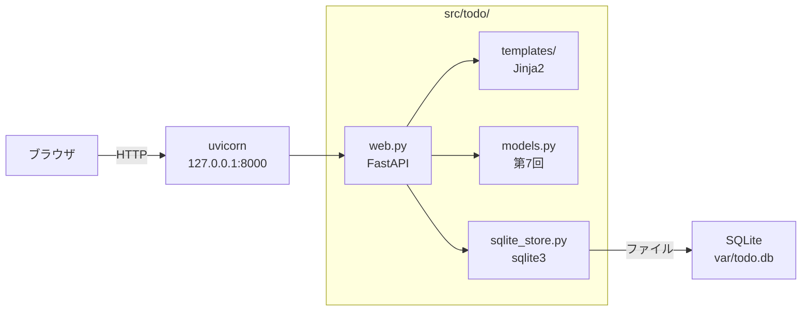

```sh
uv add fastapi jinja2 uvicorn python-multipart
```

#### 🖋 テスト用の HTTP クライアントを入れる

📚 FastAPI 公式 テスト

📒 TestClient は、サーバを立てずに `app` へ HTTP のリクエストを送る。中で使う HTTP クライアントが httpx2。テストでだけ使うので `--dev`

```sh
uv add --dev httpx2
```

#### 🖋 .gitignore と mise.toml を見本にそろえる

📒 見本の `.gitignore` は開発用 DB の `var/` と `.env` を足したもの。`mise.toml` は `[env]` に `TODO_DB_PATH`、タスクに `dev`（開発用サーバ）と `db-reset`（開発用 DB を消す）を足したもの

```sh
cp ~/handsoff/examples/todo-app-snapshots/session-11/{.gitignore,mise.toml} .; git diff .gitignore mise.toml
```

#### 🖋 コミットする

```sh
mise run check; git add .gitignore mise.toml pyproject.toml uv.lock; git commit -m "Web 版の依存パッケージと開発用のタスクを足す"
```

### 2. SqliteStore: Protocol に SQLite 版を足す（6分）

#### 🖋 レッド: 保存先のテストに sqlite を足す

📚 SE基礎 5章 自動テスト、pytest 公式 How to use fixtures

📒 見本の `test_store.py` は、第8回の fixture の `params` に `"sqlite"` を足し、開き直しても読めるテストを1つ足したもの。`SqliteStore` はまだないので `ModuleNotFoundError: No module named 'todo.sqlite_store'` で落ちる

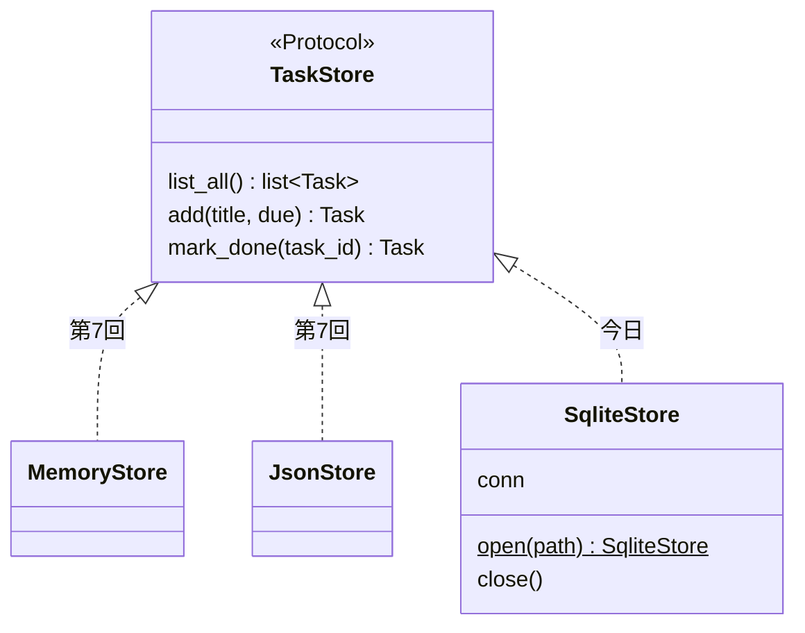

```sh
cp ~/handsoff/examples/todo-app-snapshots/session-11/tests/test_store.py tests/; git diff tests/test_store.py; mise run test
```

```sh
git add tests/test_store.py; git commit -m "レッド: SqliteStore でも保存先のテストを動かす"
```

#### 🖋 グリーン: SqliteStore をコピーして読む

📚 Python 公式 sqlite3、SE基礎 8章 データの取り扱い

📒 `open` はディレクトリとテーブルがなければ作る（`CREATE TABLE IF NOT EXISTS`）。`with self.conn:` はブロックを抜けるときにコミットし、例外ならロールバックする。値は SQL の文字列に埋め込まず `?` で渡す（SQL インジェクションを防ぐ）

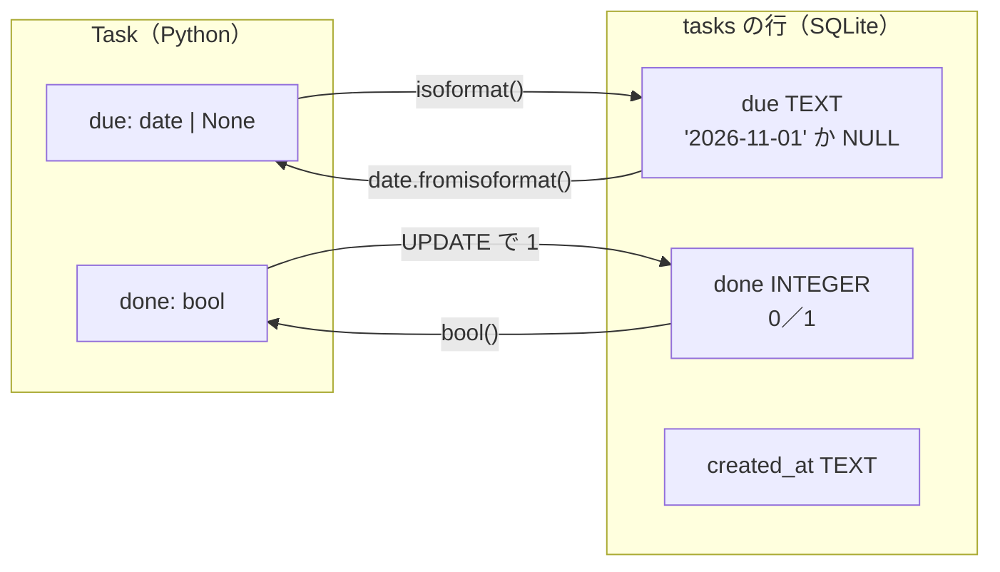

```sh
cp ~/handsoff/examples/todo-app-snapshots/session-11/src/todo/sqlite_store.py src/todo/; less src/todo/sqlite_store.py
```

#### 🖋 3つの保存先で同じテストが通るのを見る

📒 同じテストが `[memory]`・`[json]`・`[sqlite]` で通れば、`SqliteStore` も `TaskStore` の約束を守っている

```sh
uv run pytest -v tests/test_store.py   # [sqlite] が並び、15 passed（全体では 33 件）
```

#### 🖋 DB の中を見る

📒 `Task` は1行として保存される。期限は文字列、完了は 0、`created_at` はアプリが入れる。`var/` は `.gitignore` にあるのでコミットされない

```sh
uv run python -c 'from datetime import date; from pathlib import Path; from todo.sqlite_store import SqliteStore; s = SqliteStore.open(Path("var/todo.db")); print(s.add("牛乳を買う", date(2026, 11, 1))); print([tuple(r) for r in s.conn.execute("SELECT * FROM tasks")])'
# Task(id=1, title='牛乳を買う', due=datetime.date(2026, 11, 1), done=False)
# [(1, '牛乳を買う', '2026-11-01', 0, '2026-11-01T10:00:00')]
```

#### 🖋 グリーンをコミットする

```sh
mise run check; git add src/todo/sqlite_store.py; git commit -m "グリーン: SQLite に保存する SqliteStore を足す"
```

> 座学: `web.py` は `TaskStore` だけを知っていれば、保存先が SQLite でもメモリでも同じに書ける（→ まとめ「層と道具」）

### 3. レッド: 追加のテストを書く（6分）

#### 🖋 テストの fixture と補助の関数をコピーして読む

📚 FastAPI 公式 テスト、Testing Dependencies with Overrides

📒 fixture `client` は、`get_store` と `get_today` をテスト用に差し替えてから `TestClient` を渡す。`add` と `titles` はテストを短く書くための関数。今日は保存先 → 追加 → 入力エラー → 完了の順にテストを先に書く

```sh
cp ~/handsoff/docs/session11/assets/test_web.py tests/; less tests/test_web.py
```

#### 🖋 依存性の注入で差し替える仕組みを知る

📚 FastAPI 公式 依存関係、yield を持つ依存関係

📒 ルートの関数は保存先と今日を自分で作らず、引数（`StoreDep`・`TodayDep`）で受け取る。本番では FastAPI が `get_store`・`get_today` を呼ぶ。テストでは `dependency_overrides` に書いた関数を代わりに呼ぶ

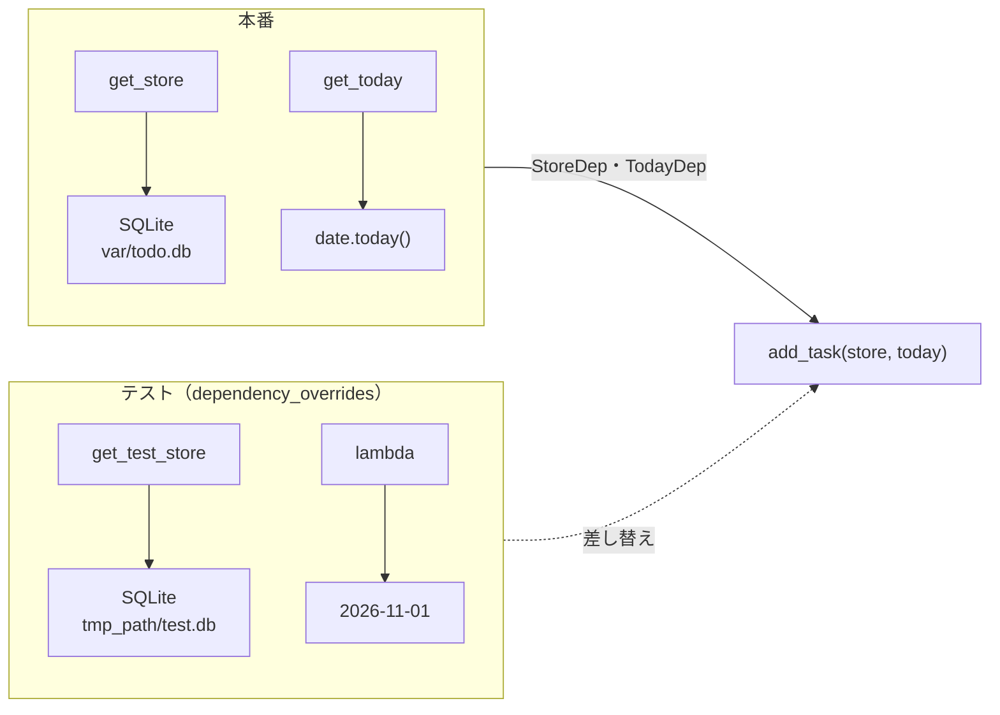

#### 🖋 fixture の流れを読む

📒 `yield` の前が準備、後が片付け。テストごとに `tmp_path` が新しくなるので、DB は毎回空から始まり、開発用の `var/todo.db` には触れない

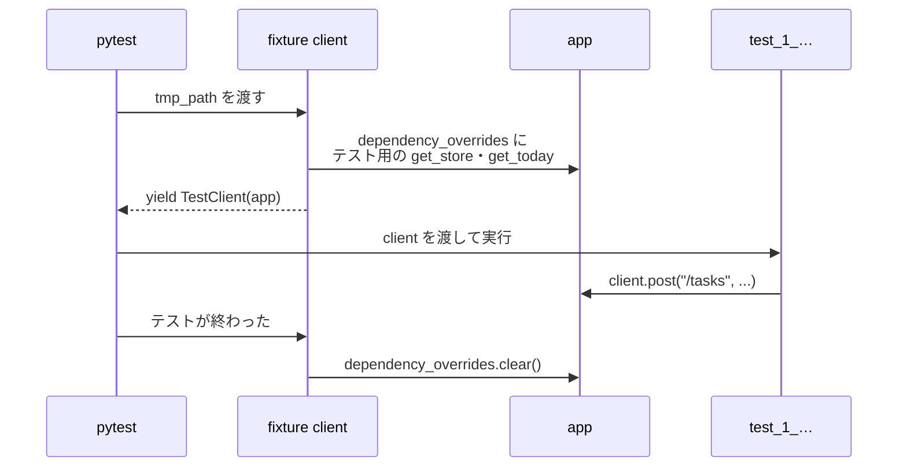

#### 🖋 追加のテストを書く

📒 受け入れ条件 (1) をテストにする。「手順3: ここに …」の行を置き換える。TestClient は 303 のリダイレクトを既定で追うので、`response` は `GET /` の結果になる

```python
def test_1_追加すると一覧へリダイレクトし未着手で出る(client: TestClient) -> None:
    response = client.post("/tasks", data={"title": "牛乳を買う", "due": "2026-11-01"})

    assert response.status_code == 200  # リダイレクトの先（GET /）
    assert response.url.path == "/"
    assert titles(response.text) == ["牛乳を買う"]
    assert '<span class="status">未着手</span>' in response.text
```

#### 🖋 失敗を見てコミットする

📒 `ModuleNotFoundError: No module named 'todo.web'` で落ちる。まだ `web.py` がないから落ちた、と言えればよい

```sh
mise run test; git add tests/test_web.py; git commit -m "レッド: タスクを追加すると一覧に出るテスト"
```

> 座学: 失敗の表示を全員で読む。何がないから落ちたか（→ まとめ「TDD とテストの元」）

### 4. グリーン: web.py とテンプレート（8分）

#### 🖋 素材の web.py とテンプレートをコピーする

📚 FastAPI 公式 Templates、Web技術の基本 5章

📒 素材の `web.py` には、依存関係（`get_store`・`get_today`・`StoreDep`・`TodayDep`）、一覧を描く `render_index`、`GET /` の `index` まである。テンプレートは見本をそのまま使う。`index.html` は `base.html` を継承し、`` だけを書く

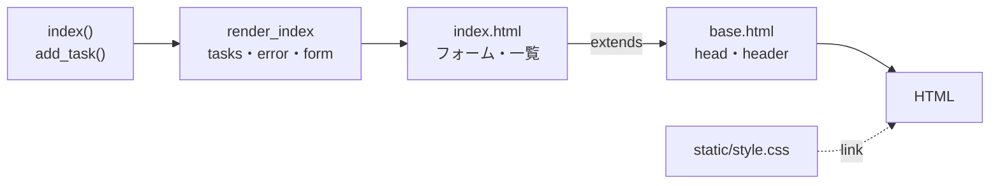

```sh
cp ~/handsoff/docs/session11/assets/web.py src/todo/; cp -r ~/handsoff/examples/todo-app-snapshots/session-11/src/todo/{templates,static} src/todo/; ls src/todo
```

#### 🖋 まだ落ちるのを見る

📒 `assert 404 == 200`。`POST /tasks` の URL がまだないので 404 になる

```sh
mise run test
```

#### 🖋 add_task を書く

📚 FastAPI 公式 フォームデータ

📒 「手順4: ここに …」の行を置き換える。テストを通す最小の形にし、入力エラーのことはまだ考えない。成功したら 303 で `/` へ戻す（第10回の POST → 303 → GET）

```python
@app.post("/tasks")
def add_task(
    store: StoreDep, title: Annotated[str, Form()], due: Annotated[str, Form()] = ""
) -> RedirectResponse:
    """A-02 追加。入力のチェックは CLI と同じ関数（models.py）を使う。"""
    store.add(validate_title(title), parse_due(due))
    # POST → リダイレクト → GET にして、再読み込みで二重に追加されないようにする
    return RedirectResponse("/", status_code=303)
```

#### 🖋 リクエストの流れを追う

📒 FastAPI は、リクエストごとに `get_store` を呼んで DB を開き、ルートの関数に渡す。レスポンスを返した後、`yield` の後ろ（`finally` の `close()`）が動いて閉じる

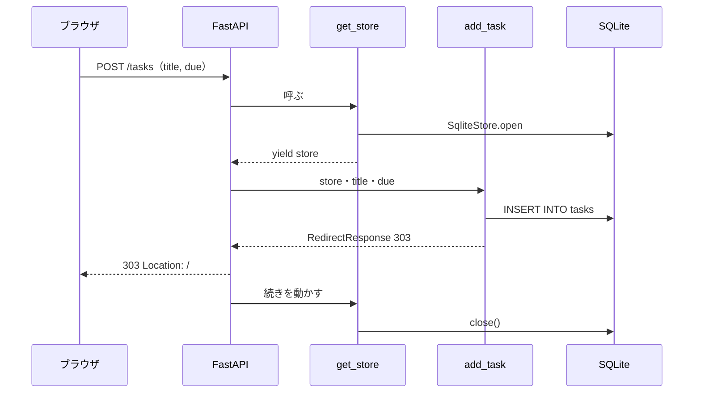

#### 🖋 グリーンを確かめてコミットする

```sh
mise run check; git add src; git commit -m "グリーン: タスクの追加と一覧のページを作る"   # 34 passed
```

### 5. 入力エラーを 400 にする（5分）

#### 🖋 レッド: 空のタイトルのテストを書く

📚 SE基礎 5章、API設計書 4章

📒 受け入れ条件 (3) をテストにする。「手順5: ここに …」の行を置き換える。`""` と `"   "`（空白だけ）の2組で動く

```python
@pytest.mark.parametrize("title", ["", "   "])
def test_3_タイトルが空なら追加せずエラーを出す(client: TestClient, title: str) -> None:
    response = client.post("/tasks", data={"title": title, "due": ""})

    assert response.status_code == 400
    assert '<p class="error" role="alert">タイトルを入力してください</p>' in response.text
    assert "タスクはありません" in response.text
```

#### 🖋 2つの落ち方を読む

📒 `""` は `assert 422 == 400`。必須の `Form()` に空の値が来たので、FastAPI が関数を呼ぶ前に 422（JSON）を返した。`"   "` は `InvalidTaskError: タイトルを入力してください`。`validate_title` の例外をどこも受け止めていない

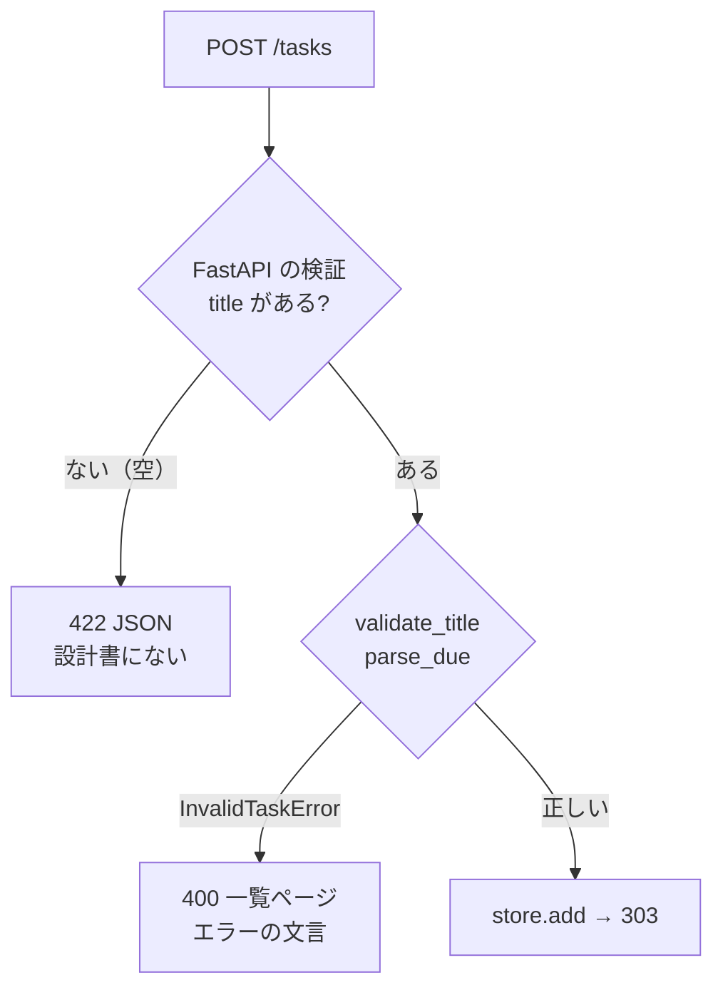

```sh
mise run test; git add tests/test_web.py; git commit -m "レッド: タイトルが空なら 400 でエラーの文言を出すテスト"
```

#### 🖋 グリーン: 例外を 400 の一覧ページにする

📒 `title` にも既定値 `""` を付け、空の値も関数まで届ける。`InvalidTaskError` を受け止めて、`render_index` で 400 の一覧ページを返す。文言は `str(e)`（CLI と同じ文言）、入力した値は `form` でフォームに残す。`from todo.models import` に `InvalidTaskError` を足し、`add_task` を下に置き換える

```python
@app.post("/tasks", response_model=None)
def add_task(
    request: Request,
    store: StoreDep,
    today: TodayDep,
    title: Annotated[str, Form()] = "",
    due: Annotated[str, Form()] = "",
) -> HTMLResponse | RedirectResponse:
    """A-02 追加。入力のチェックは CLI と同じ関数（models.py）を使う。"""
    try:
        store.add(validate_title(title), parse_due(due))
    except InvalidTaskError as e:
        form = {"title": title, "due": due}
        return render_index(request, store, today, error=str(e), form=form, status_code=400)
    # POST → リダイレクト → GET にして、再読み込みで二重に追加されないようにする
    return RedirectResponse("/", status_code=303)
```

```sh
mise run check; git add src; git commit -m "グリーン: 入力エラーは 400 で一覧とエラーの文言を返す"   # 36 passed
```

> 座学: 型の変換は FastAPI に任せ、決まり（空・100文字・日付の形）は `models.py` の関数で確かめる。CLI と Web で文言が1か所にそろう（→ まとめ「層と道具」）

### 6. 完了と 404（5分）

#### 🖋 レッド: 完了と、ないタスクのテストを書く

📚 FastAPI 公式 テスト、API設計書 A-03

📒 受け入れ条件 (13)・(14) をテストにする。「手順6: ここに …」の行を置き換える。303 そのものを確かめたいので `follow_redirects=False` を付ける

```python
def test_13_完了にすると一覧へリダイレクトし期限切れだったものも完了と出る(
    client: TestClient,
) -> None:
    add(client, "牛乳を買う", "2026-10-31")

    response = client.post("/tasks/1/done", follow_redirects=False)

    assert response.status_code == 303
    assert response.headers["location"] == "/"
    html = client.get("/").text
    assert '<span class="status">完了</span>' in html
    assert "期限切れ</span>" not in html


def test_14_ないタスクを完了にすると404(client: TestClient) -> None:
    response = client.post("/tasks/99/done")

    assert response.status_code == 404
    assert '<p class="error" role="alert">タスクが見つかりません</p>' in response.text
```

#### 🖋 失敗を見てコミットする

📒 URL がまだないので、(13) は `assert 404 == 303` で落ちる。(14) はステータスの 404 は合っているが、本文が FastAPI の `{"detail":"Not Found"}` なので落ちる。文言まで確かめるから、URL がないだけの 404 と区別できる

```sh
mise run test; git add tests/test_web.py; git commit -m "レッド: 完了にすると 303、ないタスクは 404 のテスト"
```

#### 🖋 グリーン: mark_done を書く

📒 「手順6: ここに …」の行を置き換え、`from todo.store import` に `TaskNotFoundError` を足す。`SqliteStore.mark_done` は更新した行が0件なら `TaskNotFoundError` を出す。ルートの `mark_done` はこの例外を受け止めて、404 の一覧ページを返す

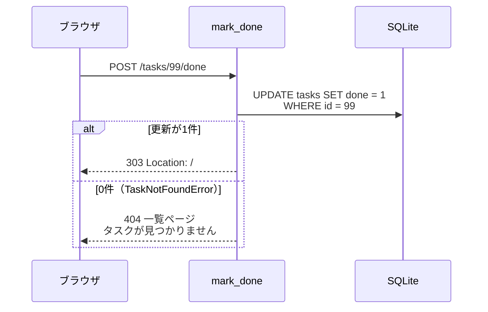

```python
@app.post("/tasks/{task_id}/done", response_model=None)
def mark_done(
    request: Request, task_id: int, store: StoreDep, today: TodayDep
) -> HTMLResponse | RedirectResponse:
    """A-03 完了。"""
    try:
        store.mark_done(task_id)
    except TaskNotFoundError:
        return render_index(request, store, today, error="タスクが見つかりません", status_code=404)
    return RedirectResponse("/", status_code=303)
```

```sh
mise run check; git add src; git commit -m "グリーン: タスクを完了にする"   # 38 passed
```

### 7. 残りの受け入れ条件のテストを足して読む（4分）

#### 🖋 見本のテストを末尾に足す

📚 SE基礎 5章

📒 (2)・(4)〜(12)・(15) と、設計レビューで決めたこと・`TODO_DB_PATH` のテストを足す。テスト名の頭の番号で、受け入れ条件と対応を取る

```sh
cat ~/handsoff/docs/session11/assets/test_web_rest.py >> tests/test_web.py; mise run test   # 53 passed
```

#### 🖋 わざと壊して、並び順のテストが落ちるのを見る

📒 コピーしたテストは最初から通った。本当に確かめているかは、壊して落ちるかで見る。一覧の並べ替えを外すと (7) だけが落ちる

```sh
sed -i 's/tasks = sort_by_due(store.list_all())/tasks = store.list_all()/' src/todo/web.py; mise run test; git restore src/todo/web.py
```

#### 🖋 わざと壊して、エスケープのテストが落ちるのを見る

📚 FastAPI 公式 Templates

📒 Jinja2 の `| safe` はエスケープを止める。タイトルの `<script>` がそのまま HTML になり、(10) が落ちる（第3回の XSS）

```sh
sed -i 's/{{ task.title }}/{{ task.title | safe }}/' src/todo/templates/index.html; mise run test; git restore src/todo/templates/index.html
```

#### 🖋 テストをコミットする

📒 実装を変えずに通ったテストなので `テスト:` を付ける

```sh
mise run check; git add tests/test_web.py; git commit -m "テスト: 残りの受け入れ条件のテストを見本から足す"
```

### 8. ブラウザと curl で確かめる（3分）

#### 🖋 開発用サーバを起動する

📚 Web技術の基本 5章

📒 `--reload` はコードを保存すると読み直す。DB は `mise.toml` の `TODO_DB_PATH`（`var/todo.db`）で、テストの DB とは別

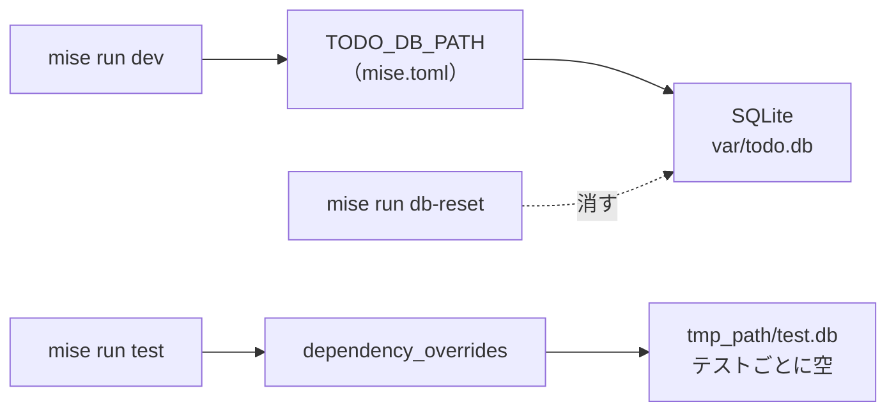

```sh
mise run dev     # 止めるときは Ctrl+C
```

- 確認: ブラウザで `http://127.0.0.1:8000/` を開くと、手順2で入れた「牛乳を買う」が出る。追加・完了・「期限切れだけ」を試す

#### 🖋 303 のレスポンスを curl で見る

📒 別のターミナルで送る。303 と `Location`、日本語を送る `--data-urlencode` は第3回のログインと同じ

```sh
curl -i --data-urlencode "title=本を返す" -d "due=2026-11-05" http://127.0.0.1:8000/tasks
```

```text
HTTP/1.1 303 See Other      ← 追加できた
server: uvicorn
content-length: 0
location: /                 ← 一覧ページ
```

#### 🖋 400 と 404 を curl で見る

```sh
curl -si --data-urlencode "title=   " http://127.0.0.1:8000/tasks | grep -E "^HTTP|error"
curl -si -X POST http://127.0.0.1:8000/tasks/99/done | grep -E "^HTTP|error"
```

```text
HTTP/1.1 400 Bad Request                                      ← 入力が正しくない
<p class="error" role="alert">タイトルを入力してください</p>      ← 一覧ページのエラー表示欄
HTTP/1.1 404 Not Found                                        ← 対象がない
<p class="error" role="alert">タスクが見つかりません</p>
```

### 9. PR を出してマージする（4分）

#### 🖋 設計書と見比べる

📚 SE基礎 4章 モデル

📒 API設計書 5章のシーケンス図（追加・完了）と、手順4・6の流れが同じかを見る。設計書どおりに作れたので設計書は変えない。変えるときは同じ PR で設計書も直す

```sh
git diff main --stat -- docs/design   # 何も出ない
```

#### 🖋 README と受け入れ条件の控えをそろえる

📒 見本の README は Web 版の使い方と `mise run dev`・`db-reset`・コードの構成を足したもの。`docs/stories.md` は受け入れ条件 (1)〜(15) にチェックを付けたもの

```sh
cp ~/handsoff/examples/todo-app-snapshots/session-11/README.md .; cp ~/handsoff/examples/todo-app-snapshots/session-11/docs/stories.md docs/; git diff --stat; git add README.md docs/stories.md; git commit -m "README に Web 版の使い方を書き、受け入れ条件にチェックを付ける"
```

#### 🖋 履歴を確かめて push する

📒 レッドとグリーンが交互に並ぶ。図ではレッドのコミットを四角で示す

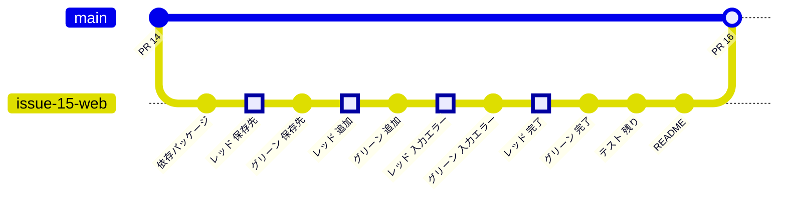

```sh
git log --oneline main..; git push -u origin issue-15-web
```

#### 🖋 PR を作り、セルフレビューする（ブラウザ）

📚 Pro Git 6.2、GitHub Docs キーワードを使用して Pull Request を Issue にリンクする

📒 本文は[テンプレート](../templates/pull_request.md)で書く。目的に `Closes #15` と、ストーリーの `Closes #8`〜`Closes #11` を1行ずつ書く（`Closes #8, #9` では #9 が閉じない）。確認方法に `mise run check` と `mise run dev` での操作を書き、`[確認]` の行コメントを1件以上残す

#### 🖋 CI が緑になってからマージする

📒 CI でも `mise run setup` が `uv.lock` どおりに FastAPI などを入れてから、53件のテストを動かす。赤なら、ログの失敗した行を読み、手元の `mise run check` で再現して直す

```sh
git switch main; git pull; git branch -d issue-15-web; mise run check
```

- 確認: Issue #8〜#11・#15 が Closed、マイルストーン `Web 版` の進み具合が 100%。main で `mise run check` が通り、`mise run dev` で追加・一覧・完了ができる

## 読む章

| 区分 | 資料 | 範囲 | 読み方 |
| --- | --- | --- | --- |
| 参考書 | [ソフトウェアエンジニアリングの基礎](https://www.oreilly.co.jp/books/9784814401789/)（SE基礎） | 5章 自動テスト、8章 データの取り扱い | 通読（5章は第8回の続き、8章は第10回の続き） |
| 参考書 | [イラスト図解式 この一冊で全部わかるWeb技術の基本 第2版](https://www.maruzenjunkudo.co.jp/products/9784815625948)（Web技術の基本） | 5章 Webアプリケーションの基本 | 該当章 |
| 無料 | [FastAPI 公式ドキュメント](https://fastapi.tiangolo.com/ja/) | チュートリアル（フォームデータ、依存関係、yield を持つ依存関係、テスト）、高度なユーザーガイド（Templates、Testing Dependencies with Overrides） | 該当章（書きながら引く） |
| 無料 | [Python 公式ドキュメント](https://docs.python.org/ja/3/) | `sqlite3`（プレースホルダ、コンテキストマネージャとしての接続） | 困ったときに引く |
| 無料 | [GitHub Docs](https://docs.github.com/ja) | キーワードを使用して Pull Request を Issue にリンクする | 困ったときに引く |
| 紹介（副読本） | [達人に学ぶDB設計徹底指南書 第2版](https://www.maruzenjunkudo.co.jp/products/9784798186627) | 6章 インデックス設計、7章 論理設計のアンチパターン | 持っている人は（テーブルが増えたとき） |
