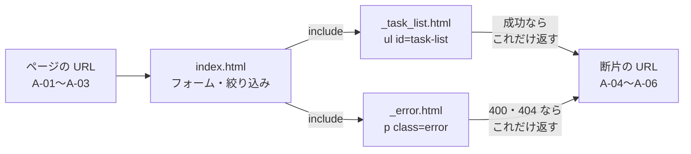
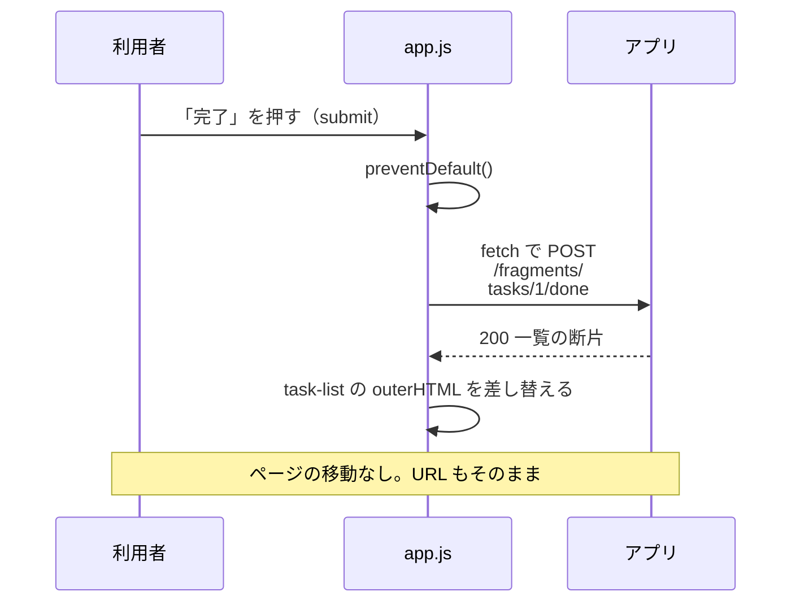
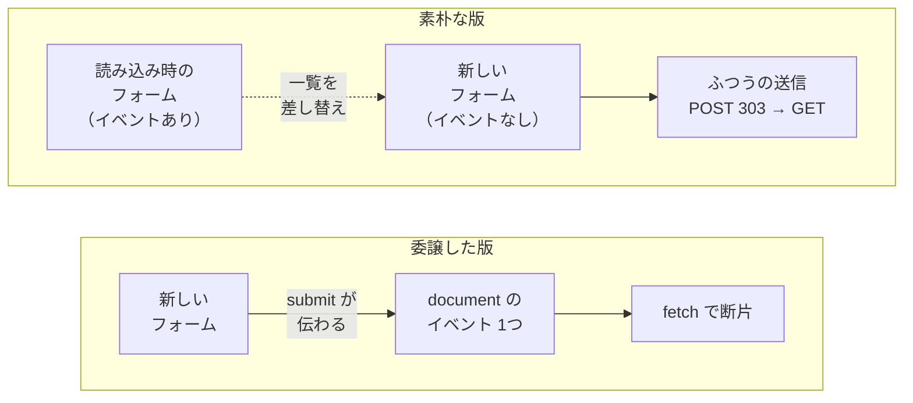
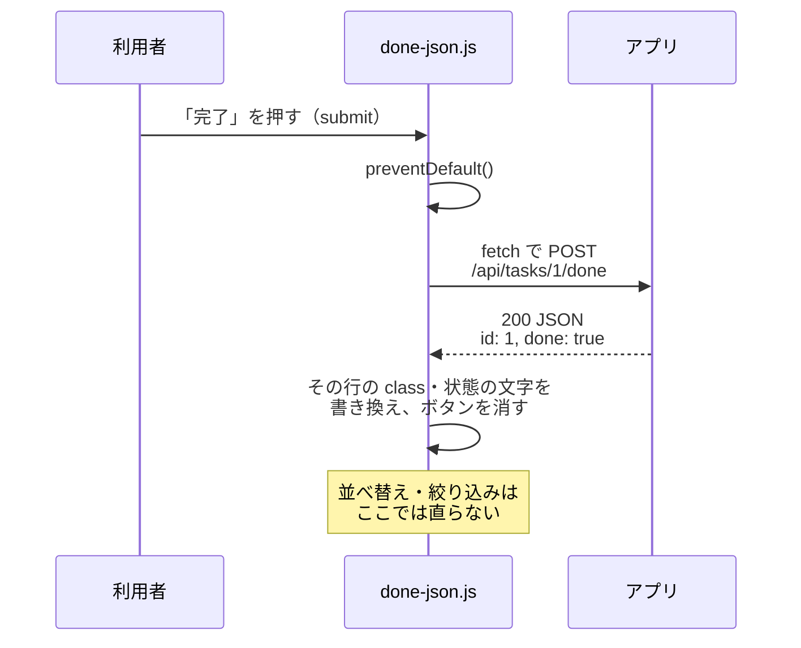
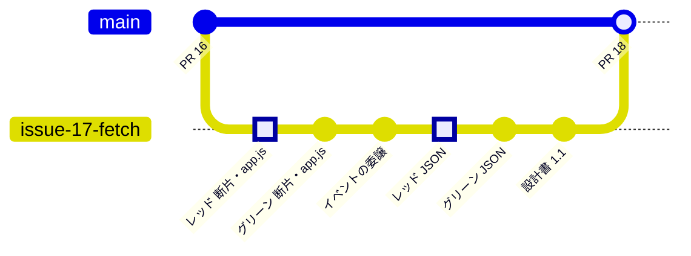
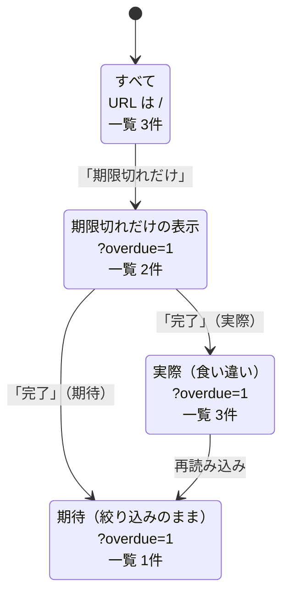
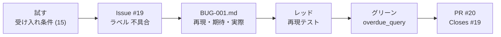

# 第12回 画面の部分更新と成果発表
tag: web-ブラウザ, test-レビュー
前提タグ: http, web-サーバ, test-自動
所要: 座学5分 / ハンズオン25分 / 発表準備5分 / 発表25分

## ゴール

- HTML 断片を返す URL をテスト先行で足し、fetch で一覧だけを差し替えられる
- 差し替えた一覧のボタンでイベントが動かない理由を言い、イベントの委譲で直せる
- 完了ボタンの JSON 版と比べ、画面をどこで組み立てるかの違いを説明できる
- 見つけた不具合を Issue と不具合票にし、再現テスト（レッド）→ 修正（グリーン）→ PR の順で直せる
- 作った TODO アプリを、構成・デモ・根拠を添えた工夫1つで短く発表できる

## 事前準備

- 第11回のハンズオンの最後（PR #16 のマージ）まで済み、`~/handsoff/workspace/todo-app` の main で `mise run check` が通る（53 passed）。Issue・PR は #16 まで使用済み
- 第3回で、開発者ツールの Network タブとコンソール、`fetch` を使った
- 遅れた人: [session-11/](../../examples/todo-app-snapshots/session-11/) を [examples/README.md](../../examples/README.md#遅れた人が追いつく方法) の手順でコピーし、push してから始める
- ブラウザは Chrome か Edge。社内ネットワークでは `NO_PROXY`・`no_proxy` に `localhost,127.0.0.1`（第2回）
- 発表はプロジェクターにつないだ自分の PC で行う（デモは `mise run dev`）
- 素材: [assets/](assets/)（`templates/`・`test_fragments.py`・`fragments.py`・`app.js`・`test_json.py`・`json_api.py`・`presentation.md`）

## まとめ

冒頭の座学で使います。前半で第11回の Web 版の一覧を部分更新にして、そこで生まれた不具合を直し、後半で1人ずつ発表します。

### 部分更新の作り（web-ブラウザ）

| 部品 | このアプリでは | 参照 |
| --- | --- | --- |
| HTML 断片 | ページ全体ではなく `<ul id="task-list">` だけを返す URL。ページと断片で同じテンプレート（`_task_list.html`）を使う | Web技術の基本 5章（Ajax） |
| `data-fragment` | フォームの `action`（ふつうの送信先）は残し、fetch の送り先を属性で足す。JavaScript がなくても動く | MDN data-* 属性 |
| `app.js` | submit を `preventDefault()` で止め、`fetch` で送り、返った断片で `outerHTML` を差し替える | MDN フェッチ API の使用 |
| イベントの委譲 | 差し替えた新しいボタンには、読み込み時に付けたイベントがない。`document` に1つだけ付け、親へ伝わる submit を受け取る | MDN イベント入門 |

| URL（API設計書 1.1） | 返すもの |
| --- | --- |
| `GET /fragments/tasks`（A-04） | 一覧の断片。`?overdue=1` で期限切れだけ |
| `POST /fragments/tasks`（A-05）・`POST /fragments/tasks/{id}/done`（A-06） | 処理して一覧の断片。入力エラーは 400、ない id は 404 で `<p class="error" role="alert">` の断片 |
| `POST /api/tasks/{id}/done`（A-07、比較用） | `{"id": 1, "done": true}`。ない id は 404 で `{"detail": "タスクが見つかりません"}` |

### HTML 断片と JSON

| 観点 | HTML 断片（基本形） | JSON（比較用、完了ボタンだけ） |
| --- | --- | --- |
| 画面を組み立てる場所 | サーバ（ページと同じテンプレート） | ブラウザ（`done-json.js`） |
| JavaScript の役割 | 送って差し替えるだけ。追加と完了で共通 | JSON から DOM を書き換える。機能ごとに要る |
| 表示の決まり | テンプレート1か所 | テンプレートと JavaScript の2か所。並べ替え・絞り込みは直らない |
| テスト | 返す HTML を pytest で確かめられる | 画面の書き換えはブラウザ側のテストが別に要る |
| XSS | テンプレートが自動でエスケープ | 受け取った値は `textContent` で入れる（第3回） |

### 不具合票（test-レビュー）

| 項目 | 書くこと | 参照 |
| --- | --- | --- |
| 再現手順 | 誰がやっても同じになる番号付きの操作。日付は「昨日」「来週」のように今日から数える | [不具合票のテンプレート](../templates/bug-report.md) |
| 期待結果と根拠 | 本来どうなるか。受け入れ条件・設計書の該当箇所 | SE基礎 6章 |
| 実際の結果 | 見えたものをそのまま。Network タブの URL・ステータスも | SE基礎 6章 |
| 直す順 | Issue（ラベル `不具合`）→ 票 → 再現テスト（レッド）→ 修正（グリーン）→ PR に `Closes` | [研修の規約](../session05/assets/commit-convention.md) |

### 発表

| 項目 | 基準 | 参照 |
| --- | --- | --- |
| 聞き手 | このアプリを初めて見る人。用語は構成図の箱の名前で言う | SE基礎 13章 |
| 順番 | 何を作ったか → 構成 → デモ → 工夫1つ（`docs/presentation.md` の4節） | 素材 [presentation.md](assets/presentation.md) |
| デモ | DB を空にし、見せるストーリーの順に3〜5手。部分更新は Network タブで見せる | — |
| 工夫は1つ | 主張を1文で言い、聞き手が後で開ける根拠を付ける（テスト名・PR の番号・設計書の節・不具合票） | SE基礎 13章 |
| 聞く側 | 良かった点を1つ＋質問を1つ。質問は「なぜその設計か」「どう確かめたか」 | SE基礎 13章 |

### 12回で通ったところ

| フェーズ | 回 | 身につけたこと | 残ったもの |
| --- | --- | --- | --- |
| 環境 | 1・2・4 | Linux の全体像、シェル・PATH・プロキシ、mise と uv で再現できる環境 | 環境設定手順書、mise.toml |
| Web | 3 | HTTP・Cookie・CORS・Web API、DOM と fetch | — |
| 構成管理 | 5 | commit・ブランチ・PR・セルフレビュー・コンフリクトの解決 | 手順書のリポジトリ、PR 2本 |
| Python | 6〜8 | CLI、dataclass と Protocol、ruff・mypy、pytest と TDD、CI | `todo-app` の PR #2・#4・#6 |
| 設計 | 9・10 | ストーリーと受け入れ条件、幅のある見積、API・DB設計書、構成図 | `docs/`、PR #12・#14 |
| 実装 | 11・12 | FastAPI＋SQLite を TDD で、fetch による部分更新、不具合票 | `src/`・`tests/`、PR #16・#18・#20 |
| 総括 | 12 | 作ったものを根拠とともに伝える | 発表資料、PR #22 |

地図: [研修で扱う知識の系統図](../diagrams/knowledge-map.png)、[全体像（回ごとの流れ）](../diagrams/overview.png)

## ハンズオン

1ステップ1コマンド。各ステップは「🖋 やること → 📚 参考書・公式資料の節 → 📒 説明 → コマンドやコード」。作業場所は `~/handsoff/workspace/todo-app/`。ターミナルを2つ使う（①開発用サーバ、②コマンド）。見本は [session-12/](../../examples/todo-app-snapshots/session-12/)（[examples/session12/](../../examples/session12/README.md)）。

### 1. 断片の URL と app.js をテスト先行で足す（6分）

#### 🖋 開発用サーバを起動する（ターミナル①）

📒 `mise run dev` は `--reload` 付きなので、ファイルを保存するたびにコードを読み直す。この回のあいだ起動したままにする

```sh
cd ~/handsoff/workspace/todo-app
git switch main; git pull; mise run dev
```

#### 🖋 Issue を立てる（ブラウザ）

📚 GitHub Docs Issue の作成

📒 第11回の PR が #16 なので、この Issue は #17 になる（GitLab では出た番号を使う）。本文は[タスク用テンプレート](../templates/issue_task.md)で書き、ラベル `タスク` を付ける

| Issue | タイトル | 目的 | 完了条件 |
| --- | --- | --- | --- |
| #17 | 一覧を fetch で部分更新する | 追加・完了のたびにページ全体を読み直さず、一覧だけを差し替える | 断片の URL（A-04〜A-06）のテストが通り、JavaScript がなくても動く。比較用の JSON 版がある |

#### 🖋 ブランチを作る（ターミナル②）

```sh
cd ~/handsoff/workspace/todo-app
git switch -c issue-17-fetch
```

#### 🖋 レッド: 素材のテストを足す

📚 SE基礎 5章 自動テスト

📒 素材のテスト7件を `tests/test_web.py` の末尾に足す。確かめるのは、一覧の断片（404）、断片での追加（405）と完了（404）、フォームの `data-fragment`、ページが `app.js` を読み込むこと

```sh
cat ~/handsoff/docs/session12/assets/test_fragments.py >> tests/test_web.py; mise run test   # 7 failed
git add tests/test_web.py; git commit -m "レッド: HTML 断片を返し、ページが app.js を読み込むテスト"
```

#### 🖋 一覧を断片のテンプレートに切り出す

📚 FastAPI 公式 Templates

📒 素材の `_task_list.html` は `index.html` の `<ul id="task-list">` を切り出したもの。`index.html` は `` で同じものを使い、フォームに `data-fragment` を足す。`base.html` は `app.js` を読み込む。落ちていたテストのうち、`data-fragment` のテストが通る



```sh
cp ~/handsoff/docs/session12/assets/templates/*.html src/todo/templates/; git diff --stat; mise run test   # 6 failed
```

#### 🖋 グリーン: 素材のルートと app.js を足して読む

📚 MDN フェッチ API の使用

📒 `fragments.py` は第11回の `add_task`・`mark_done` と同じ処理で、成功なら 303 の代わりに一覧の断片、失敗なら一覧ページの代わりにエラーの断片を返す。`app.js` は送信を止めて fetch で送り、返った断片で一覧かエラー欄を差し替える



```sh
cp ~/handsoff/docs/session12/assets/app.js src/todo/static/; cat ~/handsoff/docs/session12/assets/fragments.py >> src/todo/web.py
less src/todo/static/app.js src/todo/web.py   # :n で次のファイル、q で終わる
mise run check; git add src; git commit -m "グリーン: 断片を返す URL と、送信を横取りする app.js"   # 60 passed
```

### 2. イベントの委譲に直す（4分）

#### 🖋 ブラウザで試す

📒 `http://127.0.0.1:8000/` を再読み込みし、`F12` →「ネットワーク」→「ログを保持」に✓。2件追加し、「完了」を押す。追加はタイプ `fetch` だが、完了は `document` の `POST /tasks/…/done`（303）→ `GET /` で、ページ全体を読み直す。なぜかを考える

#### 🖋 見本の app.js に替えて違いを読む

📚 MDN イベント入門（イベントの委譲）

📒 追加で一覧を差し替えると、新しい「完了」ボタンには読み込み時に付けたイベントがない。見本の版は `document` に1つだけ付け、`event.target` で送られたフォームを見る。差し替えた後のフォームの submit も `document` まで伝わる



```sh
cp ~/handsoff/examples/todo-app-snapshots/session-12/src/todo/static/app.js src/todo/static/; git diff
```

#### 🖋 もう一度試してコミットする

📒 再読み込みして、追加 → 完了 → 完了がすべて `fetch` になることを見る。空白だけのタイトルで追加すると、400 のエラーの断片がエラー欄に入る。応答のサイズを `GET /`（ページ全体）と比べる

```sh
git commit -am "app.js のイベントを document にまとめて付ける（イベントの委譲）"
```

### 3. 完了ボタンだけ JSON 版にして比べる（5分）

#### 🖋 レッド: JSON のテストを足す

📚 Web技術の基本 4章（JSON）

📒 完了にすると `{"id": 1, "done": true}`、ない id は 404 と `{"detail": "タスクが見つかりません"}` を返すテスト。URL がないので 404 と `{'detail': 'Not Found'}` で落ちる

```sh
cat ~/handsoff/docs/session12/assets/test_json.py >> tests/test_web.py; mise run test   # 2 failed
git add tests/test_web.py; git commit -m "レッド: JSON で完了にすると id と done を返すテスト"
```

#### 🖋 グリーン: import を足し、素材のルートを足す

📚 FastAPI 公式 レスポンスモデル、エラーハンドリング

📒 `src/todo/web.py` の import を、下のように直す（`HTTPException` と `BaseModel` を足す）。素材の `DoneOut` は戻り値の型で、FastAPI が JSON にする

```python
from fastapi import Depends, FastAPI, Form, HTTPException, Request
from fastapi.responses import HTMLResponse, RedirectResponse
from fastapi.staticfiles import StaticFiles
from fastapi.templating import Jinja2Templates
from pydantic import BaseModel
```

```sh
cat ~/handsoff/docs/session12/assets/json_api.py >> src/todo/web.py; mise run check   # 62 passed
```

#### 🖋 JSON から画面を組み立てる版をコピーして読む

📚 MDN Node.textContent

📒 見本の `done-json.js` は、受け取った JSON から、その行の class・状態の文字・ボタンを自分で書き換える。表示の決まりがテンプレートとここの2か所に分かれる



```sh
cp ~/handsoff/examples/todo-app-snapshots/session-12/src/todo/static/done-json.js src/todo/static/; less src/todo/static/done-json.js
```

#### 🖋 JSON 版に差し替えて比べる

📒 `base.html` の読み込みを替えて再読み込みし、期限が昨日のタスクを足す。「期限切れだけ」の表示で「完了」を押すと、JSON 版では行が「完了」のまま残る（断片の版では消える）。応答は約20バイト。比べたら戻す

```sh
sed -i 's/app.js" defer/done-json.js" defer/' src/todo/templates/base.html
git restore src/todo/templates/base.html   # 比べ終わったら
```

#### 🖋 コミットする

```sh
mise run check; git add src; git commit -m "グリーン: JSON で完了にする URL と、比較用の done-json.js"
```

> 座学: 3つの作り（フォーム送信・HTML 断片・JSON）で、画面をどこで組み立て、どこでテストするか（→ まとめ「HTML 断片と JSON」）

### 4. 設計書をそろえて PR を出す（2分）

#### 🖋 設計書を見本にそろえる

📚 SE基礎 4章 モデル

📒 見本の API設計書 1.1 は A-04〜A-07、`data-fragment`、断片と JSON のシーケンス図、7章の比較表を足したもの。システム構成図 1.1 はブラウザの JavaScript を足したもの。作った URL と見比べる

```sh
cp ~/handsoff/examples/todo-app-snapshots/session-12/docs/design/{api,architecture}.md docs/design/; git diff --stat
git commit -am "API設計書とシステム構成図に断片と JSON の URL を足す（1.1）"
```

#### 🖋 push して PR を出し、マージする

📚 GitHub Docs キーワードを使用して Pull Request を Issue にリンクする

📒 PR は #18 で、目的に `Closes #17`、確認方法に `mise run check` と「Network で追加・完了が `fetch` になる」を書く。CI が緑になってからマージする



```sh
git push -u origin issue-17-fetch
git switch main; git pull; git branch -d issue-17-fetch   # マージした後
```

### 5. 不具合を見つけて票にし、テスト先行で直す（8分）

#### 🖋 受け入れ条件 (15) を部分更新で試す（ブラウザ）

📚 SE基礎 6章 初めて触れるシステムの調査と変更

📒 `mise run db-reset` の後、「牛乳を買う」「本を返す」（期限 昨日）と「レポートを出す」（期限 来週）を追加し、「期限切れだけ」→「牛乳を買う」の「完了」を押す。一覧と、絞り込みのリンクと URL を見比べる



```sh
mise run db-reset   # ターミナル②で
```

#### 🖋 Network で原因の見当を付ける

📒 「完了」の行の URL を見る。`POST /fragments/tasks/1/done` に `?overdue=1` が付いていないので、サーバは全件の断片を返した。ページ全体を返す版は完了すると `/` に移ったので、食い違わなかった

#### 🖋 不具合の Issue を立てる（ブラウザ）

📚 GitHub Docs ラベルを管理する

📒 Issue は #19。ラベル `不具合` を新しく作って付ける。本文は不具合票と同じ項目（概要・再現手順・期待結果・実際の結果）で書く

| Issue | タイトル | ラベル |
| --- | --- | --- |
| #19 | 期限切れだけの表示中に完了すると全件が表示される | `不具合` |

#### 🖋 ブランチを作り、不具合票を書く

📒 テンプレートをコピーして埋める。期待結果には根拠（受け入れ条件 (15)、API設計書 2章 A-01 の `data-fragment` の説明）を書く。書けたら[見本の BUG-001](../../examples/todo-app-snapshots/session-12/docs/bugs/BUG-001.md) と見比べる

```sh
git switch -c issue-19-overdue-done; mkdir -p docs/bugs; cp ~/handsoff/docs/templates/bug-report.md docs/bugs/BUG-001.md
git add docs/bugs; git commit -m "不具合票 BUG-001 を書く"   # 埋め終わったら
```

#### 🖋 レッド: 不具合を再現するテストを書く

📒 `tests/test_web.py` の末尾に、前と2行空けて足す（ruff の決まり）。「期限切れだけ」のページの完了ボタンの送り先に `?overdue=1` がないので落ちる。先に再現テストを書くと、直ったことと、二度と起きないことを確かめられる

```python
# ---- 不具合票 docs/bugs/ の再現テスト ----


def test_BUG001_期限切れだけの表示中に完了しても期限切れだけを返す(client: TestClient) -> None:
    add(client, "牛乳を買う", "2026-10-30")
    add(client, "本を返す", "2026-10-31")
    add(client, "レポートを出す", "2026-11-05")

    page = client.get("/?overdue=1").text
    # 期限切れだけの表示中は、完了ボタンの送り先にも ?overdue=1 が付く
    assert 'data-fragment="/fragments/tasks/1/done?overdue=1"' in page

    response = client.post("/fragments/tasks/1/done?overdue=1")

    assert titles(response.text) == ["本を返す"]
```

```sh
mise run test; git add tests/test_web.py; git commit -m "レッド: BUG-001 期限切れだけの表示中に完了すると全件が返る"
```

#### 🖋 グリーン: 表示中の絞り込みを断片の URL に載せる

📒 `visible_tasks` の下に `overdue_query` を足し、`render_index` と `render_task_list` の `context` に `"query": overdue_query(overdue_only),` の行を足す。テンプレートは sed で `data-fragment` の末尾に `{{ query }}` を付ける

```python
def overdue_query(overdue_only: bool) -> str:
    """断片の URL に付けるクエリ。期限切れだけの表示中は、断片も期限切れだけにする（BUG-001）。"""
    return "?overdue=1" if overdue_only else ""
```

```sh
sed -i 's/data-fragment="\([^"]*\)"/data-fragment="\1{{ query }}"/' src/todo/templates/{index,_task_list}.html; git diff
mise run check; git add src; git commit -m "グリーン: BUG-001 表示中の絞り込みを断片の URL に載せる"   # 63 passed
```

#### 🖋 README をそろえ、PR を出してマージする

📚 GitHub Docs キーワードを使用して Pull Request を Issue にリンクする

📒 見本の README は、部分更新・比較用の JSON 版・`docs/bugs/` を足したもの。PR は #20 で、目的に `Closes #19`。ブラウザで最初の操作をもう一度試し、「本を返す」だけが残ることを確かめてからマージする



```sh
cp ~/handsoff/examples/todo-app-snapshots/session-12/README.md .; git commit -am "README に部分更新と不具合票の置き場所を書く"; git push -u origin issue-19-overdue-done
git switch main; git pull; git branch -d issue-19-overdue-done   # マージした後
```

### 6. 発表準備（5分）

#### 🖋 Issue を立ててブランチを作る

📒 Issue は #21「成果発表の資料を書く」（ラベル `タスク`）。完了条件は「`docs/presentation.md` が main にある」

```sh
git switch -c issue-21-presentation
```

#### 🖋 発表資料の型をコピーする

📚 SE基礎 13章 テクノロジー業界でソフトスキルを磨く

📒 1〜3節には全員に共通する下書きが入っている。自分のアプリと違う所だけ直し、発表者の名前を書く

```sh
cp ~/handsoff/docs/session12/assets/presentation.md docs/
```

#### 🖋 作った記録の数字を集める

📒 1節の表に写す。マージした PR の数、`レッド:` で始まるコミットの数（テストを先に書いた回数）、テストの件数

```sh
git log --oneline --merges | wc -l; git log --oneline --grep='^レッド' | wc -l; mise run test 2>&1 | tail -1
```

#### 🖋 4節: 工夫を1つ選び、根拠を付ける

📒 下の候補から1つ選び、主張を1文にする。根拠は聞き手が後で開けるもの（ファイル・テスト名・PR の番号・設計書の節）にする

| 候補 | 根拠の例 |
| --- | --- |
| サーバが HTML 断片を返し、JavaScript は差し替えるだけにした | `app.js`、API設計書 7章、PR #18 |
| 保存先と「今日」を差し替えてテストした（依存性の注入） | `tests/test_web.py` の fixture、PR #16 |
| テストを先に書いた（レッド → グリーン） | `git log --grep='^レッド'` の数、PR の履歴 |
| 不具合を再現テストから直した | `docs/bugs/BUG-001.md`、`test_BUG001_…`、PR #20 |

#### 🖋 デモを1回通す（ターミナル①）

📒 `Ctrl+C` で止めてから、DB を空にして起動し、3節の表の順に操作する

```sh
mise run db-reset && mise run dev
```

#### 🖋 コミットして PR を出し、マージする（ターミナル②）

📒 PR は #22 で、目的に `Closes #21`。GitHub の PR の画面では Mermaid の図も描かれるので、発表で資料を見せるのに使える。CI が緑になってからマージする

```sh
git add docs; git commit -m "発表資料を書く"; git push -u origin issue-21-presentation
git switch main; git pull; git branch -d issue-21-presentation   # マージした後
```

### 7. 発表（25分）

#### 🖋 順番と持ち時間を確かめる

📒 1人の持ち時間は人数から講師が決める。6人なら1人4分（発表とデモ2.5分・質疑1分・交代0.5分）

#### 🖋 デモを起動しておく（発表者）

📒 前の人の質疑の間に、DB を空にして起動し、ブラウザと Network タブを開いておく

```sh
mise run db-reset && mise run dev
```

#### 🖋 発表する（発表者）

📚 SE基礎 13章 テクノロジー業界でソフトスキルを磨く

📒 `docs/presentation.md` を画面に出して1節から話す。デモは3節の表の順に操作し、工夫は1つだけ話す。質問には根拠のファイルや PR を開いて答える

#### 🖋 聞きながらメモする（聞き手）

📒 1人につき良かった点と質問を1つずつ書く。質問は設計の理由か確かめ方を聞く

| 発表者 | 良かった点（真似したいこと） | 質問（なぜその設計か・どう確かめたか） |
| --- | --- | --- |
| | | |

- 確認: Issue #17・#19・#21 が Closed。main で `mise run check` が通り（63 passed）、`docs/bugs/BUG-001.md` と `docs/presentation.md` がある

## 読む章

| 区分 | 資料 | 範囲 | 読み方 |
| --- | --- | --- | --- |
| 参考書 | [イラスト図解式 この一冊で全部わかるWeb技術の基本 第2版](https://www.maruzenjunkudo.co.jp/products/9784815625948)（Web技術の基本） | 4章 データ形式（HTML・DOM・JSON）、5章 Webアプリケーションの基本（Ajax） | 該当章 |
| 参考書 | [ソフトウェアエンジニアリングの基礎](https://www.oreilly.co.jp/books/9784814401789/)（SE基礎） | 6章 初めて触れるシステムの調査と変更 | 通読（第1回に続いて2回目） |
| 参考書 | 同上 | 13章 テクノロジー業界でソフトスキルを磨く | 通読 |
| 無料 | [MDN Web Docs](https://developer.mozilla.org/ja/) | フェッチ API の使用、イベント入門（イベントの委譲）、data-* 属性、Node.textContent | 該当章（書きながら引く） |
| 無料 | [FastAPI 公式ドキュメント](https://fastapi.tiangolo.com/ja/) | Templates、レスポンスモデル、エラーハンドリング（HTTPException） | 困ったときに引く |
| 無料 | [GitHub Docs（Issues）](https://docs.github.com/ja/issues) | Issue の作成、ラベルを管理する、Pull Request を Issue にリンクする | 困ったときに引く |
