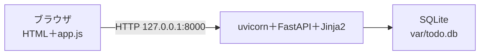

# 成果発表: TODO アプリ

<!--
第12回の発表資料の型。docs/presentation.md にコピーして埋める。
1〜3節は全員に共通する下書きが入っている。自分のアプリと違う所だけ直す。
自分で書くのは「発表者」「作った記録の数字」と 4節（工夫1つ）。
見本: examples/todo-app-snapshots/session-12/docs/presentation.md
-->

| 項目 | 内容 |
| --- | --- |
| 発表者 | |
| 持ち時間 | 発表とデモ ○分 ＋ 質疑 ○分（講師が人数から決める） |

---

## 1. 何を作ったか

コマンドラインの TODO（第6〜8回）を、ブラウザからも使えるようにした（第9〜12回）。

- タスクの追加（タイトル・期限）、一覧（期限が近い順）、完了
- 状態の表示（未着手・完了・期限切れ）と「期限切れだけ」の絞り込み
- 追加と完了は、ページを読み直さずに一覧だけを差し替える

| 作った記録 | 数 | 調べ方 |
| --- | --- | --- |
| マージした PR | | `git log --oneline --merges \| wc -l` |
| テストを先に書いたコミット | | `git log --oneline --grep='^レッド' \| wc -l` |
| テスト | | `mise run test 2>&1 \| tail -1` |

---

## 2. システム構成

- CLI と Web は、タスクの決まり（`models.py`）と保存先の約束（`TaskStore`）を共有する。保存先は CLI が JSON、Web が SQLite
- 詳しくは [システム構成図](design/architecture.md)

---

## 3. デモ手順

| 順 | 操作 | 見せること | ストーリー |
| --- | --- | --- | --- |
| 1 | `mise run db-reset && mise run dev` で起動し、<http://127.0.0.1:8000> を開く | 空の一覧 | S-02 |
| 2 | 期限が昨日・来週・なしのタスクを1件ずつ追加 | 期限が近い順に並び、昨日のものは「期限切れ」 | S-01・S-02 |
| 3 | 「期限切れだけ」→「完了」（Network タブを開いておく） | 一覧だけが差し替わる。返るのは `<ul id="task-list">` の断片 | S-03・S-04 |

---

## 4. 設計とテストの工夫（1つ）

**（主張を1文で）**

-
- 根拠: <!-- 聞き手が後で開けるもの。ファイル・テスト名・PR の番号・設計書の節・不具合票 -->
