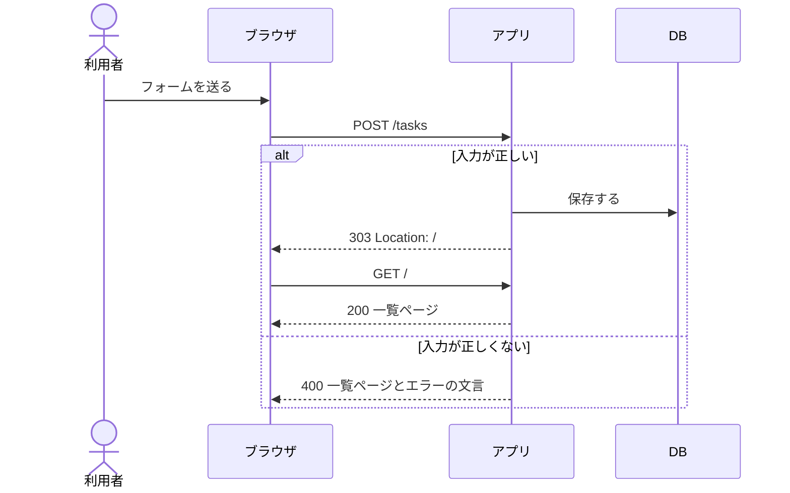

# API設計書

<!--
合格基準: 実装者が質問せずに作れるか。
必須記載事項: エンドポイント、メソッド、リクエスト・レスポンス例、ステータスコード、入力チェックとエラー表示の文言。
主な図: シーケンス図。
画面設計書は作らない。画面はストーリーの受け入れ条件とこの設計書から組み立てる。
基本形は「フォームを送り、サーバが HTML を返す」。第12回で HTML 断片を返すルートと、比較用に JSON を返すルートを1つ足す。
置き場所: docs/design/api.md
見本: examples/todo-app-snapshots/session-10/docs/design/api.md
-->

合格基準: 実装者が質問せずに作れるか

| 項目 | 内容 |
| --- | --- |
| 版 | 1.0（第10回） |
| 関連 | [要件メモ](../requirements.md)、[DB設計書](db.md)、ストーリーの Issue |

## 1. エンドポイント一覧

| ID | メソッド | URL | 内容 | 成功時 | ストーリー |
| --- | --- | --- | --- | --- | --- |
| A-01 | GET | `/` | 一覧ページ | 200 ページ全体の HTML | #<!-- Issue --> |
| A-02 | POST | | | 303 で `/` へ | |

## 2. 各エンドポイント

### A-02 POST <URL>

| パラメータ | 場所 | 型 | 必須 | 説明 |
| --- | --- | --- | --- | --- |
| | パス／クエリ／フォーム | | | |

リクエスト例:

```http
POST /tasks HTTP/1.1
Content-Type: application/x-www-form-urlencoded

title=...&due=...
```

レスポンス例（成功）:

```http
HTTP/1.1 303 See Other
Location: /
```

レスポンス例（失敗）:

```html
<!-- 返す HTML の要点（エラーの文言をどこに出すか、入力した値を残すか） -->
```

処理: <!-- どのストーリーの、どの受け入れ条件を満たすか -->

## 3. ステータスコード

| 状況 | ステータス | 返すもの |
| --- | --- | --- |
| 成功（表示） | 200 | |
| 成功（追加・更新） | 303 | `Location: /` |
| 入力が正しくない | 400 | |
| 対象が見つからない | 404 | |

## 4. 入力チェックとエラー表示

<!-- 受け入れ条件のうまくいかない場合を1行ずつ写す。文言はそのまま書く（第11回のテストで同じ文言を確かめる） -->

| 操作 | チェック | ステータス | 表示する文言（そのまま） |
| --- | --- | --- | --- |
| | <!-- 例: タイトルが空（前後の空白を除いて） --> | 400 | |
| | <!-- 例: タイトルが101文字以上 --> | 400 | |

- 表示する場所: 
- 入力した値をフォームに残すか: 
- 値は HTML として解釈せず文字として表示する（テンプレートの自動エスケープ）

## 5. シーケンス図

<!-- この図で何を伝えるかを1文で書いてから図を書く -->



## 6. 設計レビューで出た質問

<!-- 設計書を交換して「質問せずに作れるか」を確かめたときの質問。読み手は「質問」だけを書く。書き手は本文に書き足したら「反映した場所」に節を、書かないなら「答え」に理由を書く -->

| 質問 | 答え | 反映した場所 |
| --- | --- | --- |
| | | |
