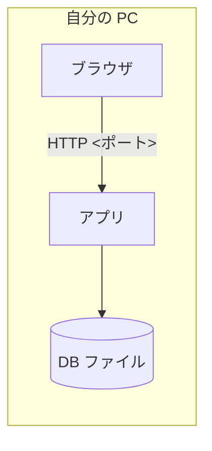

# システム構成図

<!--
合格基準: 実装者が質問せずに作れるか。
必須記載事項: 構成要素、通信経路とポート、ミドルウェアとバージョン。
主な図: 構成図。
設定（DB の場所など）は環境変数で切り替える。秘密情報はリポジトリに書かない。
置き場所: docs/design/architecture.md
見本: examples/todo-app-snapshots/session-10/docs/design/architecture.md
-->

合格基準: 実装者が質問せずに作れるか

| 項目 | 内容 |
| --- | --- |
| 版 | 1.0（第10回） |
| 関連 | [要件メモ](../requirements.md) の非機能要件 |

## 1. 構成図

<!-- この図で何を伝えるかを1文で書いてから図を書く -->



| 構成要素 | 役割 | 備考 |
| --- | --- | --- |
| | | |

## 2. 通信経路とポート

| 送信元 | 宛先 | プロトコル・アドレス・ポート |
| --- | --- | --- |
| | | |

## 3. ミドルウェアとバージョン

| ソフトウェア | バージョン | 固定する場所 |
| --- | --- | --- |
| Python | 3.12 | `mise.toml` |
| | | `pyproject.toml` と `uv.lock` |

## 4. 設定（環境変数）

| 環境変数 | 意味 | 既定値 |
| --- | --- | --- |
| | | |

## 5. 起動のしかた

<!-- 起動コマンドと、開くURL。プロキシを使う場合の NO_PROXY の注意 -->

```sh

```
