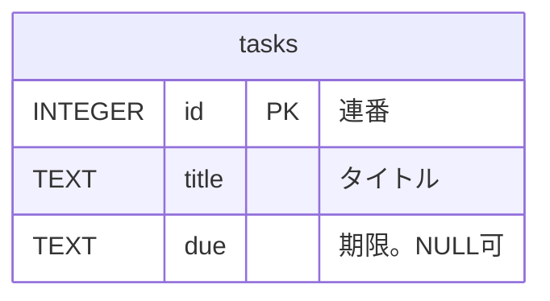

# DB設計書

<!--
合格基準: 実装者が質問せずに作れるか。
必須記載事項: テーブル定義（カラム・型・NULL可否・キー）、制約。
主な図: ER図。
NULL を許すカラムは「NULL が何を意味するか」も書く。計算で求められる値（状態など）はテーブルに持たない。
置き場所: docs/design/db.md
見本: examples/todo-app-snapshots/session-10/docs/design/db.md
-->

合格基準: 実装者が質問せずに作れるか

| 項目 | 内容 |
| --- | --- |
| 版 | 1.0（第10回） |
| DBMS | SQLite 3 |
| DB の場所 | <!-- 例: 環境変数 TODO_DB_PATH。既定は var/todo.db --> |
| 関連 | [要件メモ](../requirements.md)、[API設計書](api.md) |

## 1. ER図

<!-- テーブル名・カラム名は英字。説明は "..." の中に日本語で -->

## 2. テーブル定義

### <テーブル名>（<日本語の名前>）

| カラム | 型 | NULL | キー・既定値 | 説明 |
| --- | --- | --- | --- | --- |
| id | INTEGER | 不可 | PK、AUTOINCREMENT | 連番 |
| | | 可／不可 | | <!-- NULL 可なら、NULL の意味 --> |

## 3. 制約

| 制約 | 内容 | 理由 |
| --- | --- | --- |
| NOT NULL | | |
| DEFAULT | | |
| CHECK | <!-- 例: done は 0 か 1 --> | |

## 4. DB に持たず計算で求める値

<!-- 状態など、記録から計算するもの。条件を不等号まで正確に書く（境目の当日を含むか） -->

| 値 | 条件 |
| --- | --- |
| | |

## 5. 並び順

<!-- 一覧で使う順序。期限なしの扱い、同じ値のときの順 -->

- 
