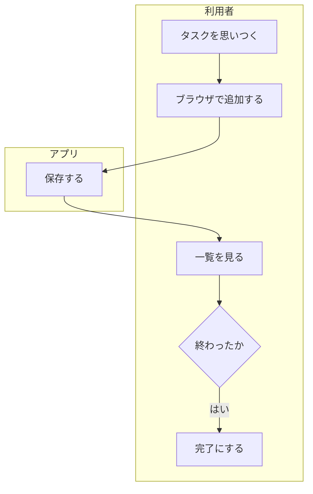
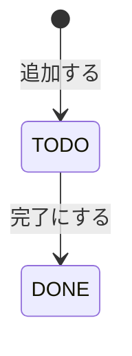

# 要件メモ <アプリ名>

<!--
何を作るかはユーザーストーリー（Issue）と受け入れ条件で決める。ストーリーに書けないこと（目的・非機能要件・制約・対象外）だけをここに短く書く。
必須記載事項: 目的・背景、非機能要件（性能・セキュリティ・運用）、制約、対象外、ストーリー一覧へのリンク。
主な図: 業務フロー図、状態遷移図（Mermaid で書き、Git で差分を追える形にする）。
置き場所: docs/requirements.md
見本: examples/todo-app-snapshots/session-09/docs/requirements.md（ストーリーの控えは同じフォルダの docs/stories.md）
-->

合格基準: 実装者が質問せずに作れるか

| 項目 | 内容 |
| --- | --- |
| 版 | 1.0（第9回） |
| 書いた人 | |
| 依頼人 | <!-- 誰に聞いたか --> |

## 1. 目的・背景

<!-- 今どう困っているかと、このアプリで何を解決するか。「〜できるようにする」で書く。例: CLI を開かないとタスクを確かめられず、期限切れに気づくのが遅れる → ブラウザで一覧と期限切れがすぐわかるようにする -->

### 業務フロー図

<!-- この図で何を伝えるかを1文で書いてから図を書く -->

### 状態遷移図

<!-- 状態と、変わるきっかけ。状態を DB に持つか、計算で求めるかも書く -->

| 状態 | 意味 | 条件 |
| --- | --- | --- |
| `TODO` | 未着手 | |
| `DONE` | 完了 | |
| `OVERDUE` | 期限切れ | <!-- 不等号まで正確に（期限の当日を含むか） --> |

## 2. ストーリー一覧

<!-- ユーザーストーリーは Issue に書く（テンプレート: issue_story.md）。ここには一覧へのリンクと控えのファイルだけを置く -->

- Issue の一覧: <!-- ラベル「ストーリー」で絞り込んだ URL -->
- 控え: [stories.md](stories.md)

## 3. 非機能要件

<!-- 数字や確かめられる形にする -->

| 区分 | 要件 |
| --- | --- |
| 性能 | <!-- 例: タスク 1,000件で一覧を1秒以内に表示する --> |
| セキュリティ | <!-- 例: 127.0.0.1 だけで待ち受ける。入力した文字は HTML として解釈せず表示する --> |
| 運用 | <!-- 例: DB の場所は環境変数で変えられる。mise.toml と README だけで再現できる --> |

## 4. 制約

<!-- 使う言語・フレームワーク、期限など、変えられない条件。例: Python 3.12、FastAPI、SQLite、第12回までに動かす -->

- 

## 5. 対象外

<!-- 今回やらないことと理由。範囲の認識をそろえるために必ず書く。例: ログイン（自分の PC だけで使う） -->

| 項目 | 理由 |
| --- | --- |
| | |

## 6. 未定・確かめたいこと

- 
