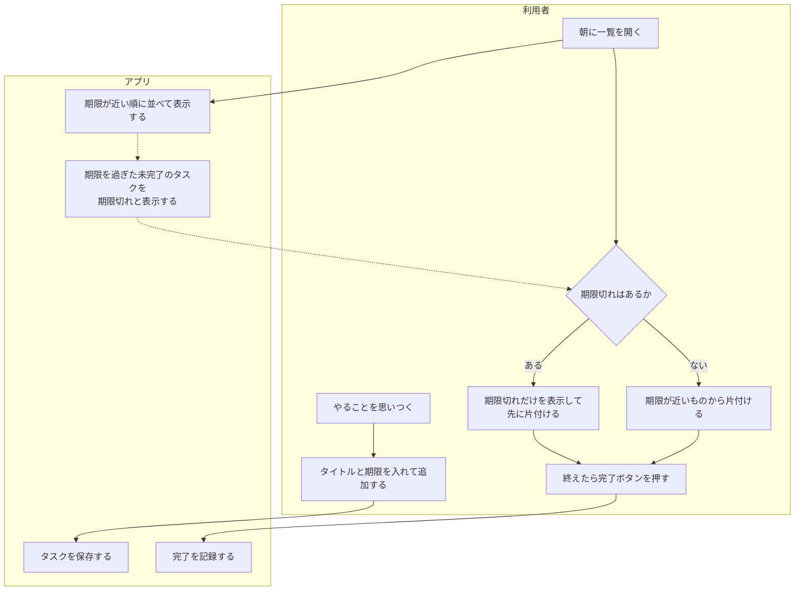
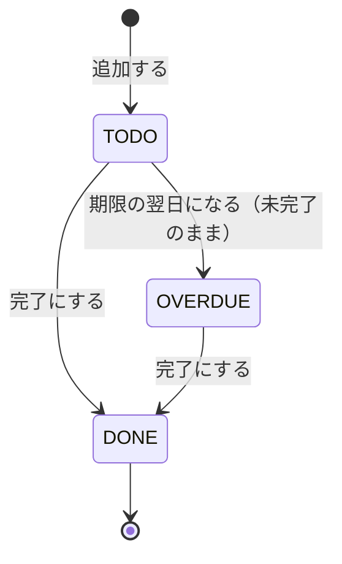

# 要件メモ TODO アプリ（Web 版）

合格基準: 実装者が質問せずに作れるか

| 項目 | 内容 |
| --- | --- |
| 版 | 1.0（第9回） |
| 書いた人 | `<名前>` |
| 依頼人 | 講師（依頼者役）。依頼は「CLI の TODO を Web でも使いたい」 |

何を作るかは [ユーザーストーリー](stories.md)（Issue）と受け入れ条件で決める。このメモには、ストーリーに書けない目的・非機能要件・制約・対象外だけを書く。

## 1. 目的・背景

第6〜8回で作った CLI（`uv run todo ...`）は、ターミナルを開かないと使えない。

- 一覧を見るたびにコマンドを打つので、期限切れに気づくのが遅れる
- ターミナルに慣れていない人には使ってもらえない

→ ブラウザで追加・一覧・完了ができ、期限切れが一目でわかるようにする。タスクの決まり（タイトルは1〜100文字、状態は未着手・完了・期限切れ）は CLI と同じにする。利用者は自分1人。

### 業務フロー図

導入後の1日の流れと、アプリが受け持つところ。

### 状態遷移図

タスクの状態と、変わるきっかけ。期限切れは DB に持たず、表示するときに今日の日付と比べて決める。

| 状態 | 意味 | 条件 |
| --- | --- | --- |
| `TODO` | 未着手 | 完了していない、かつ（期限がない、または 期限 ≧ 今日） |
| `DONE` | 完了 | 完了した（期限に関係なく、期限切れにはならない） |
| `OVERDUE` | 期限切れ | 完了していない、かつ 期限 < 今日（期限の当日はまだ `TODO`） |

完了から未着手には戻せない（5章 対象外）。

## 2. ストーリー一覧

- Issue の一覧: `<リポジトリのURL>/issues?q=label:ストーリー`
- 控え: [stories.md](stories.md)

| ID | ストーリー |
| --- | --- |
| S-01 | [タスクを追加する](stories.md#s-01-タスクを追加する) |
| S-02 | [タスクの一覧を見る](stories.md#s-02-タスクの一覧を見る) |
| S-03 | [タスクを完了にする](stories.md#s-03-タスクを完了にする) |
| S-04 | [期限切れのタスクだけを見る](stories.md#s-04-期限切れのタスクだけを見る) |

## 3. 非機能要件

本番公開（社内ネットワーク内）を想定して書く。研修では実際には公開せず、自分の PC（`127.0.0.1`）でだけ動かす。

| 区分 | 要件 |
| --- | --- |
| 性能 | タスク1,000件で、一覧画面を1秒以内に表示する |
| セキュリティ | 開発中は `127.0.0.1` だけで待ち受ける。入力した文字は HTML として解釈せず表示する（XSS を防ぐ）。秘密情報はリポジトリに書かず、環境変数で渡す |
| 運用 | DB の場所は環境変数で変えられる。DB は1ファイルなので、ファイルのコピーでバックアップできる。`mise.toml` と README だけで開発環境を再現できる |
| 保守性 | ruff・mypy・pytest が CI で通ることをマージの条件にする |

## 4. 制約

- 言語は Python 3.12、Web は FastAPI＋Jinja2、DB は SQLite
- 画面は素の HTML と JavaScript で作り、フレームワークやビルドツールを使わない
- タスクの決まり（`src/todo/models.py`）と保存先の約束（`TaskStore`）は CLI と共通にする
- 第12回までに動く状態にする

## 5. 対象外

| 項目 | 理由 |
| --- | --- |
| ログインと複数人での利用 | 自分1人で、自分の PC だけで使う。社内に公開するときに改めて考える |
| タスクの編集・削除、完了の取り消し | 今は「追加して完了にする」だけで足りる。次の段階で考える |
| 期限の通知（メールなど） | 一覧で期限切れがわかれば足りる |
| CLI の `tasks.json` と Web の DB の同期・移行 | CLI は今のまま使えればよい。データは別々に持つ |

## 6. 未定・確かめたいこと

- 完了したタスクが増えたとき、一覧から隠すか（今は全部出す。使ってみて決める）
- 本番公開するときのログインの方式（社内の認証に合わせる）
