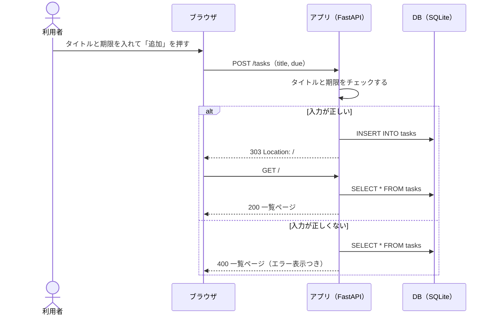
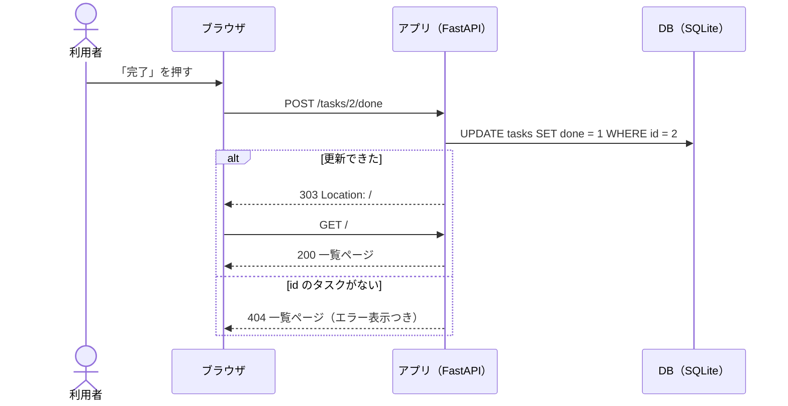

# API設計書

合格基準: 実装者が質問せずに作れるか

| 項目 | 内容 |
| --- | --- |
| 版 | 1.0（第10回） |
| 関連 | [要件メモ](../requirements.md)、[ユーザーストーリー](../stories.md)、[DB設計書](db.md)、[システム構成図](architecture.md) |

この API は **HTML を返す**。画面は一覧ページ1枚で、ブラウザの通常のフォーム送信で操作する。POST の後は 303 でリダイレクトし、再読み込みで二重に送信されないようにする（POST → リダイレクト → GET）。

## 1. エンドポイント一覧

| ID | メソッド | URL | 内容 | 成功時 | ストーリー |
| --- | --- | --- | --- | --- | --- |
| A-01 | GET | `/` | 一覧ページ | 200 ページ全体の HTML | S-02・S-04 |
| A-02 | POST | `/tasks` | タスクを追加する | 303 で `/` へ | S-01 |
| A-03 | POST | `/tasks/{id}/done` | タスクを完了にする | 303 で `/` へ | S-03 |

## 2. 各エンドポイント

### A-01 GET /

| パラメータ | 場所 | 型 | 必須 | 説明 |
| --- | --- | --- | --- | --- |
| overdue | クエリ | 文字列 | 任意 | `1` なら期限切れのタスクだけを出す。それ以外・省略はすべて |

- 並び順: 期限が近い順。期限なしは最後、期限が同じなら id の順
- 処理: S-02 の (7)〜(11)、S-04 の (15)
- 状態は表示するときに決める（今日の日付と比べる。[要件メモ](../requirements.md) 1章 状態遷移図）

ページの構成:

| 部分 | 中身 |
| --- | --- |
| 追加フォーム | `<form method="post" action="/tasks">`。タイトル（`name="title"`、必須、100文字まで）、期限（`name="due"`、`type="date"`、任意）、「追加」ボタン |
| エラー表示欄 | エラーのときだけ `<p class="error" role="alert">文言</p>` |
| 絞り込み | 「すべて」（`/`）と「期限切れだけ」（`/?overdue=1`）のリンク。表示中のほうに `aria-current="page"` |
| 一覧 | `<ul id="task-list">`。1件が1つの `<li>`。1件もなければ「タスクはありません」の `<li>` |

一覧の1件（レスポンス例の抜粋）:

```html
<li id="task-2" class="task status-overdue">
  <span class="title">牛乳を買う</span>
  <span class="due">2026-10-30</span>
  <span class="status">期限切れ</span>
  <form method="post" action="/tasks/2/done"><button type="submit">完了</button></form>
</li>
```

- `class` の `status-todo`・`status-done`・`status-overdue` で色を変える。状態は文字でも出す（色だけに頼らない）
- 完了したタスクには「完了」ボタンを出さない

### A-02 POST /tasks

| パラメータ | 場所 | 型 | 必須 | 説明 |
| --- | --- | --- | --- | --- |
| title | フォーム（`application/x-www-form-urlencoded`） | 文字列 | 必須 | 前後の空白を除いて1〜100文字 |
| due | フォーム | 文字列 | 任意 | `YYYY-MM-DD`。空なら期限なし |

リクエスト例:

```http
POST /tasks HTTP/1.1
Content-Type: application/x-www-form-urlencoded

title=%E7%89%9B%E4%B9%B3%E3%82%92%E8%B2%B7%E3%81%86&due=2026-11-01
```

レスポンス例（成功）:

```http
HTTP/1.1 303 See Other
Location: /
```

レスポンス例（失敗、400 の一覧ページの要点）:

```html
<input name="title" value="   " maxlength="100" required>  <!-- 入力した値を残す -->
...
<p class="error" role="alert">タイトルを入力してください</p>
```

処理: S-01 の (1)〜(6)。入力が正しくないときは、400 で一覧ページを返す。エラー表示欄に文言を出し、入力した値はフォームに残す。

### A-03 POST /tasks/{id}/done

| パラメータ | 場所 | 型 | 必須 | 説明 |
| --- | --- | --- | --- | --- |
| id | パス | 整数 | 必須 | タスクの id |

- 処理: S-03 の (12)〜(14)
- 完了済みのタスクをもう一度完了にしても、エラーにせず 303 を返す（状態は完了のまま）
- id のタスクがなければ、404 で一覧ページを返す

## 3. ステータスコード

| 状況 | ステータス | 返すもの |
| --- | --- | --- |
| 一覧の表示 | 200 | 一覧ページ |
| 追加・完了の成功 | 303 | `Location: /` |
| 入力が正しくない（A-02） | 400 | 一覧ページ（エラー表示欄に文言） |
| タスクが見つからない（A-03） | 404 | 一覧ページ（エラー表示欄に文言） |

## 4. 入力チェックとエラー表示

| 操作 | チェック | ステータス | エラーの文言 |
| --- | --- | --- | --- |
| 追加（A-02） | タイトルが空でない（前後の空白を除いて） | 400 | タイトルを入力してください |
| 追加（A-02） | タイトルが100文字以内 | 400 | タイトルは100文字以内で入力してください |
| 追加（A-02） | 期限が空か `YYYY-MM-DD` の日付 | 400 | 期限は YYYY-MM-DD の形で入力してください |
| 完了（A-03） | id のタスクがある | 404 | タスクが見つかりません |

- 表示する場所: 一覧ページのエラー表示欄（追加フォームのすぐ下）。`role="alert"` を付ける
- 入力した値をフォームに残すか: 残す（入力し直せるように）
- チェックと文言は CLI と同じ（`src/todo/models.py` の `validate_title`・`parse_due`）
- エラーになっても一覧はそのまま表示する
- 画面に出す値（タイトルなど）はすべてテンプレートでエスケープする

## 5. シーケンス図

### 追加（A-02）

通常のフォーム送信で、成功ならリダイレクトして一覧を読み直し、失敗なら 400 でその場に一覧とエラーを返す。



### 完了（A-03）



## 6. 設計レビューで出た質問（反映済み）

設計書を交換して「質問せずに作れるか」を確かめたときに出た質問と、反映した場所。

| 質問 | 答え | 反映した場所 |
| --- | --- | --- |
| 完了済みのタスクをもう一度完了にしたら？ | エラーにせず 303。完了のまま | 2章 A-03 |
| 入力エラーのとき、入れた値は消える？ | フォームに残す | 2章 A-02 |
| 期限の当日は期限切れ？ | まだ期限切れではない（翌日から） | 2章 A-01（要件メモ 1章へのリンク） |
| `?overdue=0` や `?overdue=yes` は？ | `1` 以外はすべて表示 | 2章 A-01 のパラメータ表 |
