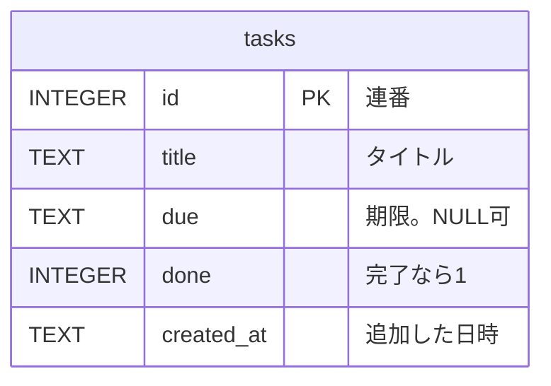

# DB設計書

合格基準: 実装者が質問せずに作れるか

| 項目 | 内容 |
| --- | --- |
| 版 | 1.0（第10回） |
| DBMS | SQLite 3（Python 標準の `sqlite3` から使う） |
| DB の場所 | 環境変数 `TODO_DB_PATH`。既定は `var/todo.db`。ファイルやテーブルがなければアプリが作る |
| 関連 | [要件メモ](../requirements.md)、[API設計書](api.md)、[システム構成図](architecture.md) |

## 1. ER図

利用者は1人なのでテーブルは1つ。ログインと複数人での利用（[要件メモ](../requirements.md) 5章 対象外）を入れるときに、`users` テーブルと `tasks.user_id` を足す。



## 2. テーブル定義

### tasks（タスク）

| カラム | 型 | NULL | キー・既定値 | 説明 |
| --- | --- | --- | --- | --- |
| id | INTEGER | 不可 | PK、AUTOINCREMENT | 連番。一度使った番号は使い直さない |
| title | TEXT | 不可 | | タイトル。前後の空白を除いて1〜100文字（アプリでチェックしてから保存する） |
| due | TEXT | 可 | | 期限。`YYYY-MM-DD`（ISO 8601 の日付）。NULL は「期限なし」 |
| done | INTEGER | 不可 | DEFAULT 0 | 完了なら 1、未完了なら 0 |
| created_at | TEXT | 不可 | | 追加した日時。`YYYY-MM-DDTHH:MM:SS`（ISO 8601） |

```sql
CREATE TABLE IF NOT EXISTS tasks (
    id INTEGER PRIMARY KEY AUTOINCREMENT,
    title TEXT NOT NULL,
    due TEXT NULL,
    done INTEGER NOT NULL DEFAULT 0,
    created_at TEXT NOT NULL
);
```

## 3. 制約

| 制約 | 内容 | 理由 |
| --- | --- | --- |
| NOT NULL | `title`・`done`・`created_at` | タイトルのないタスクは作らない。完了かどうかと追加日時は必ずある |
| DEFAULT | `done` は 0 | 追加したときは未完了 |
| CHECK | 付けない。タイトルの長さ・期限の形はアプリ（`models.py` の `validate_title`・`parse_due`）でチェックする | CLI と同じ決まりを1か所で持つ |

- SQLite には日付と真偽値の型がないので、日付は ISO 8601 の文字列、真偽値は 0／1 で持つ（ISO 8601 の文字列は、大小と日付の前後が一致する）
- 値は必ずプレースホルダー（`?`）で渡し、SQL の文字列に埋め込まない（SQL インジェクションを防ぐ）

## 4. DB に持たず計算で求める値

| 値 | 条件 |
| --- | --- |
| 状態 `DONE`（完了） | `done = 1` |
| 状態 `OVERDUE`（期限切れ） | `done = 0` かつ `due` が NULL でなく `due < 今日`（期限の当日は含まない） |
| 状態 `TODO`（未着手） | 上のどちらでもない |

日付が変わるたびに書き換えずに済むよう、期限切れは保存しない。

## 5. 並び順

- DB からは `ORDER BY id` で読み、期限順への並べ替えはアプリ（`models.py` の `sort_by_due`）でする。CLI と同じ決まりを使うため
- 期限が近い順。期限なし（NULL）は最後。期限が同じなら id の順

| 操作 | SQL |
| --- | --- |
| 一覧 | `SELECT id, title, due, done FROM tasks ORDER BY id` |
| 追加 | `INSERT INTO tasks (title, due, created_at) VALUES (?, ?, ?)` |
| 完了 | `UPDATE tasks SET done = 1 WHERE id = ?`（更新した行数が 0 ならタスクがない） |
