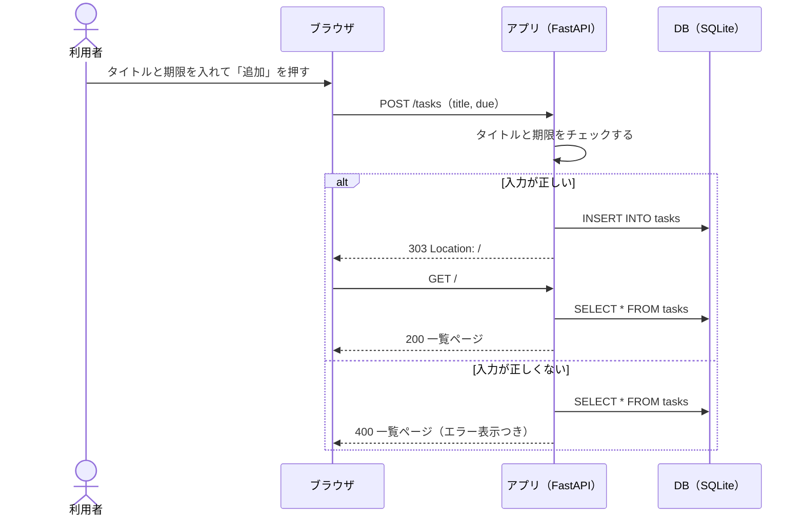
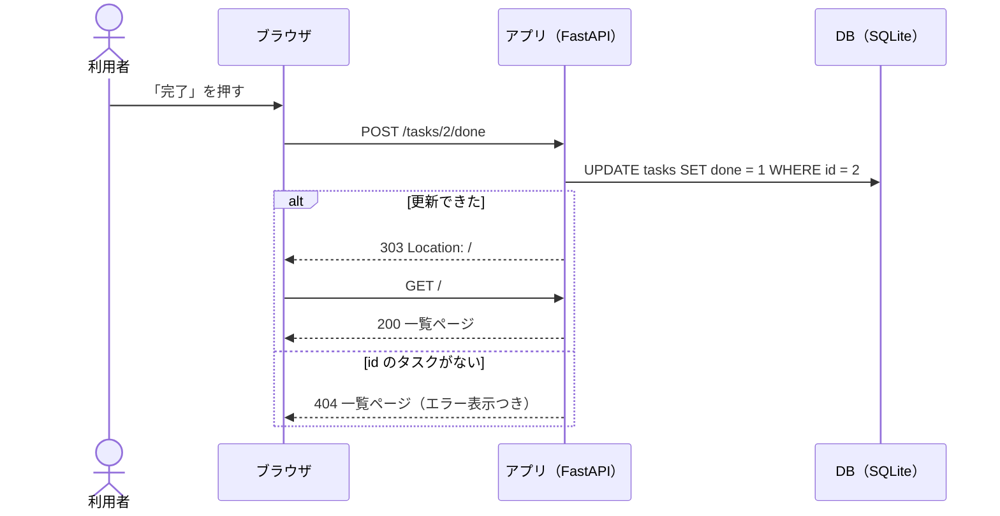
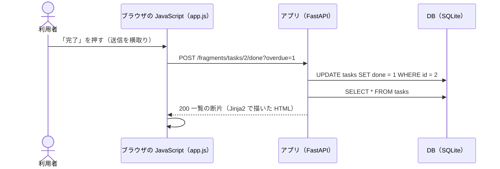
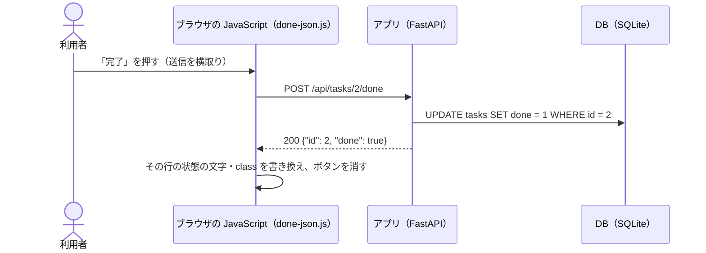

# API設計書

合格基準: 実装者が質問せずに作れるか

| 項目 | 内容 |
| --- | --- |
| 版 | 1.1（第12回: HTML 断片を返す URL と、比較用の JSON の URL を追加） |
| 関連 | [要件メモ](../requirements.md)、[ユーザーストーリー](../stories.md)、[DB設計書](db.md)、[システム構成図](architecture.md) |

この API は **HTML を返す**。画面は一覧ページ1枚。

- 画面の URL（A-01〜A-03）: ブラウザの通常のフォーム送信で使う。POST の後は 303 でリダイレクトし、再読み込みで二重に送信されないようにする（POST → リダイレクト → GET）
- 断片の URL（A-04〜A-06、第12回）: JavaScript（`static/app.js`）が fetch で使う。同じ処理をして、ページ全体ではなく一覧などの **HTML 断片** を返す。JavaScript は受け取った断片で画面の一部を差し替えるだけ
- 比較用の JSON の URL（A-07、第12回）: 完了だけを JSON で返す版。HTML 断片の作りと比べるために置く（7章）

## 1. エンドポイント一覧

| ID | メソッド | URL | 内容 | 成功時 | ストーリー |
| --- | --- | --- | --- | --- | --- |
| A-01 | GET | `/` | 一覧ページ | 200 ページ全体の HTML | S-02・S-04 |
| A-02 | POST | `/tasks` | タスクを追加する | 303 で `/` へ | S-01 |
| A-03 | POST | `/tasks/{id}/done` | タスクを完了にする | 303 で `/` へ | S-03 |
| A-04 | GET | `/fragments/tasks` | 一覧の断片 | 200 `<ul id="task-list">` | S-02・S-04 |
| A-05 | POST | `/fragments/tasks` | 追加して一覧の断片を返す | 200 `<ul id="task-list">` | S-01 |
| A-06 | POST | `/fragments/tasks/{id}/done` | 完了にして一覧の断片を返す | 200 `<ul id="task-list">` | S-03 |
| A-07 | POST | `/api/tasks/{id}/done` | 比較用: 完了にして JSON を返す | 200 `{"id": 2, "done": true}` | S-03 |
| — | GET | `/static/...` | CSS・JavaScript | 200 | — |

## 2. 各エンドポイント

### A-01 GET /

| パラメータ | 場所 | 型 | 必須 | 説明 |
| --- | --- | --- | --- | --- |
| overdue | クエリ | 文字列 | 任意 | `1` なら期限切れのタスクだけを出す。それ以外・省略はすべて |

- 並び順: 期限が近い順。期限なしは最後、期限が同じなら id の順
- 処理: S-02 の (7)〜(11)、S-04 の (15)
- 状態は表示するときに決める（今日の日付と比べる。[要件メモ](../requirements.md) 1章 状態遷移図）

ページの構成:

| 部分 | 中身 |
| --- | --- |
| 追加フォーム | `<form method="post" action="/tasks" data-fragment="/fragments/tasks">`。タイトル（`name="title"`、必須、100文字まで）、期限（`name="due"`、`type="date"`、任意）、「追加」ボタン |
| エラー表示欄 | `<div id="error-area">`。エラーのときだけ中に `<p class="error" role="alert">文言</p>` |
| 絞り込み | 「すべて」（`/`）と「期限切れだけ」（`/?overdue=1`）のリンク。表示中のほうに `aria-current="page"` |
| 一覧 | `<ul id="task-list">`。1件が1つの `<li>`。1件もなければ「タスクはありません」の `<li>` |

一覧の1件（レスポンス例の抜粋）:

```html
<li id="task-2" class="task status-overdue">
  <span class="title">牛乳を買う</span>
  <span class="due">2026-10-30</span>
  <span class="status">期限切れ</span>
  <form method="post" action="/tasks/2/done" data-fragment="/fragments/tasks/2/done"><button type="submit">完了</button></form>
</li>
```

- `action` は通常の送信先、`data-fragment` は fetch で送る先（断片の URL）。JavaScript が動かなくても `action` で動く
- 「期限切れだけ」の表示中（`/?overdue=1`）は、`data-fragment` の URL にも `?overdue=1` を付け、返す断片も期限切れだけにする

- `class` の `status-todo`・`status-done`・`status-overdue` で色を変える。状態は文字でも出す（色だけに頼らない）
- 完了したタスクには「完了」ボタンを出さない

### A-02 POST /tasks

| パラメータ | 場所 | 型 | 必須 | 説明 |
| --- | --- | --- | --- | --- |
| title | フォーム（`application/x-www-form-urlencoded`） | 文字列 | 必須 | 前後の空白を除いて1〜100文字 |
| due | フォーム | 文字列 | 任意 | `YYYY-MM-DD`。空なら期限なし |

リクエスト例:

```http
POST /tasks HTTP/1.1
Content-Type: application/x-www-form-urlencoded

title=%E7%89%9B%E4%B9%B3%E3%82%92%E8%B2%B7%E3%81%86&due=2026-11-01
```

レスポンス例（成功）:

```http
HTTP/1.1 303 See Other
Location: /
```

レスポンス例（失敗、400 の一覧ページの要点）:

```html
<input name="title" value="   " maxlength="100" required>  <!-- 入力した値を残す -->
...
<p class="error" role="alert">タイトルを入力してください</p>
```

処理: S-01 の (1)〜(6)。入力が正しくないときは、400 で一覧ページを返す。エラー表示欄に文言を出し、入力した値はフォームに残す。

### A-03 POST /tasks/{id}/done

| パラメータ | 場所 | 型 | 必須 | 説明 |
| --- | --- | --- | --- | --- |
| id | パス | 整数 | 必須 | タスクの id |

- 処理: S-03 の (12)〜(14)
- 完了済みのタスクをもう一度完了にしても、エラーにせず 303 を返す（状態は完了のまま）
- id のタスクがなければ、404 で一覧ページを返す

### A-04 GET /fragments/tasks

| パラメータ | 場所 | 型 | 必須 | 説明 |
| --- | --- | --- | --- | --- |
| overdue | クエリ | 文字列 | 任意 | A-01 と同じ |

A-01 の一覧（`<ul id="task-list">` 〜 `</ul>`）だけを返す。並び順・状態の出し方は A-01 と同じ。

### A-05 POST /fragments/tasks

パラメータは A-02 と同じ（フォームの title・due）に、クエリの `overdue`（A-01 と同じ）を足したもの。

- 成功: 200 で、追加した後の一覧の断片（A-04 と同じ形）
- 入力が正しくない: 400 で、エラーの断片 `<p class="error" role="alert">文言</p>`。JavaScript はこれをエラー表示欄に入れる

### A-06 POST /fragments/tasks/{id}/done

パラメータは A-03 と同じ（パスの id）に、クエリの `overdue` を足したもの。

- 成功: 200 で、完了にした後の一覧の断片。`?overdue=1` なら期限切れだけ（完了にしたものは出なくなる）
- id のタスクがない: 404 で、エラーの断片

### A-07 POST /api/tasks/{id}/done（比較用）

完了だけを、HTML の代わりに JSON で返す版。画面は `static/done-json.js` が JSON から組み立てる。

レスポンス例（200）:

```json
{"id": 2, "done": true}
```

id のタスクがなければ 404 で `{"detail": "タスクが見つかりません"}`。

## 3. ステータスコード

| 状況 | ステータス | 返すもの |
| --- | --- | --- |
| 一覧の表示（A-01・A-04） | 200 | 一覧ページ／一覧の断片 |
| 追加・完了の成功（A-02・A-03） | 303 | `Location: /` |
| 追加・完了の成功（A-05・A-06） | 200 | 一覧の断片 |
| 完了の成功（A-07） | 200 | JSON `{"id": .., "done": true}` |
| 入力が正しくない（A-02・A-05） | 400 | 一覧ページ（エラー表示欄に文言）／エラーの断片 |
| タスクが見つからない（A-03・A-06・A-07） | 404 | 一覧ページ（エラー表示欄に文言）／エラーの断片／JSON `{"detail": "タスクが見つかりません"}` |

## 4. 入力チェックとエラー表示

| 操作 | チェック | ステータス | エラーの文言 |
| --- | --- | --- | --- |
| 追加（A-02・A-05） | タイトルが空でない（前後の空白を除いて） | 400 | タイトルを入力してください |
| 追加（A-02・A-05） | タイトルが100文字以内 | 400 | タイトルは100文字以内で入力してください |
| 追加（A-02・A-05） | 期限が空か `YYYY-MM-DD` の日付 | 400 | 期限は YYYY-MM-DD の形で入力してください |
| 完了（A-03・A-06・A-07） | id のタスクがある | 404 | タスクが見つかりません |

- 表示する場所: 一覧ページのエラー表示欄（追加フォームのすぐ下）。`role="alert"` を付ける
- fetch のとき（A-05・A-06）: エラーの断片（`_error.html`）を返し、JavaScript がエラー表示欄 `#error-area` に入れる。一覧はそのまま
- 入力した値をフォームに残すか: 残す（入力し直せるように）
- チェックと文言は CLI と同じ（`src/todo/models.py` の `validate_title`・`parse_due`）
- エラーになっても一覧はそのまま表示する
- 画面に出す値（タイトルなど）はすべてテンプレートでエスケープする

## 5. シーケンス図

### 追加（A-02）

通常のフォーム送信で、成功ならリダイレクトして一覧を読み直し、失敗なら 400 でその場に一覧とエラーを返す。



### 完了（A-03、通常のフォーム送信）



### 完了（A-06、fetch で HTML 断片を受け取る）



### 完了（A-07、比較用: fetch で JSON を受け取る）



## 6. 設計レビューで出た質問（反映済み）

設計書を交換して「質問せずに作れるか」を確かめたときに出た質問と、反映した場所。

| 質問 | 答え | 反映した場所 |
| --- | --- | --- |
| 完了済みのタスクをもう一度完了にしたら？ | エラーにせず 303。完了のまま | 2章 A-03 |
| 入力エラーのとき、入れた値は消える？ | フォームに残す | 2章 A-02 |
| 期限の当日は期限切れ？ | まだ期限切れではない（翌日から） | 2章 A-01（要件メモ 1章へのリンク） |
| `?overdue=0` や `?overdue=yes` は？ | `1` 以外はすべて表示 | 2章 A-01 のパラメータ表 |


## 7. HTML 断片と JSON の比較（第12回）

完了の1機能を両方の作りで書いて比べた結果。基本は HTML 断片にする。

| 観点 | HTML 断片（A-06・app.js） | JSON（A-07・done-json.js） |
| --- | --- | --- |
| サーバが返すもの | Jinja2 で描いた一覧の断片 | `{"id": 2, "done": true}` |
| 画面を組み立てる場所 | サーバ（テンプレートは A-01 と共通） | ブラウザ（状態の文字・class を JavaScript で書く） |
| JavaScript の量 | 送って差し替えるだけ。追加と完了で共通 | 機能ごとに DOM の書き換えが要る |
| 表示の決まり | テンプレート1か所 | テンプレートと JavaScript の2か所。並べ替えや「期限切れだけ」は JSON 版では反映されない |
| テスト | 返す HTML を pytest で確かめられる | API は pytest で確かめられるが、画面の書き換えはブラウザ側のテストが別に要る |
| 安全性 | テンプレートが自動でエスケープする | 受け取った値を innerHTML に入れると XSS になる。textContent を使う |
