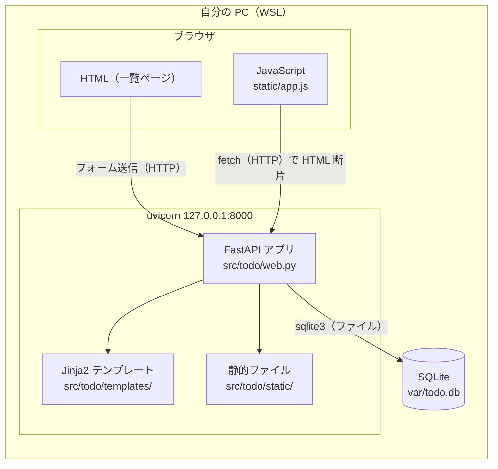
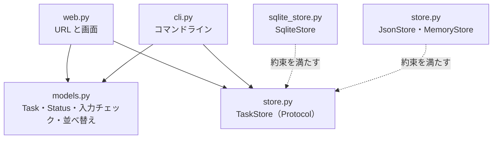
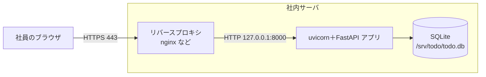

# システム構成図

合格基準: 実装者が質問せずに作れるか

| 項目 | 内容 |
| --- | --- |
| 版 | 1.1（第12回: ブラウザの JavaScript を追加） |
| 関連 | [要件メモ](../requirements.md) の非機能要件、[API設計書](api.md)、[DB設計書](db.md) |

## 1. 構成図

研修では自分の PC だけで動かす。ブラウザからアプリまでが HTTP（フォーム送信と fetch）、アプリから DB まではファイルの読み書き。



| 構成要素 | 役割 | 備考 |
| --- | --- | --- |
| ブラウザ | 画面を表示し、フォームを送る。JavaScript（fetch）で一覧だけを差し替える | Chrome・Edge の最新版。JavaScript はライブラリ・ビルドツールなし |
| 静的ファイル | CSS と JavaScript（`app.js`、比較用の `done-json.js`）を返す | `/static/...` |
| uvicorn | HTTP を受けてアプリを呼ぶ（ASGI サーバ） | `127.0.0.1` だけで待ち受ける |
| FastAPI アプリ | URL ごとの処理、入力チェック、HTML を返す | タスクの決まり（`models.py`）は CLI と共通 |
| Jinja2 テンプレート | HTML を組み立てる。値は自動でエスケープする | |
| SQLite | タスクを保存する | サーバのプロセスはなく、アプリがファイルを直接読み書きする |

アプリの中では、保存先を `TaskStore`（Protocol）として受け取る。Web は `SqliteStore`、CLI は `JsonStore`（`tasks.json`）を使い、テストでは一時ディレクトリの DB に差し替える（FastAPI の依存性の注入）。



## 2. 通信経路とポート

| 送信元 | 宛先 | プロトコル・アドレス・ポート |
| --- | --- | --- |
| ブラウザ | uvicorn | HTTP `127.0.0.1:8000`（ほかの PC からはつながらない） |
| FastAPI アプリ | SQLite | ファイル（`TODO_DB_PATH`） |

## 3. ミドルウェアとバージョン

| ソフトウェア | バージョン | 固定する場所 |
| --- | --- | --- |
| Python | 3.12 | `mise.toml` |
| uv | 0.9 | `mise.toml` |
| FastAPI | 0.143 | `pyproject.toml` と `uv.lock` |
| Jinja2 | 3.1 | `pyproject.toml` と `uv.lock` |
| uvicorn | 0.54 | `pyproject.toml` と `uv.lock` |
| SQLite | 3（Python 3.12 に同梱） | `mise.toml`（Python のバージョン） |

## 4. 設定（環境変数）

| 環境変数 | 意味 | 既定値 |
| --- | --- | --- |
| `TODO_DB_PATH` | SQLite のファイルの場所。親ディレクトリがなければ作る | `var/todo.db` |

- 開発では `mise.toml` の `[env]` で設定する
- 秘密情報（パスワードなど）は今はない。増えたときも環境変数で渡し、リポジトリには入れない

## 5. 起動のしかた

```sh
mise run dev   # uvicorn todo.web:app --reload --host 127.0.0.1 --port 8000
```

- ブラウザで <http://127.0.0.1:8000> を開く
- 社内プロキシを設定している場合は、`NO_PROXY` に `localhost,127.0.0.1` を入れる（入れないと、ブラウザや curl がプロキシへ送ってしまう）

## 6. 本番公開するときの想定

研修では公開しない。社内に公開するなら次の構成にする（非機能要件の確認用）。



| 項目 | 想定 |
| --- | --- |
| HTTPS | リバースプロキシで終端する。アプリは `127.0.0.1` で待ち受けたまま |
| 設定 | `TODO_DB_PATH=/srv/todo/todo.db` のように環境変数で渡す |
| バックアップ | DB のファイルを1日1回コピーする |
| 先に必要なもの | ログイン（[要件メモ](../requirements.md) 5章 対象外）。複数人で使うなら DB を PostgreSQL などに替えることも考える |
