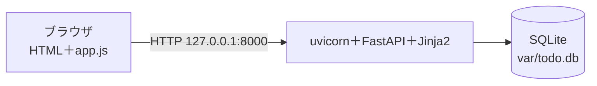

# 成果発表: TODO アプリ

| 項目 | 内容 |
| --- | --- |
| 発表者 | `<名前>` |
| 持ち時間 | 発表とデモ 2.5分 ＋ 質疑 1分（6人のとき） |

---

## 1. 何を作ったか

コマンドラインの TODO（第6〜8回）を、ブラウザからも使えるようにした（第9〜12回）。

- タスクの追加（タイトル・期限）、一覧（期限が近い順）、完了
- 状態の表示（未着手・完了・期限切れ）と「期限切れだけ」の絞り込み
- 追加と完了は、ページを読み直さずに一覧だけを差し替える

| 作った記録 | 数 | 調べ方 |
| --- | --- | --- |
| マージした PR | 8（#2〜#20） | `git log --oneline --merges \| wc -l` |
| テストを先に書いたコミット | 11（第8回 4、第11回 4、第12回 3） | `git log --oneline --grep='^レッド' \| wc -l` |
| テスト | 71 | `mise run test 2>&1 \| tail -1` |

---

## 2. システム構成

- 本番は社内公開を想定して設計した（HTTPS はリバースプロキシで終端。実際の公開はしていない）。詳しくは [システム構成図](design/architecture.md)
- CLI と Web は、タスクの決まり（`models.py`）と保存先の約束（`TaskStore`）を共有している。保存先は CLI が JSON、Web が SQLite

---

## 3. デモ手順

見せるストーリーの順に進める。

| 順 | 操作 | 見せること | ストーリー |
| --- | --- | --- | --- |
| 1 | `mise run db-reset && mise run dev` で起動し、<http://127.0.0.1:8000> を開く | 空の一覧（「タスクはありません」） | S-02 |
| 2 | 「牛乳を買う」（期限 昨日）、「レポートを出す」（期限 来週）、「本を読む」（期限なし）を追加 | 期限が近い順に並び、昨日のものは「期限切れ」 | S-01・S-02 |
| 3 | タイトルを空白だけにして追加 | 「タイトルを入力してください」と出て、一覧はそのまま | S-01 |
| 4 | 「期限切れだけ」を押す | 「牛乳を買う」だけが出る | S-04 |
| 5 | 「牛乳を買う」を完了にする（開発者ツールの Network タブを開いておく） | 一覧だけが差し替わる。返ってきたのが `<ul id="task-list">` の断片だけであること | S-03 |
| 6 | ターミナルで `uv run todo list` | CLI も同じ決まりで動く（データは別） | — |

---

## 4. 設計とテストの工夫（1つ）

**サーバが HTML 断片を返し、JavaScript は差し替えるだけにした。**

- `static/app.js` は19行で、追加と完了で共通。一覧の HTML は Jinja2 のテンプレート（`_task_list.html`）1か所にあり、ページ全体の表示と断片で同じものを使う
- 比べるために、完了だけを JSON で返す版（`static/done-json.js`、完了だけで20行）も書いた。JSON 版は状態の文字・class を JavaScript でも書くので、表示の決まりが2か所に分かれ、「期限切れだけ」の表示も反映されなかった
- 断片を返すので、画面の中身を pytest で確かめられる（`tests/test_web.py`。テストは全部で71件）
- 根拠: [API設計書 7章 HTML 断片と JSON の比較](design/api.md#7-html-断片と-json-の比較第12回)、`tests/test_web.py` の断片のテスト、PR #18（`Closes #17`）

